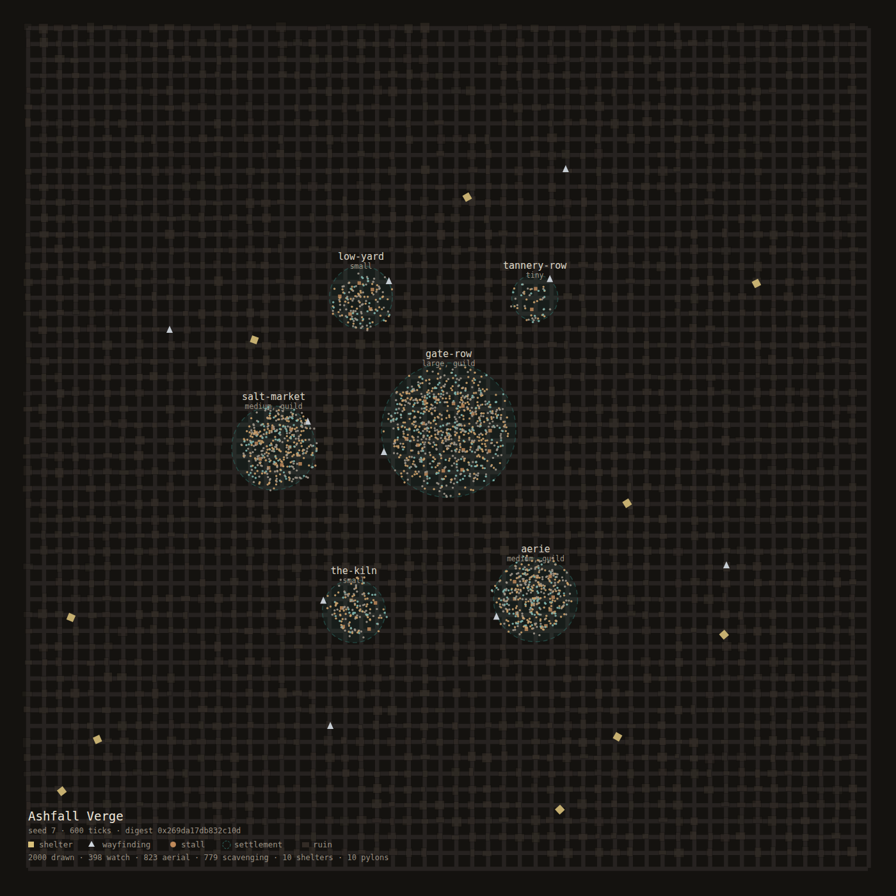

# bevy-flock

**Deterministic crowd and NPC simulation for Bevy.** One NPC or a million, with
pluggable cognition and a replay you can trust.

```rust
use bevy_app::App;
use bevy_flock::prelude::*;

let mut app = App::new();
app.add_plugins(FlockPlugin::new(FlockConfig::preset(CrowdPreset::CityAmbient)));
app.update();
```

That is a running crowd of 2,000 people, each with their own personality,
their own random stream, and a spatial index built under them. No assets, no
window, no GPU.

---

## Status

`0.1.0` is the simulation foundation, and it is deliberately honest about what
that means:

| Area | State |
| --- | --- |
| Boids and steering (separation, alignment, cohesion, seek, arrive) | **Shipped** |
| Reciprocal local avoidance with per-NPC priority (ADR 0045) | **Shipped (on by default)** |
| Obstacle-derived navigation that rebuilds in budgeted slices (ADR 0046) | **Shipped (opt-in)** |
| Stimulus perception: sight cone, hearing, decay, occlusion hook (ADR 0047) | **Shipped (opt-in)** |
| Navigation links and an optional polygon navmesh (ADR 0048, `navmesh` feature) | **Shipped** |
| Deterministic spatial grid (radius, k-nearest) | **Shipped** |
| Deterministic RNG with per-NPC streams (PCG32, reference-verified) | **Shipped** |
| Budgeted, deterministic population spawning (unique and recycled) | **Shipped** |
| Behaviour trees: flat compiled nodes, resume, abort, cooldown, timeout, parallel | **Shipped** |
| Leaf catalogue with declared costs and per-archetype trees | **Shipped** |
| Social memory: bounded slot store, cold archive, lazy decay (`memory` feature) | **Shipped (opt-in)** |
| Memory in cognition: enrolment by proximity, three-integer views, grudge/friend leaves (ADR 0041) | **Shipped (opt-in)** |
| Versioned save format with a subject registry and a committed fixture corpus | **Shipped (opt-in)** |
| Diagnostics: ghost rows, orphan slots, SVG graphs (`registry_telemetry` example) | **Shipped (opt-in)** |
| Guarded state machines with dwell times | **Shipped** |
| Extension registry for game-defined logic | **Shipped** |
| Personality, needs and mood model | **Shipped** |
| Virtual-cost fair-queue think scheduler (ADR 0009) | **Shipped** |
| Proximity weights with hysteresis, wired to the scheduler | **Shipped** |
| Tiered cognition: reflex, reactive, deliberative, social (ADR 0017) | **Shipped** |
| Ambient continuum: population as density past the manifest band (ADR 0018) | **Shipped** |
| Continuum ambient tier (millions of inhabitants, nine gates) | **Shipped** |
| Procedural NPC generation: names, temperament, needs, backgrounds (ADR 0035 context) | **Shipped** |
| Behaviour tree node set: six composites, four decorators, allocation-free ticks (ADR 0035) | **Shipped** |
| Utility scoring: curves, inhibition, count compensation, explain (ADR 0036) | **Shipped** |
| Groups, formations and faction relations (ADR 0039 context, ADR 0021) | **Shipped** |
| World director: mood, events, alarms and a decision trace (ADR 0039) | **Shipped** |
| Encounter perception: who noticed whom, and for how long | **Shipped** |
| Dialogue graphs, facts and conversation state, validated at load (ADR 0037) | **Shipped** |
| Barks: bounded queue, per-category cooldowns, per-frame cap (ADR 0038) | **Shipped** |
| Dialog provider seam: an asynchronous line source off the tick (ADR 0037) | **Shipped** |
| Navigation port, flow-field cache and a hand-authored source (ADR 0040) | **Shipped** |
| Physics, replication and render ports — no engine dependency (ADR 0040) | **Shipped** |
| Versioned snapshots and compatibility corpus (ADR 0012-0014) | **Shipped (opt-in)** |
| Property-based tests for the invariants that must hold for every input | **Shipped** |
| "Why did it do that": one-call state dump for any NPC (ADR 0042) | **Shipped** |
| Debug overlay as data, off by default, drawn by the game (ADR 0042) | **Shipped** |
| Decoder robustness: libFuzzer targets plus a stable corruption suite | **Shipped** |
| Rendering, avian and replicon *adapters* (the ports are here; the engines are yours) | Deliberately not shipped |

The full task plan lives in [`plan.toml`](plan.toml), including the capability
contracts and the acceptance scenarios each future task must satisfy. Anything
marked *Planned* has a specification and a test plan, not an implementation — treat
this table as the source of truth.

## Verify it in ten minutes

Every number above is a committed artifact, not a claim. From a fresh clone:

```sh
cargo build --locked                                  # ~2 min cold
cargo test  --locked --lib                            # the unit suite, no network
cargo run   --locked --release --example hello_flock  # a crowd, headless, prints a report
cargo bench --locked --bench crowd -- flock_frame     # the frame numbers in the table above
cargo bench --locked --bench tiers -- tier_frame      # the tier numbers in the corpus
```

| Claim in this README | Where it is pinned |
| --- | --- |
| 10,000 agents in 4.3 ms | `benches/crowd.rs`, table in [`docs/performance.md`](docs/performance.md) |
| Per-agent cost is flat | same table, 1,000 / 10,000 / 100,000 rows |
| Same seed, same world | `tests/determinism.rs`, whole-world digest |
| No allocation in a tick | `tests/tree_no_alloc.rs`, `tests/crowd_no_alloc.rs` |
| A tick never allocates at scale | `Local` neighbour buffer, `benches/crowd.rs` steady state |
| 30.5 MiB per million NPCs | [`docs/memory.md`](docs/memory.md), cachegrind run |
| Feature matrix compiles | [`docs/platforms.md`](docs/platforms.md), `wasm` + `portability` CI jobs |
| Performance has not regressed | `scripts/scaling_regression.py`, `scaling-regression` CI job |

If a number here and a number you measure disagree by more than the tolerance those scripts
use, that is a bug report, not a difference of opinion.

## Asset pipeline skills

`skills/` holds the agent-facing playbooks for the work that surrounds the crate: generating NPC
bodies and portraits with Meshy, shipping a complete archetype, keeping media out of Git without
breaking the build, and building the shared humanoid action library every rig plays. They are written
for *your* game, not for this crate — flock loads no media, and `build_render_plan` is the only seam
between a simulation and a mesh. See [skills/README.md](skills/README.md) for what changed when they
were ported from another project and why.

## The book

[`docs/book/src/`](docs/book/src/SUMMARY.md) is the long form: getting started, the model,
crowds at scale, behaviour, memory, extending, debugging, and what it costs. It is Markdown,
so it reads on a forge without a build step; `mdbook build docs/book` produces the HTML.

## Why another crowd crate

`big-brain` is utility AI for Bevy and last shipped against Bevy 0.15; `bevy_boids`
is a flocking demo. Neither answers the questions a game actually hits at scale:
what does the crowd cost per frame, what happens at 100,000 agents, and can I
replay the frame that crashed?

`bevy-flock` is built around three answers:

1. **Determinism is a feature, not a constraint.** Fixed logical ticks, per-NPC
   RNG streams derived from `(seed, NpcId)`, `libm` instead of `std` transcendentals,
   no hash iteration order anywhere in simulation code. The same seed produces the
   same world on Linux, macOS, Windows and wasm.
2. **Cost is explicit.** Steering has an accelerations limit and a priority
   budget, neighbours come from a spatial index rather than an `O(n²)` scan, and
   the neighbour buffer is a `Local` — a frame that steers 100,000 NPCs allocates
   once, on the first frame, and never again.
3. **The engine knows nothing about rendering.** No `Sprite`, no `Mesh`, no
   camera. A server can run the same crowd with `default-features = false`, and a
   renderer observes the simulation instead of driving it.

## What the code looks like

```rust
use bevy_app::App;
use bevy_flock::prelude::*;

let mut app = App::new();
app.add_plugins(FlockPlugin::new(
    FlockConfig::preset(CrowdPreset::BattleHorde)
        .with_population(PopulationSize::clamped(10_000))
        .with_seed(SimSeed::new(42)),
));
```

Spawning is budgeted, so ten thousand NPCs arrive over a few frames instead of
one 400 ms hitch:

```rust
let config = FlockConfig {
    population: PopulationSize::clamped(10_000), // the design target for one crowd
    spawn_budget: 4_096,                         // entities per frame
    ..FlockConfig::default()
};
```

`MAX_POPULATION` is 10,000,000 and the spawner will honour it, but past about 10,000 the answer
is a band rather than a bigger `population`: the near ring is entities, the far ring is a density
field, and the frame cost tracks what is manifested rather than what exists. `BandPlugin` is the adapter, and
[`docs/book/src/crowds-at-scale.md`](docs/book/src/crowds-at-scale.md) is the walkthrough.

Behaviour is data:

```rust
use bevy_flock::prelude::*;

let tree = BehaviorTree::try_from_spec(sequence(vec![
    condition(IS_ALARMED),          // game-defined leaf ids
    selector(vec![action(FLEE), action(HIDE)]),
]))?;
```

An authored tree is validated when it is compiled, not when it is ticked: an
empty composite or a tree deeper than 64 levels is an authoring error, and the
caller decides whether that is fatal.

and logic a game writes is registered once:

```rust
struct Greet;

impl LeafBehavior for Greet {
    // `&self`: one instance serves the whole crowd, so per-NPC state lives on the
    // blackboard, never in a field.
    fn tick(&self, ctx: &mut LeafContext<'_>) -> Status {
        // read ctx.blackboard, write what the next leaf needs
        Status::Success
    }
    fn label(&self) -> &'static str { "greet" }
}

let mut registry = FlockRegistry::new();
let greet = registry.register_leaf("greet", Greet)?;
```

### Memory in a crowd, and why it is opt-in

Memory is a fixed resource: a row capacity and a subject ceiling. The crate spends it
nearest-first, so the NPCs a player can actually meet are the ones who remember them, and
publishes the strongest memory as three blackboard integers once per tick. A tree asks
"do I know you?" for the price of a slot lookup.

```rust
use bevy_flock::prelude::*;

let mut app = App::new();
app.add_plugins(FlockPlugin::new(FlockConfig::preset(CrowdPreset::QuietVillage)));
// Defaults: 24 m enrolment radius, 64 new rows per tick, a capacity of a tenth of
// the crowd. Add `MemoryBridgePlugin` yourself to choose differently.
app.insert_resource(MemoryConfig::default().with_publish_radius(30.0));

// Register the three memory leaves, then use them like any other.
let mut registry = FlockRegistry::new();
let memory = MemoryLeaves::register(&mut registry)?;
let tree = BehaviorTree::try_from_spec(selector(vec![
    action(memory.greet_friend),
    action(memory.shun_grudge),
    action(memory.recognise),
]))?;
# Ok::<(), Box<dyn std::error::Error>>(())
```

Turn the `memory` feature off and every one of those leaves simply answers
`Failure`: the trees still compile, the crowd still runs, and nobody remembers anybody.
That asymmetry is the point — games author one set of trees (ADR 0041).

### When an NPC does something inexplicable

```rust
use bevy_flock::prelude::*;

// One call, one string: tier, think weight, tree depth, cursor, mood, needs, group,
// every blackboard slot sorted by key, and the memory row if there is one.
let why = explain_npc(app.world_mut(), entity)?;
println!("{why}");
# Ok::<(), Box<dyn std::error::Error>>(())
```

`explain_npc` allocates, because it is for logs, tests and debug keys — not for frames.
The overlay is the same bargain: `collect_debug_overlay` fills a `DebugOverlay` with the
nearest labels and the game draws them, and `DebugOverlayConfig::enabled` is `false` by
default so the system costs one branch (ADR 0042).

## Determinism, precisely


The guarantee is: *same binary, same platform, same features, same seed and the
same tick count produce the same world state*. That is what the tests assert, by
hashing positions and velocities in `NpcId` order and comparing the result.

It is not a claim that different machines agree when you change the feature set
or swap the physics adapter, and the docs say so rather than implying more.

Three mechanisms make it hold:

- **Logical ticks.** The simulation advances a `u64` counter. Wall-clock time is
  never read in simulation logic, so a 40 ms frame does not skip a tick.
- **Per-entity streams.** `RngStream::for_npc(seed, id)` is a pure function, so
  adding an NPC does not shift anyone else's draws.
- **Ordered queries.** The spatial grid returns `(distance, NpcId)`-ordered
  results from a flat array sorted by `(cell id, insertion index)` — a total
  order, so no hasher, no pointer order and no thread scheduling can change it.

## Benchmarks

### Optional: four agents at a time

`features = ["simd"]` runs the steering kernel four agents wide with `wide::f32x4`, behind a
cell-major block order. It is off by default so the default build has no dependencies.

| Workload | Scalar | `simd` |
| --- | --- | --- |
| 1,000,000 band frame | 4.75 ms | **3.78 ms** |
| packed steer, 50,000 agents | 138 ms | **56.5 ms** |
| packed steer, 5,000 agents | 1.31 ms | **1.20 ms** |

The wide path is bit-identical to the scalar one, which stays in the crate as the reference and
is tested against it on every run. ADR 0023 has the design and the three slower attempts.

Run them yourself:

```sh
cargo bench --bench crowd
```

A headless frame — spawn drain, grid rebuild, steering, integration — on the
6-vCPU ARM64 reference host described in [`docs/performance.md`](docs/performance.md):

| NPCs | Frame | Per agent |
| --- | --- | --- |
| 1 | 1.01 ms | — |
| 1,000 | 1.74 ms | 1.7 µs |
| 10,000 | 4.3 ms | 0.43 µs |
| 100,000 | 29.2 ms | 0.29 µs |

Per-agent cost is flat because neighbour queries are local: a radius-8 m query is
138 ns at 1,000 agents and 552 ns at 100,000. Ten thousand steered NPCs fit a 60 Hz frame
3.9× over — the ADR 0026 kernel cut that frame from 18.2 ms, the three-dimensional kernel in
ADR 0028 cost 19% on top of it, and ADR 0044 took another 48% off by steering on every core
instead of one. The remaining fixed millisecond is the grid rebuild.

The first version of the spatial index cost **37 ms for a crowd of one**, because
it materialised 15.6 million cells every tick. The second fixed that and lost 4×
at scale. What shipped is the third design, and
[`docs/performance.md`](docs/performance.md) has both losing designs, their
numbers, and why they lost — a benchmark table without the failures is marketing.

### Placing the crowd

The default is a golden-angle spiral at 1.6 m spacing: compact at any population, and draw-free, so
it changes nothing about the people a seed produces. Anything else is a `Placement`, validated
against the simulated volume before it can reach the spawner — a crowd that reaches outside the
grid does not fail loudly, it piles into the border cells and the frame gets slower.

```rust
use bevy_flock::prelude::*;

// 400 people scattered over a district, reproducible from the seed.
let config = FlockConfig::preset(CrowdPreset::CityAmbient)
    .with_placement(Placement::uniform_disc(Vec3::new(120.0, 0.0, -40.0), 80.0))?;

// Or exactly where the level says: doorways, stalls, patrol anchors.
let config = FlockConfig::preset(CrowdPreset::QuietVillage)
    .with_placement(Placement::fixed(vec![
        Vec3::new(4.0, 0.0, 0.0),
        Vec3::new(-4.0, 0.0, 2.0),
    ]))?;

// The same crowd shape as the default, from a different centre or spacing.
let config = FlockConfig::preset(CrowdPreset::BattleHorde)
    .with_placement(Placement::spiral_at(Vec3::new(0.0, 0.0, -60.0), 1.2))?;
# Ok::<(), bevy_flock::error::ConfigError>(())
```

`Placement::uniform_rect` covers axis-aligned areas, `uniform_volume` a box, and `uniform_sphere` a
sphere with volume-uniform density (`r = R·∛u`) — the three-dimensional answers, for stairwells,
hangars and swarms. Random placements draw from each NPC's own stream, so a replay scatters the same
people into the same spots, and a population larger than an authored list cycles through it (the
extras stand on earlier points until separation moves them).

```rust
// A swarm around a point in the air, and a crowd on a first floor.
let swarm = Placement::uniform_sphere(Vec3::new(0.0, 30.0, 0.0), 25.0);
let upper_floor = Placement::uniform_disc(Vec3::new(0.0, 4.2, 0.0), 18.0);
```

### Cost per agent

32 bytes of steering state per NPC (positions, velocities, desired, bucket chain, cell-major
order), no allocation in the steady state, 30.5 MiB for a million. Measured, with cache
profiles, in [`docs/memory.md`](docs/memory.md).

## The playground



`demo/` is a separate package that builds a city, runs a crowd in it and writes four artefacts: a
top-down plan (`ashfall.svg`), a render payload (`ashfall.scene.json`), a run report with the digest,
the tier histogram and the wall time (`ashfall.run.json`), and an asset manifest. Three bodies and
three props were generated with Meshy from six concept images and shipped as GLBs — 2.4 MB after
`tools/shrink_glb.py` took the 22.9 MB Meshy originals down without touching a vertex.

```text
cargo run --release --manifest-path demo/Cargo.toml -- --population 4000 --ticks 900
```

There is no renderer in that crate, deliberately: a demo that needs a GPU cannot run in CI, so
`ashfall.scene.json` is the `build_render_plan` contract written down and checked instead. The images
come from the software rasteriser in `demo/src/raster.rs`, and a second front end in `demo-gpu/` draws
the same scene, meshes and shot table through an instanced `wgpu` pipeline — with a `noop` backend so
it still validates and encodes on a runner with no driver, and a benchmark that separates a frame's
latency from its throughput. `docs/playbooks/gpu-demos.md` is the instruction set for building one:
environment classification, adapter policy, the pipeline recipe, the shader rules, the correctness
gates and the benchmarking traps. It is written for an agent to follow, and it says where the numbers
are allowed to come from. `demo/README.md` explains the
city, the assets, the test that caught a headless app having no clock, and why the tier histogram
reads 100% reflex below the manifest band.

## Architecture

```
src/
  domain/         pure simulation math and state — no Bevy, no clock, no I/O
  application/    the logical clock and orchestration
  adapters/
    primary/      plugin, components, systems — what a game calls
    secondary/    indexes and stores the simulation owns
  behavior/       trees, state machines, blackboard, extension registry
  boids.rs        the ECS systems that drive steering each frame
```

Rendering is not an adapter. It observes; it cannot drive. See
[`ARCHITECTURE.md`](ARCHITECTURE.md) and [`docs/adr/`](docs/adr/) for the
reasoning, including the alternatives that were rejected.

## MSRV

Rust **1.97.1**, which is Bevy 0.20's declared minimum. `glam` is pinned to the
0.33 line that Bevy 0.20 uses — 0.34 exists and will silently give you two
incompatible `Vec3` types, so `cargo tree -d -i glam` should never show two.

## Licence

MIT OR Apache-2.0, at your option.
