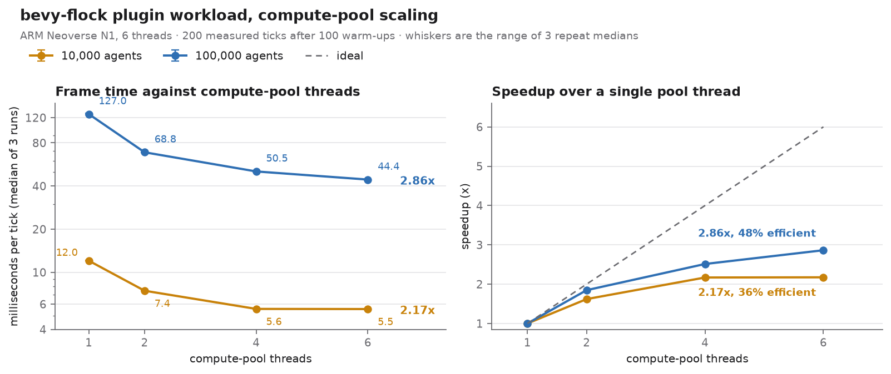
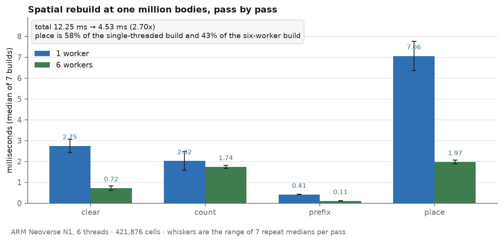
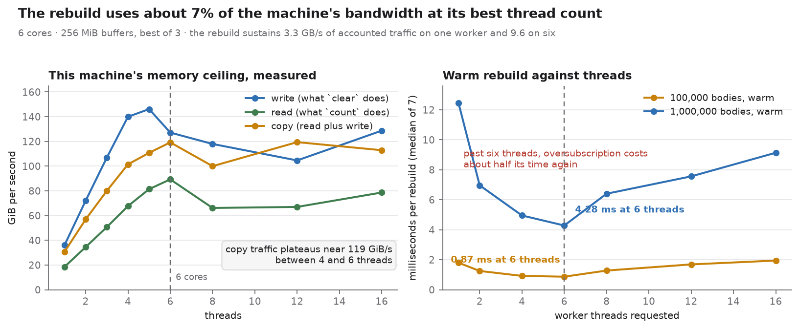
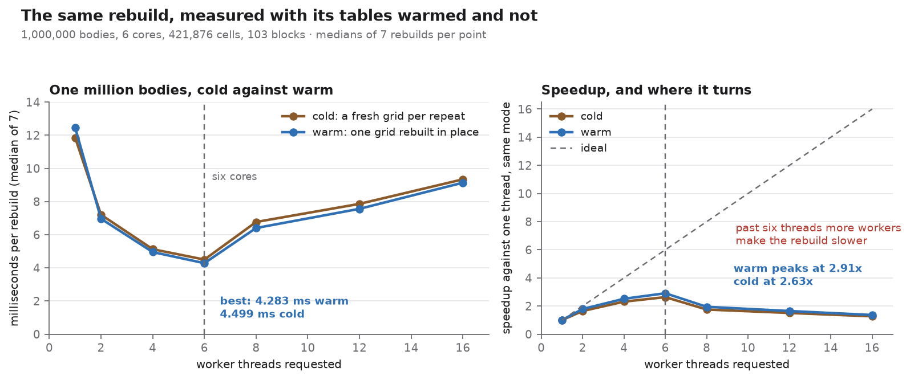

# Archived benchmark results

The JSONL files here preserve benchmark output that was previously kept under ignored `target/` paths. Each line is one complete JSON result record.

## 2026-11-09, Apple M3 Pro

- [`m3-pro/300-ticks/bevy-flock.jsonl`](2026-11-09/m3-pro/300-ticks/bevy-flock.jsonl) contains the `--workload all` run at 10,000 and 100,000 agents, with 100 warm-up ticks and 300 measured ticks.
- [`m3-pro/1000-ticks/bevy-flock.jsonl`](2026-11-09/m3-pro/1000-ticks/bevy-flock.jsonl), [`unreal.jsonl`](2026-11-09/m3-pro/1000-ticks/unreal.jsonl), and [`godot-grid.jsonl`](2026-11-09/m3-pro/1000-ticks/godot-grid.jsonl) contain the three-engine comparison, with 100 warm-up ticks and 1,000 measured ticks.
- [`m3-pro/1000-ticks/godot-grid-runner.jsonl`](2026-11-09/m3-pro/1000-ticks/godot-grid-runner.jsonl) preserves the separate Godot result emitted by the cross-engine runner. Its measurements differ from `godot-grid.jsonl`, so keep these runs distinct.

## 2026-11-11, Apple M3 Pro

- [`m3-pro/plugin-incremental/incremental-build-100k.jsonl`](2026-11-11/m3-pro/plugin-incremental/incremental-build-100k.jsonl)
  and [`incremental-build-1m.jsonl`](2026-11-11/m3-pro/plugin-incremental/incremental-build-1m.jsonl) are the index
  paths the Bevy adapter now uses, from `examples/incremental_build`: the still row, the crossers row and the full
  rebuild, three runs each, at 100,000 and 1,000,000 bodies over eleven workers. The crossers row is the patch path a
  moving crowd takes, and it is 6.6x cheaper than the rebuild at a hundred thousand bodies and 9.9x at a million.
- [`m3-pro/plugin-incremental/horde-100k.jsonl`](2026-11-11/m3-pro/plugin-incremental/horde-100k.jsonl) is the
  full-cognition plugin at 100,000 NPCs, five runs, each reporting 120 patched ticks and 25 rebuilt ticks over a
  120-frame steady run with the same digest every time.
- [`m3-pro/plugin-incremental/horde-100k-before-after.txt`](2026-11-11/m3-pro/plugin-incremental/horde-100k-before-after.txt)
  is the frame comparison that could not be read: the same harness before and after, five alternating pairs. The medians
  are 0.08 ms apart and the host's run-to-run range is wider than that, so the frame says nothing about the change. The
  host was shared while these ran and its load average was above 18, which is the likeliest reason the range is that
  wide. The index path it moves is about 1 ms of a 15 ms frame.

## 2026-11-09, six-core aarch64 virtual machine

The harness names this machine from `CPU implementer` and `CPU part`, because the kernel publishes no model line:
`ARM Neoverse N1, 6 threads`.

- [`sandbox-aarch64/pool-sweep/bevy-flock.jsonl`](2026-11-09/sandbox-aarch64/pool-sweep/bevy-flock.jsonl) is the plugin
  workload at 10,000 and 100,000 agents, 200 ticks after 100 warm-ups, once per compute-pool shape (1, 2, 4 and 6
  threads), each row repeated three times. The median of the 100,000-agent row falls from 127.008 ms on one pool thread to
  44.365 ms on six, which is 2.86x, and the spread across the three repeats is 0.14% to 3.18%, so that difference is far
  outside the noise.
- [`sandbox-aarch64/build-passes/bevy-flock-build.jsonl`](2026-11-09/sandbox-aarch64/build-passes/bevy-flock-build.jsonl)
  is the spatial rebuild at 10,000, 100,000 and 1,000,000 bodies, on 1 and 6 workers, with the harness's own seven repeats.
  At one million bodies the total falls from 12.246 ms to 4.535 ms, which is 2.70x. The per-pass figures there carry
  spreads of 8% to 28%: `clear` 2.745 to 0.719 ms, `count` 2.022 to 1.740 ms, `prefix` 0.411 to 0.105 ms, `place` 7.056 to
  1.972 ms.

Both charts are drawn from the two files above, by reading them rather than by retyping the numbers. The first is the
pool sweep: frame time against pool threads on a log scale, with the repeat range as whiskers, and the same data as a
speedup against the ideal line. The second is the million-body rebuild pass by pass, where `place` is 58% of the
single-threaded build and 43% of the six-worker one.

### Warm rebuild and the machine's bandwidth ceiling

Two more files from the same host, written by harnesses that share this schema:

- [`sandbox-aarch64/warm-sweep/`](2026-11-09/sandbox-aarch64/warm-sweep/bevy-flock-warm.jsonl) is the rebuild at 100,000
  and 1,000,000 bodies over 1, 2, 4, 6, 8, 12 and 16 workers, cold (a fresh grid per repeat, the historical shape) and
  warm (`--warm`, one grid rebuilt in place). Warm at six workers is 4.283 ms against cold 4.499 ms at a million bodies,
  and 0.870 against 0.981 ms at a hundred thousand.
- [`sandbox-aarch64/bandwidth.jsonl`](2026-11-09/sandbox-aarch64/bandwidth.jsonl) is the machine's own memory ceiling at
  each thread count, measured with the three patterns the rebuild uses: writes reach about 146 GiB/s by five threads, reads
  and copies about 89 and 119 GiB/s by six, and all three flatten there. This file is a machine reference and not a
  cross-engine row, and `scripts/compare_benchmarks.py` says so rather than pretending otherwise.

The two panels belong together because they answer the question the thread sweep raises. The rebuild's knee is at the core
count, where eight threads cost 50% more time than six at a million bodies, but it is not a bandwidth wall: the rebuild
moves about 41 MB per pass, which at its best is 9.6 GB/s, or roughly 7% of the copy ceiling this same machine reaches. Its
cost is dependent latency and one dispatch per pass, and that is where further speedup has to come from.

A caveat the spread column exists to state: the same harness at 10,000 bodies reports passes of 27 to 410 microseconds
with spreads from 2% to 625%. Those figures are too small for this machine to measure reliably, so only the million-body
rows above are worth quoting. The earlier prose tables that reported 10,000-body passes to three decimal places were
overstating what a shared VM can resolve.

The runs are observations from one machine, not a controlled comparison across hardware. Their JSON `notes` fields describe the measured work. See the [benchmark guide](../../docs/dev/tuning/benchmarks/cross-engine.md) and [comparison notes](../README.md) for workload caveats.
