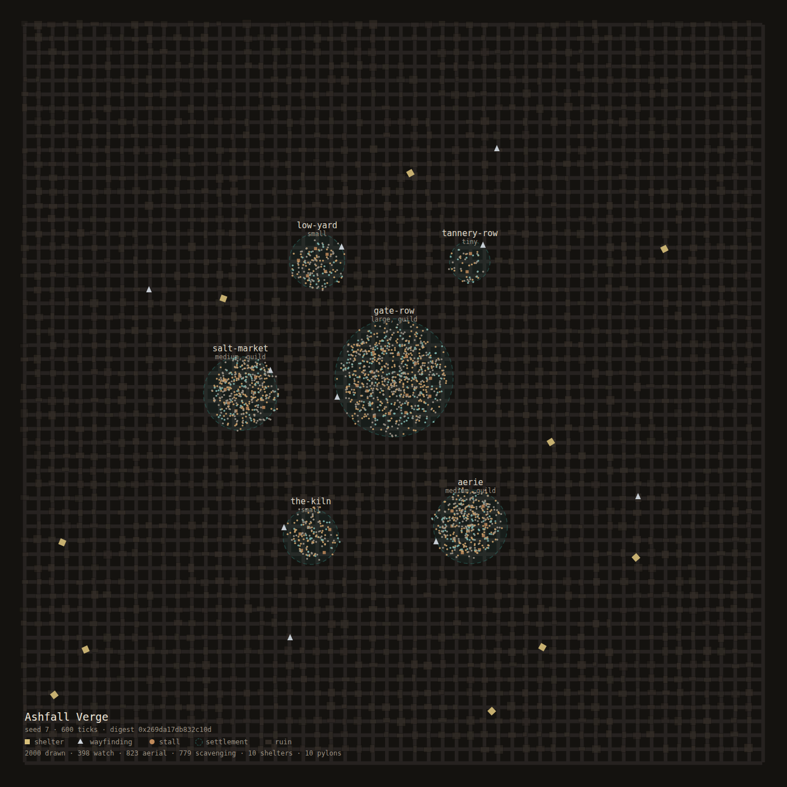
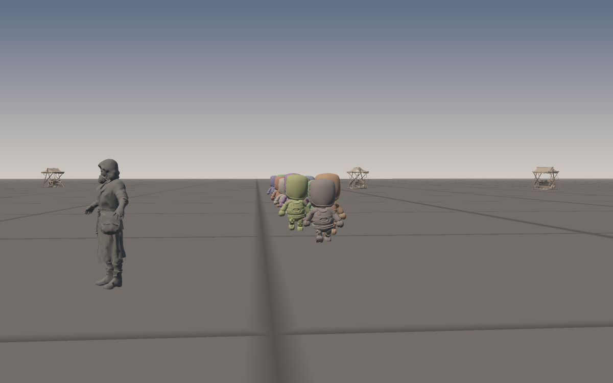
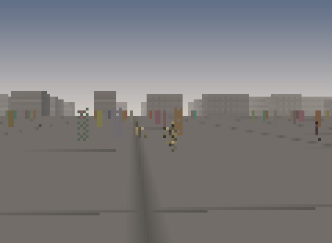

# Ashfall Verge — a `bevy-flock` playground

A city, a crowd, and nine artefacts that prove what happened. Ashfall Verge is a technical
playground for this crate: it exists to answer "what does this library look like when it is a
place?" without asking a reader to take a README's word for it.



```text
cargo run --release --manifest-path demo/Cargo.toml -- --population 4000 --ticks 900
```

```text
city    6 districts, 2096 blocks, 10 shelters, 10 pylons, 44 stalls over 1800 m
  gate-row       large   r=144   42% of the crowd  (guild)
  aerie          medium  r=90    20% of the crowd  (guild)
  salt-market    medium  r=90    20% of the crowd  (guild)
  low-yard       small   r=68    7% of the crowd
  the-kiln       small   r=68    7% of the crowd
  tannery-row    tiny    r=50    2% of the crowd

crowd   2000 NPCs · 601 ticks · 1.69 ms/tick
tiers   100% reflex / 0% habit / 0% social / 0% deliberate
digest  0x269da17db832c10d (coarse) · crowd 0x55c7a27a6dbad0c1
visitor (1, -38) — the anchor the cognition ladder measures from
```

## What it writes

| Artefact | What it is | Who it is for |
| --- | --- | --- |
| `ashfall.svg` | A top-down plan: districts, ruins, shelters, wayfinding, and every NPC as a dot | A reviewer, in a browser, in one second |
| `ashfall.scene.json` | The render payload: model, position, facing, scale, tint — grouped by model for batching | A renderer, engine-agnostic |
| `ashfall.run.json` | Seed, digest, crowd fingerprint, tier histogram, wall time, per-asset fingerprints | CI, and anyone reading a performance claim |
| `manifest.json` | What shipped: the six models, their heights, their purposes, their provenance | The next person to regenerate an asset |

The demo has no renderer, no window and no asset loader. That is a boundary, not an omission: a
demo that needs a GPU cannot run in CI, and a demo that cannot run in CI stops being evidence.
`ashfall.scene.json` is the `build_render_plan` contract written down — a real consumer for real
GLBs — and a game with a `bevy_render` front end can load it in an afternoon.

## The 3D views

The same scene also renders five images without a GPU, a window, or a renderer dependency: a
software rasteriser in `src/raster.rs` (perspective, near-plane clipping, a depth buffer, a
footprint-aware shaded ground, and a deflate/PNG writer), and a glTF geometry reader in
`src/gltf.rs`.

```text
cargo run --release --bin ashfall-3d                          # five views into target/demo
cargo run --release --bin ashfall-3d -- --view hero --supersample 1
```

| View | What it shows |
| --- | --- |
| `district` | the gate settlement from the air: 2,000 bodies, the street grid, the ruins beyond |
| `street` | eye level in the crowd, 190 m of settlement ahead |
| `procession` | eighteen animated walkers on one rig, each at a different phase of the same clip |
| `hero` | one body at 5 m, framed from the crowd and lit from its sun side |
| `skyline` | the whole verge from 200 m, with aerial perspective |



**The Meshy bodies are static.** They are generated meshes with no skeleton, so a crowd of them
stands still; that is a property of the assets, not of the library. The walkers are a second kind of
asset — a KayKit mannequin (CC0, `assets/anim/KAYKIT-LICENSE.txt`) with a 23-joint skeleton and
eleven clips — and `src/skinned.rs` samples a clip, composes the joint matrices and skins the mesh
on the CPU per instance:

```rust
let pose = rig.pose(rig.clips().get("Walking_B").unwrap(), phase);
rig.skin(&pose, transform, |positions, normals| renderer.triangle(image, &face));
```

Fourteen to eighteen instances of one rig, each at a staggered phase, cost about 7,000 triangles
each and read as a street rather than as a diorama. `tests` in `skinned.rs` hold the seams down: the
rig loads with its clips, weights sum to one, a walk clip moves a knee through more than 15 cm while
the bind pose is still, two evaluations of the same time are bit-identical, and the clip loops.

The demo deliberately does *not* ship a blend tree, additive layers or IK. The library owns
behaviour; the clip-to-vertices arithmetic is the smallest thing that makes the seam real, and
anything more belongs to the game that embeds it.

## Flying it in a terminal

There is a second front end next door: `demo-gpu/` draws the same city, crowd, meshes and shot table
through an instanced `wgpu` pipeline, so the software rasteriser has something to be compared *with*
rather than only described. Its district frame is `../docs/demo/ashfall-gpu-district.png`: same
composition, same crowd, a flat ground and no impostors, drawn on `llvmpipe` because that is the only
adapter this machine has. It falls back to the `noop` backend where no driver exists, and
`docs/playbooks/gpu-demos.md` is the recipe it was built from.
The five views are still images. `ashfall-play` makes the same scene a place to stand in, without a
window, a GPU or a widget toolkit:

```text
cargo run --release --manifest-path demo/Cargo.toml --bin ashfall-play
cargo run --release --manifest-path demo/Cargo.toml --bin ashfall-play -- --view street --cols 200
cargo run --release --manifest-path demo/Cargo.toml --bin ashfall-play -- --play 24 --out target/demo/flight
```

| Key | What it does |
| --- | --- |
| `w` `a` `s` `d` | walk and strafe, in the direction you are looking |
| `e` / `c` | climb and descend |
| arrows | look |
| `1`-`5` | jump to a view |
| `p` | watch the scripted flight, hands off |
| `[` / `]` | change the lens |
| `+` / `-` | change the walking speed |
| `h` | the key list, in the corner |
| `q` | quit |

A cell is split by `▀` into two pixels, so a 112-cell terminal shows a 112 × 40-pixel picture with
square pixels. It is not a screenshot: it is the same rasteriser, called every frame.



*The procession view: 120 × 44 cells, which is 120 × 88 framebuffer pixels, shown at 480 × 352 — four
times, without smoothing. Regenerated from the client's own session by `examples/frame_capture.rs`
rather than screenshotted from a pty, so it cannot rot as the terminal path changes:
`cargo run --release --example frame_capture -- --columns 120 --rows 44 --view procession --band 8`.
The band is on: between sixteen and twenty-four metres a body is drawn as a mesh and a two-triangle
impostor at once, dissolving by coverage so it fades instead of popping, and `--band 0` renders the
hard switch that differs from this frame by 1,152 pixels. At four pixels wide a dissolving body reads
as a dotted outline, which is the honest cost of the fade at a cell count it was not designed for —
the reason the five shipped views leave the band at zero and only the interactive client turns it on.*

Two things make it fast enough to steer. The *budget* in `session::Budget` changes the shot rather
than the world — 420 bodies, 240 m of crowd, a 0.75-pixel triangle cull — and everything past 24 m is
drawn as two triangles instead of an 11,000-triangle mesh. The switch is measured from the camera to
the body's feet and lives on the shot (`Shot::impostor_distance`) rather than in the renderer or the
session; it is hard unless `Shot::impostor_band` widens it into the cross-fade described below.
Measured on the district view:
850 ms a frame at full detail, 19.0 ms under the budget, 38 ms in a real 112 × 88-pixel terminal
(26 fps). The budget is a `Copy` struct, so a bigger terminal or a faster machine is four numbers, not
a code change.

`--play N` runs the same flight the `p` key runs, `N` frames per view, and writes a PNG per frame plus
`playback.json`. It needs no tty, so it works in CI and in a pipe:

```text
ffmpeg -framerate 30 -i target/demo/flight/%03d.png -pix_fmt yuv420p flight.mp4
```

**On `bevy-archie`:** the windowed front end is the one thing here that is not wired, and the reason
has changed. When this was written the machine had no display server, no `libvulkan` and no
`libxkbcommon`; all three are present now, and the Vulkan loader resolves to `llvmpipe` — a CPU
driver, not a card. So a window would open and run at software-renderer speed, which is why the
second front end went the other way: `../demo-gpu/` binds `wgpu` directly and renders to a texture
instead of a surface, which works with no window at all. What a windowed front end still needs from
this side exists and is tested: `Session` (camera, view, lens, budget),
`Session::advance(&CameraInput, dt)`, `input::Command` and `session::Budget`.
See [ADR 0050](../docs/adr/0050-interactive-playground.md).

### The cross-fade band

`Shot::impostor_band` turns the level-of-detail switch into a window: a body inside
`impostor_distance - impostor_band .. impostor_distance` is drawn as its mesh *and* its billboard, the
quad claiming an increasing share of the pixels while the mesh gives its own up. The fade is a per-pixel
ordered dither, not a blend — a blended fragment cannot write depth, and a body that cannot write depth
stops occluding itself, which drew blotches where a hidden facet overpainted a visible one. Coverage
keeps every fragment opaque, so the body still hides its own back faces.

The shipped views leave the band at zero: at their sizes a dissolve is invisible and the committed
PNGs are full detail. `--play` and the interactive loop set it, because a 300-cell terminal is where a
pop is actually visible. It costs one comparison per pixel and a second draw for the bodies inside the
window, and the interactive frame measures the same either way — 19.39 ms with the band, 19.63 ms
without, both inside the noise of this machine.

Where the billboard pass can still go faster, and how to settle each claim, is
[`../docs/demo/billboard-optimisations.md`](../docs/demo/billboard-optimisations.md).

## Costing the two pipelines

`demo/benches/render_pipeline.rs` draws the same 2,000-body district scene through the software
rasteriser and through a `wgpu` device on its `noop` backend — a real device, pipeline, buffers, render
pass and submission, with the commands discarded — so the CPU half of each frame can be compared:

| Case | Median |
| --- | --- |
| `software/full/600x375` | 850 ms |
| `software/interactive/112x72` | 19.0 ms |
| `wgpu/full/600x375` | 33.6 µs |
| `wgpu/interactive/112x72` | 34.7 µs |
| `wgpu_upload/2064_instances` | 106 µs |

The wgpu figure is the API's CPU cost, not a frame time; nothing here was measured on a GPU. Read the
ratio as the shape of the work — per-pixel and per-triangle labour belongs to the device, and what is
left on the CPU is fixed and scales with the draw list. `docs/performance.md` records the run.


## The city

Six settlements on a jittered 34 m grid, joined by 9 m streets, inside 1800 m of ruins. Classes
are large/medium/small/tiny and set the radius, the cap and the guild: `gate-row` is the large
gate settlement and holds 42% of the crowd, `tannery-row` is a 50 m shanty with 2%.

Placement is *keyed*, not sequential: `CityLayout::npc_position(district, NpcId)` draws from
`RngStream::for_npc`, so the same id lands in the same place whatever order the spawner worked in.
`district_for(slot, population)` partitions the crowd exactly — the shares in the table above sum
to the population with no remainder left over.

## The assets

Six models, generated with Meshy from six concept images, then shrunk. All original designs: the
writeup this was pitched from is a setting, not a licence, so nothing here reproduces a character,
a name or a likeness from it.

| Model | Kind | Height | Triangles | Bytes | Purpose |
| --- | --- | --- | --- | --- | --- |
| `gatewarden` | body | 1.80 m | 12,654 | 460 KB | Guards: gate-row, patrols |
| `aerie` | body | 1.80 m | 14,613 | 650 KB | Merchants and nobles: the market, the terrace |
| `scavenger` | body | 1.75 m | 11,506 | 460 KB | Urchins and wanderers: the ruins, the low yard |
| `pylon` | prop | 3.00 m | 6,131 | 270 KB | Wayfinding: one per gate, four at junctions |
| `shelter-door` | prop | 2.50 m | 5,971 | 240 KB | Shelters, in the ruins between settlements |
| `market-stall` | prop | 2.50 m | 7,180 | 340 KB | Stalls, in the market classes |
| `kaykit-walker` | rig | 2.20 m | 6,916 | 674 KB | The animated crowd: 23 joints, 11 clips (CC0) |

Three bodies carry five archetypes, and tint plus scale jitter does the rest — the variant budget
argument from the crate documentation, made concrete rather than asserted.

`tools/shrink_glb.py` is the pipeline step that makes them shippable: Meshy's 2K base colour map is
most of a 4 MB file and roughly eight times more texture than a 12,000-triangle prop can show. The
script re-encodes the images, re-lays the binary chunk and leaves geometry, accessors and indices
byte-identical. 22.9 MB became 2.4 MB:

```text
  aerie.glb               4.62 MB ->  0.65 MB   14613 tris  1.80 m tall
  gatewarden.glb          4.36 MB ->  0.46 MB   12654 tris  1.80 m tall
  scavenger.glb           3.74 MB ->  0.46 MB   11506 tris  1.75 m tall
  market-stall.glb        3.46 MB ->  0.34 MB    7180 tris  2.50 m tall
  pylon.glb               3.32 MB ->  0.27 MB    6131 tris  3.00 m tall
  shelter-door.glb        3.36 MB ->  0.24 MB    5971 tris  2.50 m tall
```

`tests/assets.rs` is the gate: every promised file is opened, its container and version checked,
its geometry confirmed, its animation absence asserted and its size held to a budget. A
regenerated asset that skips the shrink step fails there.

## Two things the demo had to learn the hard way

Both are recorded because they are the kind of thing a "playground" is for.

**A crowd with cohesion is a flock.** With the default weights, everyone walks to the same
intersection; the first build of this demo produced a city with a single dense dot in the middle of
it. Cohesion off, alignment low, seek on: a street holds its districts.

**A headless app has no clock.** `App::new()` does not include `TimePlugin`, and `integrate_flock`
advances positions by the frame delta, so the crowd stood perfectly still — placed, drawn, and
never moving. `tests/playground.rs::the_crowd_walks` is the test that caught it, and it is still
there: half a second of simulated time is not long enough to see anyone walk, which is why it runs
300 ticks rather than 30.

## What the numbers mean

The tier histogram reads 100% reflex at these populations, and that is correct rather than
disappointing: "reflex" is the *highest* fidelity band, and below the manifest band there is no
reason to demote anyone. Push the population past it and the ladder starts folding — the library's
benchmarks cover that path; this demo is sized to stay readable.

`ms_per_tick` is one number on one machine with a debug-friendly configuration: it is not the
kernel benchmark, and `docs/performance.md` is where the measured performance of the steering road
lives. What `ashfall.run.json` gives you is the same measurement *for the run you just made*, next
to the seed and the digest, so a change in this demo's cost is attributable.

The first `districts` line in the summary is longer than the population check deserves: the
`digest` is deliberately coarse (population, tiers, mood, the tick) and matches across seeds, so
`crowd_fingerprint` hashes quantised positions to the millimetre for the artefacts.

## Layout

```text
demo/
  src/app.rs        Playground: build, place, tick, read back   <- tests drive this
  src/city.rs       Districts, blocks, shelters, pylons, stalls, keyed placement
  src/assets.rs     The model table, the body mapping, the GLB probe
  src/scene.rs      Engine-agnostic instances + crowd fingerprint
  src/plan.rs       The SVG plan
  src/raster.rs     A software rasteriser + PNG writer (no GPU, no image crate)
  src/gltf.rs       glTF geometry reader for the shipped GLBs
  src/skinned.rs    Rigged meshes: clip sampling, joint matrices, CPU skinning
  src/render3d.rs   The five views, the procession, the shot table
  ../demo-gpu/      A wgpu front end over the same scene, and its frame benchmark
  src/bin/ashfall-3d.rs  The 3D entry point
  src/report.rs     run.json
  src/json.rs       A 90-line writer (no serde: the demo writes four small documents)
  src/main.rs       Flags and artefacts
  tests/            assets.rs (the gate), playground.rs (determinism, walking, placement)
  tools/            shrink_glb.py
  assets/           npcs/, props/, concepts/, anim/
```

The crate is not in the root workspace, for the same reason `compat/` is not: a demo should not be
able to break the library's build, and the library should not pay for the demo's dependencies.
