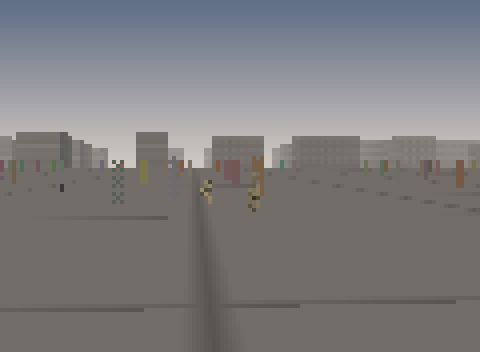
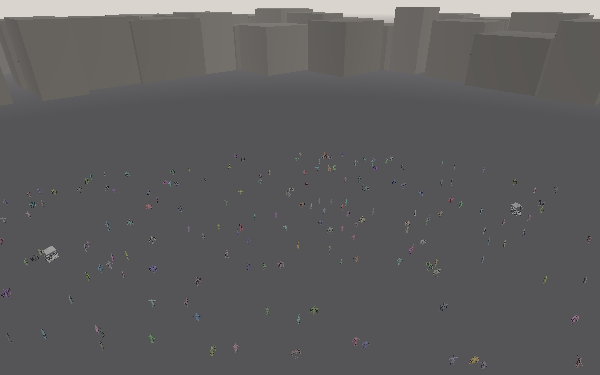

# ADR 0050 — Exploring the playground without a window

- **Status:** Accepted
- **Date:** 2026-11-05
- **Task:** `ashfall-demo-interactive`
- **Supersedes:** nothing
- **Related:** [ADR 0049](0049-row-major-neighbour-broadcast.md) (the kernels the demo draws),
  `demo/README.md`, `docs/performance.md`

## Context

The playground shipped five PNGs and a report: the city, the crowd, the assets and the timings could
be inspected, but not *explored*. A person looking at `district.png` cannot walk down the street it
shows, and a person evaluating the crowd cannot see it move.

Two front ends were asked for: interactive camera controls, or a command-line playback mode. There is
also a candidate library for the first — `bevy-archie`, another crate by the same author — and a
second request that came with it: measure the CPU cost of the software rasteriser against a wgpu
pipeline.

The sandbox this work runs in has no window system, no GPU and no `libvulkan`, `libxkbcommon` or
`libwayland-client`, which rules out everything a winit window needs before the first frame. The
constraint is not a sandbox quirk, either: the same is true of CI, of a remote shell, and of the
`demo` job that already has to run headless.

## Decision

**Explore in the terminal, and keep the crude parts crude on purpose.**

1. **A pure session core, no I/O.** `demo/src/session.rs` owns the camera, the current view, the lens
   and the draw budget; `step`/`advance` take an input snapshot and return; nothing in it touches a
   terminal, a clock or a file. Eleven unit tests drive it with synthesised input, which is what makes
   the interactive path testable in CI at all.
2. **Input is decoded, not read.** `demo/src/input.rs` turns bytes into `Command`s, with a 140 ms
   escape timeout so a lone `Esc` is not mistaken for the head of a sequence. A `Decoder` is fed bytes
   in tests and keys in the binary.
3. **The picture is the same rasteriser.** A cell is split by `▀` into two vertical pixels, so a
   `cols × rows` terminal shows `cols × rows·2` square pixels at roughly 20 kB a frame. No image
   protocol is assumed, because half of the terminals people actually use do not have one.
4. **A draw budget, not a smaller scene.** The interactive path changes the *shots*, not the world:
   420 bodies inside 240 m, ruins inside 300 m, triangles under 0.75 px dropped, and — the change that
   mattered — anything past 24 m drawn as a two-triangle camera-facing billboard. The same scene at
   full detail costs 850 ms a frame at 600×375 and about 1,100 ms at the district view's own
   resolution; the budget costs 19.0 ms at 112×72, which is 53 fps, and 38 ms in a real 112×88-pixel
   terminal, which is 26 fps measured.
5. **Playback is the same loop with a camera on a rail.** `--play N` steps the scripted flight, writes
   a PNG per frame plus `playback.json`, and needs no tty — so the feature can be exercised in CI, and
   the images can be assembled into a video without a screen recorder.
6. **`bevy-archie` is not wired in, and the seam is named.** Archie is a windowed, gamepad-and-keyboard
   front end: it needs a window, and the crate in this environment cannot open one. What it needs from
   this side is a `CameraInput` per frame and a `Session`, and both are public and tested. The ADR
   records the seam rather than pretending to a binding that could not be compiled here:
   `Session::camera()`, `Session::advance`, `Command`, and the `Budget` are the four things a windowed
   front end would consume.

The result, rendered through the client's own `Session` and `Budget` at 120 × 88 pixels and enlarged
four times without smoothing:

It is regenerated rather than screenshotted, by `demo/examples/frame_capture.rs`: the client's frame
minus the status line, at the size the client draws it. `--band 8` is the cross-fade this ADR records
and `--band 0` is the hard switch it replaced; in this frame the two differ by 1,152 pixels, which is
how the band was confirmed to be doing something instead of being configured and ignored.

## The measurement

`demo/benches/render_pipeline.rs` runs the same scene through both pipelines and records what the CPU
does:

| Case | Median |
| --- | --- |
| `software/full/600x375` | 850 ms |
| `software/interactive/112x72` | 19.0 ms |
| `wgpu/full/600x375` | 33.6 µs |
| `wgpu/interactive/112x72` | 34.7 µs |
| `wgpu_upload/2064_instances` | 106 µs |

The wgpu side runs on its `noop` backend: a real `wgpu::Device`, a real pipeline description, real
vertex and index buffers, a real render pass and a real submission, with the commands discarded
instead of executed. That is precisely the CPU work a wgpu game pays every frame and precisely *not*
the GPU work, which cannot be measured without a GPU. Read the table as two facts and no more:

- The CPU side of a wgpu frame is **34 µs** for 2,064 instances in six batches, and does not care
  whether the target is 600×375 or 112×72: the size of the framebuffer is the GPU's problem.
- The software path spends 850 ms on the full-detail frame and 19.0 ms on the terminal frame, because
  everything a GPU would parallelise it does on one core, one triangle at a time.

The ratio — 550× at terminal size, 25,000× at full detail — is not "wgpu is faster." It is the shape
of the cost: per-pixel and per-triangle work moves to the device, and the CPU keeps a fixed,
population-proportional cost that the impostor budget also attacks (a body past 24 m is two triangles
instead of 11,000).

One number in the table looks wrong and is not: an isolated `write_buffer` of the crowd costs 106 µs,
three times what the whole frame costs. Inside `frame()` the write is queued to the staging belt and
rides the submit; measured alone it flushes. A renderer that uploads outside a submit pays the flush,
which is why the benchmark keeps both cases.

## Consequences

- **The terminal is a first-class front end.** It runs over SSH, in a container, in CI, on a machine
  with no GPU, and on the sandbox that produced every artefact in `docs/demo/`.
- **The budget is data.** `session::Budget` is a plain `Copy` struct, so a caller that wants a richer
  picture (a bigger terminal, a faster machine) changes four numbers rather than the renderer.
- **The switch is a band, and it fades by coverage.** `Shot::impostor_band` widens the switch into a
  window: a body between `impostor_distance - impostor_band` and `impostor_distance` is drawn as both,
  the quad claiming an increasing share of the pixels while the mesh gives its own share up. The fade
  is an 8 by 8 ordered dither resolved per pixel (`Renderer::triangle_coverage`), not a blend, and a
  defect rather than a taste decided that: the first implementation composited a faded mesh, which
  turns the depth write off, and a body then stops occluding *itself* — a hidden facet overpainted a
  visible one and faded bodies went blotchy. Coverage keeps every fragment opaque, so a fading body
  still writes depth, still hides its own back faces, and every pixel of the dissolve belongs to
  exactly one representation. The price is a hole or two at the silhouette, where the mesh has given a
  pixel up before the quad has taken it, and that is why the five committed views leave the band at
  zero while the steered front end sets it: at 112 cells a body is three or four pixels and the
  dissolve is invisible; on a 300-cell terminal it is the difference between a pop and a fade. The band
  costs one comparison per pixel and a second draw for the bodies inside it, and the interactive frame
  measures the same either way — 19.39 ms with the band against 19.63 ms without, which is this
  machine's noise floor (see `docs/performance.md`). The distance is eye to feet, not to silhouette, so
  a tall body crosses a fraction late — under a pixel at 24 m.
- **Five tests pin the switch instead of leaving it to inspection.** The hard switch is monotone in the
  threshold and exact at two triangles per billboard; the quad's projection matches the camera's own
  matrix to within 2.5 px at a 0.26 width-to-height ratio; a band of zero is byte-for-byte the hard
  switch; a body inside the band costs its mesh plus two triangles, and a wider band adds two per body
  it reaches; and half way through the band about half of the quad's pixels have changed hands, which a
  switch cannot produce at either end. Every shipped view still carries an infinite threshold and a
  zero band, so the committed PNGs stay full detail.
- **`impostor_distance` defaults to infinity.** The shipped PNGs are made at full detail and stay
  byte-identical; the LOD exists for the steered view. A renderer that turned it on by default would
  have silently changed five committed images.
- **A windowed front end remains unwritten.** Archie would give game controller support, a resizable
  window and a real `wgpu` surface; the work it needs from this side is done and tested, and the
  binding is one file when a machine with a display is available.
- **The billboard pass has a written-down next step.** Flat-shaded cards, one fused pass per cell
  bucket, cards aligned to the mesh's measured bounds and a sub-pixel cull on the card are each
  recorded in `docs/demo/billboard-optimisations.md` with the measurement that would settle them. None
  is implemented, and none is claimed as a win.
- **The comparison is CPU-only by construction.** Any claim about end-to-end frame times on a GPU
  needs a GPU, and this ADR claims none.

## Amendment, 2026-11-06: the machine grew a GPU, and so did the playground

The decision above stands — the interactive front end is a terminal client over a framebuffer, and
the software rasteriser stays the artefact producer. Two of its premises have changed, and a record
that quietly keeps them would be wrong.

**The environment is no longer bare.** `DISPLAY=:0` answers with an X.Org server, `libvulkan`,
`libxkbcommon`, `libwayland-client`, `libX11`, `libasound` and `libudev` are installed, and the Vulkan
loader finds `lvp_icd.json`. What it resolves to is `llvmpipe (LLVM 20.1.2, 128 bits)` with
`device_type: Cpu`, and there is still no `/dev/dri` render node: this is a *software* Vulkan driver,
not a graphics card. The sentence above about `libvulkan` and `libxkbcommon` being absent was true when
it was written and is now false; the conclusion it supported — that no GPU frame time can be claimed
here — is still true, for the narrower reason that the only adapter is a CPU.

**A second front end exists.** `demo-gpu/` renders the same city, crowd, meshes and `Shot` table
through an instanced `wgpu` pipeline, with `Backend::{Auto, Vulkan, Gl, Noop}`. It shares the scenario
rather than re-deriving it, so the two pictures are comparable: the same district view at 600x375, 615
instances, 7 draws, 5,401,392 triangles.

| Case (600x375, district) | Median | Interval |
| --- | --- | --- |
| `frame` (submit and wait) | 974.56 ms | 968.84 - 980.93 ms |
| `eight_frames_per_drain` | 7.8932 s (986.6 ms/frame) | 7.8580 - 7.9271 s |
| `frame_with_readback` | 997.35 ms | 994.51 - 1000.5 ms |

The same district, 600x375, drawn by `demo-gpu` on `llvmpipe`. Compare it with
`ashfall-3d-district.png` next to it: the composition and the crowd agree because both read the same
`Shot`; the ground is flat where the software renderer draws a grid, the sky is one fog colour where
that one has a gradient, and every body is its full mesh where that one uses impostors past forty
metres. Those three differences are the honest cost of the second front end being a reference rather
than a replacement.

Read those as a statement about `llvmpipe` and nothing else. The interesting part is not that a CPU
Vulkan driver is about as fast as the software rasteriser — it is the same kind of work on the same
kind of processor — but that throughput and latency are the same number here: with no separate
processor, a frame has no pipeline to fill. That is also why an earlier version of this benchmark,
which submitted frames without draining the queue, reported 992 ms for a case it called `encode`: it
was measuring queue saturation, not encoding. The case names were changed to say what the loop does,
and `docs/playbooks/gpu-demos.md` records the trap.

The `Noop` backend is the part that survives a machine with no driver at all: it validates and encodes
every command and executes none, so CI proves the pipeline state on a runner with nothing installed.

What this does **not** change: the shipped images in `docs/demo/` are still produced by the software
rasteriser, the terminal client is still the interactive front end, and no claim is made about
hardware frame times. What it does add is a measured reference for the day a real adapter appears —
the encode path is already written, tested and costed, and only the adapter line in the results changes.
