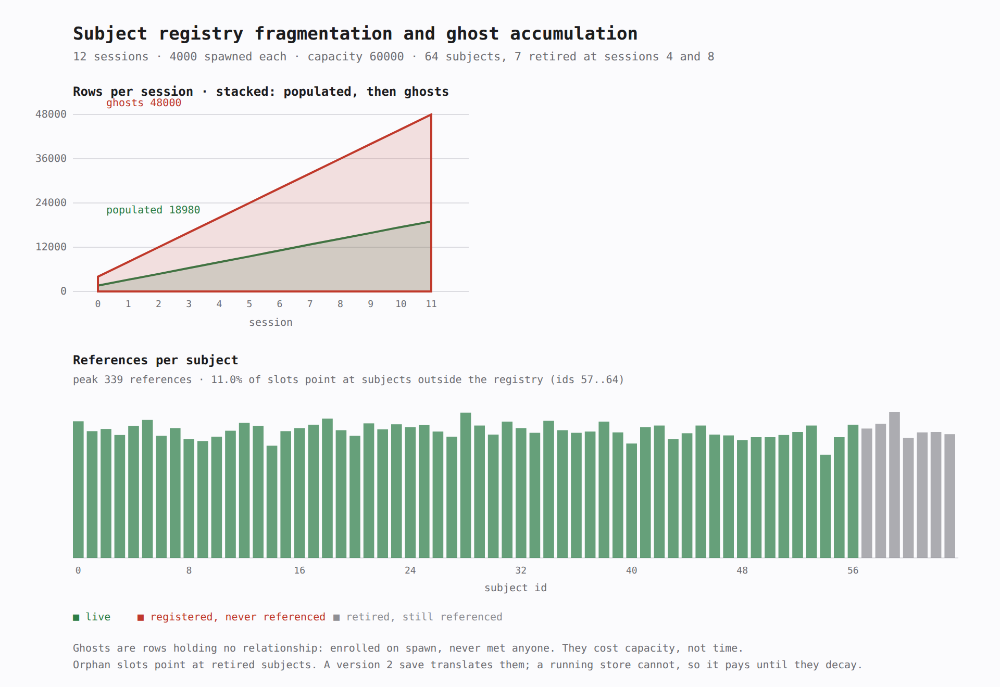

# 0015, Waste is measured in integers and drawn outside the library

- Status: Accepted
- Date: 2026-11-04
- Relates to: ADR 0010 (social memory), ADR 0013 (subject registry)

## Context

The store is bounded, so every row it holds is a row it cannot give to somebody
else. Two kinds of waste fill it, both invisible to a game that does not look:

1. **Rows that hold nothing.** Games enrol on spawn and remember on encounter.
   Between those two moments, which for a wave of new arrivals is most of them , 
   the store is full of NPCs who have met nobody. Nothing is wrong with any single
   row; ten thousand of them is a store that cannot remember the captain.
2. **Slots pointing at subjects that no longer exist.** A save file translates
   retired subjects by key (ADR 0013). A *running* store cannot: it holds positions,
   the content patch shifted them, and the slots stay until decay or a sweep.

Both are capacity problems, not latency problems, which is why profiling does not
find them: frame time is unaffected by a row that remembers nobody.

## Decision

**Measure in the library with integers, draw in an example with no dependencies.**

### The definitions, stated so the graph cannot lie

| Term | Definition |
| --- | --- |
| populated row | an enrolled row holding at least one slot |
| ghost row | an enrolled row holding none: `enrolled − populated` |
| ghost share | `ghosts × 1000 / capacity` permille, capacity being the store's, not the row count |
| orphan slot | a slot whose subject is at or beyond the current registry's length |
| orphan subject | a registered subject no row references |
| fragmentation | `orphan subjects × 1000 / registry length`, permille |

Every measure is permille, in `u32`, so a game can alert on a threshold without a
float, a `f64` comparison, or a platform-dependent rounding difference. Ghost share
is against **capacity**, deliberately: 500 ghosts in a store of 1,000 is a different
problem from 500 in a store of 50,000, and dividing by the row count would hide that
behind a healthy-looking percentage.

### Where it lives

`domain::telemetry` returns a [`Sample`] of plain integers from
[`measure`]. `examples/registry_telemetry` simulates a world over twelve sessions , 
spawning eagerly, meeting rarely, retiring seven characters in two patches, prints a
table and writes an SVG with two panels: accumulation over time, and references per
subject with retired ones marked.

The split is the point. A game wants the numbers to log, alert on, or feed to its own
dashboard; that must not require the crate to depend on a charting library. The
example wants to show the shape of the problem to a human; that must not require the
crate to own a drawing.

The picture above is the example's own output, rendered from the SVG and committed, so
a change in the numbers or the layout shows up in a diff.

SVG is written by hand: no plotting dependency, deterministic output, and a file a
designer can open in a browser.

### What it does not measure

- **Faded slots.** A slot whose decayed valence has reached zero still occupies its
  cell until `sweep` runs. Modelling that needs the decay policy at measurement time,
  and the answer would be a property of the sweep cadence rather than of the store.
  The row is counted as populated until the sweep makes it a ghost, which is the
  honest reading: it is still costing capacity.
- **Per-subject familiarity distribution.** Useful for tuning, out of scope for a
  waste diagnostic.
- **The archive.** It is bounded separately and evicts by policy; a ghost there is
  evicted rather than accumulated, so the graph would show a flat line.

### Thresholds, offered as advice rather than defaults

The library does not warn; a game decides what matters. Reasonable starting points,
from the example's run: ghost rows above **25% of capacity** mean spawning outpaces
memory hard enough that a quarter of the store is scenery; orphan slots above **5%**
mean a content patch removed subjects that relationships still reference, and a save
written then will drop those relationships on the next load.

## What the tool found while being written

The first run reported a fifth of arrivals meeting somebody when the fixture asked
for two fifths, and half the subject identifiers never referenced. The cause was not
the fixture's randomness, it was `MAX_SUBJECTS`, then 16: the store clamps its subject
stride, and the fixture's thirty-two subjects meant every encounter past the ceiling
was silently rejected by `remember` returning `false`.

Two consequences. The fixture now sizes itself from `MAX_SUBJECTS` rather than a
literal, so the tool cannot lie about the cap again. And the cap is worth stating
where games will read it: the subject count is a hard ceiling, not a default (raised to
sixty-four by ADR 0016), and a
game that wants a player plus twenty regulars needs the subject list designed around
it, which is a design consequence of the flat slot array in ADR 0010, not a bug in
it.

## Consequences

- **Measurement is `O(rows × subjects)`**, the same walk as `sweep`: run it on the
  sweep cadence, never per frame. At 10,000 rows and sixty-four subjects that is 640,000
  cell tests, which is hundreds of microseconds, not milliseconds.
- **The numbers are testable.** `Sample` is a plain struct of integers, so the
  definitions above are asserted in unit tests rather than inferred from pixels.
- **A game can own the presentation.** `measure` returns data; a studio with an
  existing metrics pipeline ignores the SVG entirely.
- **The example is a fixture, not a benchmark.** It uses a SplitMix64-driven
  simulation with a fixed seed so two runs produce identical bytes; comparing builds
  requires that.
- **Nothing here is feature-gated differently.** Diagnostics live behind the same
  `memory` feature as the store they measure, because measuring absent memory is not
  a thing.

## Alternatives rejected

- **A `metrics` or `tracing` integration.** Reasonable for a game, wrong for a
  library: it pickles the crate into a logging stack, and the numbers are cheap
  enough for the caller to forward itself.
- **Plotting inside the crate.** Pulls a dependency tree into a library that
  currently has five dependencies, to serve a debugging tool.
- **Counting ghosts by row emptiness alone, ignoring capacity.** A store can be
  empty and healthy or half-full and dying; the ratio to capacity is the measure
  that changes with the decision the game can actually make.
- **Reporting a single "health score".** A weighted composite hides which of the two
  problems is growing, and they have different fixes: spawn less eagerly, or clean up
  retired subjects.
- **Emitting warnings from the library.** A threshold that is wrong for one game is
  noise in another; the permille values exist so each game sets its own.
