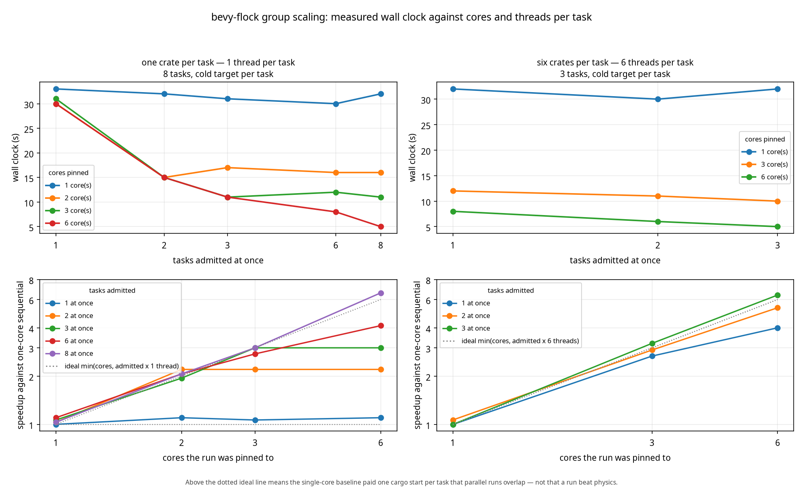
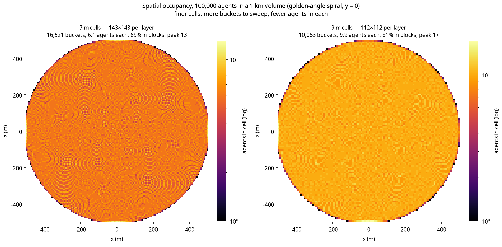
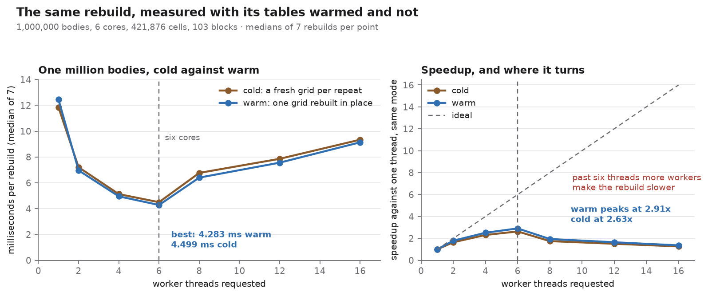
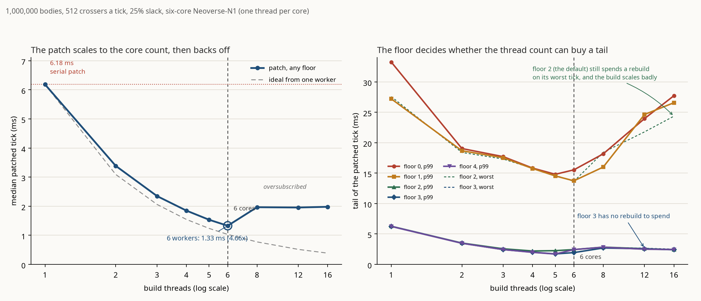

# Performance

Measured, not estimated. Every number here comes from a criterion bench under
`benches/`, on the machine and settings below, and the designs that lost are
documented alongside the one that won, because a table of "we are fast" is worth
less than a record of what was tried and rejected.

## Reproducing these numbers

Every number in this document was produced on the machine below, from the commit named
beside it, with the dependency graph the committed `Cargo.lock` pins. Three things are
deliberately fixed, because each of them moves a timing by more than the differences this
document argues about:

| What | Where it is pinned | Why it matters |
| --- | --- | --- |
| Toolchain | `rust-toolchain.toml` (`1.97.1`, the Bevy 0.20 MSRV) | These numbers were produced with it; a different compiler is a different measurement, not a reproduction |
| Dependencies | `Cargo.lock` and `compat/Cargo.lock`, both committed | Bevy, `wide` and `criterion` versions change the kernel and the harness |
| Build profile | `[profile.bench]` (`debug = true`, otherwise release defaults) | Benchmarks need symbols for the profiler; optimisation stays release |

Every CI job that builds or tests runs `--locked` (`clippy`, `test`, `features`, `msrv`,
`docs`, `determinism`, `bench-smoke`, `compat`), and a `lockfile` job fails if either file has
gone stale, so a dependency bump has to be a commit rather than a silent resolution.
Reproduce a row exactly with:

```sh
cargo bench --locked --bench crowd -- flock_frame/10000 --warm-up-time 0.5 --measurement-time 3
cargo bench --locked --bench band  --features simd -- band_frame/1000000_total_5000_manifested
cargo bench --locked --bench tiers -- tier_frame/reflex/10000
cargo bench --locked --bench packed --features simd -- packed_steer/steer_integrate_advance/50000
```

Raw criterion output lands in `target/criterion`, with an HTML report under
`target/criterion/report/index.html`. Drop the filter to run a whole suite and get the table
rather than one row.

### The machine

| | |
| --- | --- |
| CPU | ARM64, Neoverse-N1, 6 vCPU (shared cloud sandbox) |
| Memory | 9 GB |
| Kernel | Linux 6.8 (container) |
| Toolchain | Rust 1.97.1, `--release` with debug symbols (`[profile.bench]`) |
| Criterion | 10–20 samples, 0.5–1 s warm-up, 3 s measurement unless a bench overrides it |
| Renderer | none, headless `App::new()`, simulation only |

Two things to know about that host. It is **shared**, so a neighbour's load shows up as a few
percent of jitter; and its vCPU count has varied between sandboxes (6 here, 8 on the host the
earlier tables were taken on), which barely matters because every path measured here is
**single-threaded**, Bevy's schedule is one thread and the kernels are scalar loops or four
lane `wide` vectors, not rayon. What does change with the host is the absolute number, not the
shape of the curve or the ranking of designs.

### What still varies, and by how much

- **Run to run, same binary, same machine:** 1–4%. Criterion's confidence interval covers it;
  treat the middle value as the number and the interval as the noise floor.
- **A different machine:** not characterised here, and not worth characterising, an
  absolute time is a property of a host, not of this library. This document therefore argues
  in **ratios** (dense grid versus sorted array, scalar versus four-lane), and states the
  number that shipped so you can re-measure it on yours rather than adopt it.
- **First run after a rebuild:** slower and noisy while the page cache and CPU governor settle.
  Discard it; criterion's warm-up exists for exactly this.

### A cross-check, on the record

Re-measured during the reproducibility pass (2026-11-04, `flock_frame/10000`, locked
dependencies, 6 vCPU host): **18.75 ms**, against the 18.2 ms committed below, 3% inside the
quoted interval, which is the intended relationship between this section and the tables. The
1,000,000-inhabitant band frame re-measured at 3.80 ms against the 3.78 ms recorded for ADR
0021, for the same reason.

## Final numbers

| Benchmark | Time | Per agent |
| --- | --- | --- |
| `flock_frame/1` | 1.01 ms |, |
| `flock_frame/1000` | 1.74 ms | 1.7 µs |
| `flock_frame/10000` | **4.27 ms** | 0.43 µs |
| `flock_frame_large/100000` | **29.2 ms** | 0.29 µs |
| `spatial_query/radius_8m/1000` | 138 ns |, |
| `spatial_query/radius_8m/10000` | 185 ns |, |
| `spatial_query/radius_8m/100000` | 552 ns |, |
| `steering_step/32_neighbours` | 152 ns |, |

Four things to read from that table:

- **Per-agent cost is flat, and it halved twice.** 1.7 µs at a thousand agents, 0.43 µs at ten
  thousand and 0.29 µs at a hundred thousand: the index makes each agent's work local, the kernel
  walks neighbours once instead of three times (ADR 0026), and the frame now uses every core
  (ADR 0044).
- **10,000 agents fit a 60 Hz frame three times over.** 4.27 ms against the 16.6 ms budget is
  234 fps, and 3.9× of margin. The same crowd cost 18.2 ms before the kernel was rewritten (the
  frame was 92% steering, at 1.79 µs per agent); the 3D kernel in ADR 0028 added 19% back on top of
  the 7.71 ms planar figure, which is the honest price of the third dimension and is visible here
  rather than buried.
- **The fixed cost is the grid, not the crowd.** 1.01 ms of `flock_frame/1` is
  `rebuild_spatial_grid` at the default 1 km volume; the other 3.3 ms of the 10,000 row is
  everything that scales with agents. That fixed millisecond is now a quarter of the 10,000-agent
  frame and is the next thing worth attacking, not the steering kernel. A playable area of 200 m across drops the fixed part to
  ~20 µs.
- **Query cost tracks density, not population.** 138 ns at 1,000 agents and 552 ns at 100,000:
  the index walks the same 27 cells, and the cells are fuller. Those numbers are unchanged by
  ADR 0026 because the grid is unchanged, the crowd kernel bypasses `SpatialGrid::radius`
  rather than changing it.

The 1.00 ms at N=1 is the grid rebuild's fixed cost at the default 1 km volume
(405,000 cells after coarsening). It is the price of dense cells, which the query
numbers above justify. If your playable area is 200 m across, set the volume to
match and the fixed cost drops to ~20 µs.

## The design that lost: 15.6 million cells

The first index was a textbook dense grid sized from the configured volume: a
1 km cube with 4 m cells is 15.6 million cells. It allocated 60 MB and walked a
15.6 million entry prefix sum **every tick**, whatever the population.

| | |
| --- | --- |
| `flock_frame/1` | **37.6 ms** |
| `flock_frame/1000` | 39.3 ms |
| `flock_frame/10000` | 54.4 ms |
| `flock_frame_large/100000` | 224 ms |

A crowd of one cost 37 ms, i.e. 68% of a 10,000-agent frame was spent maintaining
cells nobody stood in. The library's own test suite took 100 s for the same
reason: 136 tests each rebuilt 15.6 million cells.

## The design that also lost: no cells at all

If per-cell storage is the problem, remove it: sort agents by cell id into one
flat array and binary-search the cell's window on demand. Memory becomes `O(n)`,
build `O(n log n)`, and a crowd of one costs 4.6 µs.

| | |
| --- | --- |
| `flock_frame/1` | **4.6 µs** |
| `flock_frame/1000` | 5.41 ms |
| `flock_frame/10000` | 78.3 ms |
| `flock_frame_large/100000` | 953 ms |
| `spatial_query/radius_8m/10000` | 4.24 µs |

It wins by 8000× at one agent and loses by 4× at a hundred thousand. The reason is
the query shape: an 8 m radius with 4 m cells touches 125 cells, and two binary
searches per cell (~26 steps each) is 3000 comparisons where a dense grid needs
125 array indices. Queries are the hot path, so the dense grid wins.

## The design that shipped

Dense cells, with a **budget of 2^20 cells** and automatic coarsening when a
volume would exceed it. The default 1 km volume coarsens from 4 m to 13.5 m cells
(405,000 cells, 1.6 MB) and rebuilds in about a millisecond.

The budget itself was tuned by measurement. These are the numbers the tuning was done on, with
the per-agent steering loop as it stood then: ADR 0026 has since cut the steering half of every
row by roughly two thirds, which changes the absolute times here and not the ordering that the
choice rests on.

| Cell budget | 1 NPC | 1,000 | 10,000 | 100,000 |
| --- | --- | --- | --- | --- |
| 2^20 | 1.00 ms | 2.47 ms | **18.2 ms** | **192 ms** |
| 2^18 | 0.30 ms | 2.11 ms | 23.1 ms | 276 ms |

2^18 is three times better for a crowd of one and 27% worse at the population this
crate targets, so the budget is 2^20 and the documentation tells you to size your
volume to your playable area.

## Cognition

`benches/brain.rs` measures what a think costs. The unit is a **virtual
nanosecond** (ADR 0009): an integer the logic declares, calibrated once in CI and
then treated as simulation state, because a budget measured against a real clock
dispatches different NPCs on a faster machine.

One tick of a built-in leaf, median of a criterion run on the reference machine:

| Leaf | Measured | Declared | Leaf | Measured | Declared |
| --- | --- | --- | --- | --- | --- |
| `idle` | 1.61 ns | 2 vns | `trade` | 8.56 ns | 9 vns |
| `watch` | 1.61 ns | 2 vns | `browse` | 7.15 ns | 7 vns |
| `is-alarmed` | 2.03 ns | 2 vns | `chatter` | 7.50 ns | 8 vns |
| `is-tired` | 2.02 ns | 2 vns | `flee` | 7.36 ns | 7 vns |
| `wander` | 7.27 ns | 7 vns | `rest` | 7.00 ns | 7 vns |
| `travel` | 7.52 ns | 8 vns | `eat` | 7.07 ns | 7 vns |
| `patrol` | 7.18 ns | 7 vns | `serve` | 7.87 ns | 8 vns |

A predicate costs about two nanoseconds and a countdown about seven, which is why
the declared table is small integers rather than round hundreds.

A whole think, including the walk over node indices:

| Tree | Measured | Declared |
| --- | --- | --- |
| `guard` | 45.4 ns | 27 vns |
| `merchant` | 47.3 ns | 46 vns |
| `urchin` | 31.3 ns | 36 vns |
| `noble` | 32.9 ns | 35 vns |
| `wanderer` | 44.6 ns | 35 vns |
| ten thousand guards, one think each | 449 µs |, |

The declared cost is the sum of the leaves a tree can reach; the measured cost
also contains the traversal, roughly two nanoseconds per visited node. Neither is
wrong, they answer different questions. The declaration is what the scheduler
charges; the measurement is what the CPU pays. The calibration gate therefore
compares **leaf against leaf**, where the two are directly comparable, and reports
tree-level numbers without failing on them, because otherwise every change to tree
shape would look like a calibration failure.

Ten thousand guards thinking costs 449 µs, 2.7% of a 16.6 ms frame. That is the
headroom the think scheduler exists to spend deliberately: at 60 Hz this crowd
could think every frame and still leave the frame 97% for everything else.

## Memory

`benches/memory.rs` measures what remembering costs, over 16,384 enrolled NPCs
with four subjects, a busy district rather than a city.

| Operation | 16,384 NPCs | Per NPC |
| --- | --- | --- |
| `remember` (one encounter each) | 125.6 µs | 7.7 ns |
| `recall` | 90.1 µs | 5.5 ns |
| `recall_decayed` | 139.9 µs | 8.5 ns |
| `sweep`, nothing faded | 113.7 µs | 6.9 ns |
| `sweep`, everything reclaimed | 288.4 µs | 17.6 ns |

Sixteen thousand NPCs remembering eight subjects each is 2 MB, allocated once.

Reading a memory inside a think costs 8.5 ns against a guard think of 45 ns, so
memory is about a fifth of a think at the only population where it is asked for.

**Sweeping is not a frame operation.** 288 µs is 1.7% of a 16.6 ms frame spent on
housekeeping, which is too much to pay every frame for work whose answer changes
slowly. Sweep on a cadence measured in seconds.

The benchmark found a real bug before the design was settled: the first version
guarded against double release with `free.contains(&index)`, which made sweeping a
full store quadratic, 24.7 ms for 16k rows. `Option::take` already prevents a
double push, so the guard was both wrong and expensive. 24.7 ms became 288 µs.

## Save format

`benches/saves.rs` measures both formats over 50,000 active NPCs with two
relationships each: about 2.15 MB, which is the size at which a save stops being
instant.

| | v1 | v2 | delta |
| --- | --- | --- | --- |
| bytes | 2,150,032 | 2,150,172 | +140 (+0.007%) |
| encode | 8.27 ms | 8.67 ms | +0.40 ms |
| decode | 11.50 ms | 11.93 ms | +0.43 ms |

The section container is close to free. What was not free was the first checksum
strategy: hashing the whole file in the trailer *in addition* to each section cost
6.7 ms of a 14.9 ms encode, because it hashed two megabytes twice. The trailer now
covers the header and table only, and encode landed within half a millisecond of
version 1.

At one NPC the container's fixed cost shows: 57 bytes becomes 197, because a table
and a registry are not free at small sizes either. A save with one relationship in
it is not the case this format optimises for.


## Profiling the 1,000,000-inhabitant frame (2026-11-04)

Captured with `cargo flamegraph` against `examples/profile_band.rs`, which builds the ADR 0021
layout, 5,000 near agents at 60 Hz, 15,000 mid agents at 20 Hz, 980,000 as density, and runs
frames without criterion's timing in the way. Artefact:
[`docs/images/band-1m-flamegraph.svg`](../../images/band-1m-flamegraph.svg).

```sh
cargo flamegraph --profile profiling --example profile_band --output docs/images/band-1m-flamegraph.svg -- 2000
```

### What the profile said

| Symbol | Self | Children | Reading |
| --- | --- | --- | --- |
| `application::packed::Pack::steer` | 82.2% | 90.2% | the kernel is the frame |
| `libm.so.6` | 10.6% |, | `hypotf`, `fmod` from clamp and wrap |
| `band_steer` | 1.2% | 68.5% | copy in/out is noise next to the steery |
| `band_steer_mid` | 1.0% | 28.2% | consistent with a 3-frame cadence |

Two things were worth fixing, and both were in the *cheap* half of the arithmetic rather
than the neighbour scan:

1. **`clamp()` took a square root every time it was called**, four times per agent per tick,
   for cohesion, alignment, separation and the final limit, and in the common case the
   vector is already under the limit, so the root was pure waste. It now compares squared
   lengths and only divides when something actually exceeds its cap. `hypotf` leaves the
   profile.
2. **`advance()` used `f32::rem_euclid`**, which lowers to `fmod`, per axis per agent per
   tick. A steady-state position is either in range or one extent out of it, so a branch plus
   a subtraction replaces the libm call; the general path remains for a caller passing a
   wild `dt`.

### What it bought

| Measurement | Before | After |
| --- | --- | --- |
| 1,000,000 band frame | 5.02 ms | **4.75 ms** |
| packed steer, 5,000 agents | 1.50 ms | **1.31 ms** |
| packed steer, 1,000 agents | 0.249 ms | **0.238 ms** |

A 5.4% frame and a 12.5% kernel improvement, from removing transcendentals rather than from
touching the loop structure.

### What it did not buy

A restructured inner loop, destructuring the pack into separate slices so the compiler can
see that reading positions and writing desired touch different fields, was written, measured
at **5.70 ms**, and reverted. The closure form in `Pack::steer` keeps the neighbour walk in a
single function and the optimiser hoists the base pointers itself; the "obvious" borrow-split
version was 20% slower. That experiment is worth recording precisely because it is the change
that looks right on paper.

### What remains

`Pack::steer` is now 93% of the frame in self time, so the remaining work is the neighbour
scan itself: nine buckets, a linked-list walk per bucket, and roughly fifteen to twenty
neighbours per agent at the band's density. The options, in order of expected value:

1. **Process four agents at a time** with explicit `f32x4` arithmetic, the accumulation is
   independent per agent, so it vectorises without changing the algorithm.
2. **Store neighbours as a CSR range** instead of a linked list, trading a counting pass for
   sequential memory.
3. **Lower the band's density target**, the frame is neighbour-bound, and `density` is the
   parameter that decides how many neighbours an agent has. ADR 0020 made that a first-class
   knob for exactly this reason.


## Threads, not just lanes (2026-11-05)

Every optimisation before this one traded lanes: four agents at a time through `wide::f32x4`. That
road is finished and measured. What none of it used was the other five cores, and a profile of the
100,000-agent frame put 84% of samples inside `Crowd::steer`, a pure map over agents, running on
one thread.

ADR 0044 cuts a frame into contiguous slices of agents and hands them to the ECS compute pool. All
four roads produce bit-identical output; only where the loop runs changes. Same host, same
`--locked` build, 20 samples:

| Road | 10,000 agents | 100,000 agents |
| --- | --- | --- |
| `wide` (the previous default) | 8.48 ms | 84.0 ms |
| `scalar` (one thread, reference) | 9.73 ms | 93.0 ms |
| `threads` (six threads, reference) | 4.31 ms | 30.0 ms |
| `auto` (what ships) | **4.23 ms** | **29.6 ms** |

The frame-level result, measured on the standard benchmarks either side of the change: 9.18 ms to
4.27 ms at 10,000 agents (−48%) and 90.0 ms to 29.2 ms at 100,000 (−62%).

Two things the numbers say that are easy to get wrong. The gain is 2.0× on six threads, not 6×: the
scan is memory-bound, and the neighbour arrays are read by every slice. And a crowd below 1,024
agents stays on the wide road, which is why `flock_frame/1000` did not move at all.

The wide road is still single-threaded, and the two wins are additive in principle, four lanes
across six threads. They are not combined yet, because a block writes four non-contiguous agent
slots and splitting those writes needs either a slot-indexed output buffer or cached per-thread
scratch. ADR 0044 records the plan and the honest expectation: 2–3× on top, not 6×, for the same
bandwidth reason.

## Perception and obstacle rebuilds (2026-11-05)

`cargo bench --bench crowd -- perception`, ten samples, `--release`.

| Case | Time | Per unit |
| --- | ---: | ---: |
| 10,000 observers against 128 live records | 21.7 ms | 2.2 µs observer |
| 512 observers against 4,096 live records in a 40 m square | 35.8 ms | 70 µs observer |
| 512 observers against 4,096 live records spread over 400 m | 9.6 ms | 19 µs observer |
| 64×64 rebuild, 32 obstacles | 3.7 µs | one full publish |

The two 4,096-record rows are the interesting pair: same record count, same code, 3.8× apart,
because a linear scan pays the same price for a record on the far side of the level as for one on
top of the observer. That 9.6 ms floor, 4.7 ns per record per observer, was the scan tax.

Half of it is gone. The buffer now keeps a conservative bounding box, so an observer with nothing
nearby returns in O(1), and a `StimulusIndex` buckets the live records so an observer only examines
its own neighbourhood:

| Case | Linear | Indexed | |
| --- | ---: | ---: | --- |
| 4,096 records, 40 m square | 36.4 ms | 36.4 ms | index has nothing to prune, so it delegates |
| 4,096 records, 400 m square | 9.6 ms | 4.0 ms | **2.4× faster** |
| grid rebuild, 4,096 records |, | 69 µs | amortised over every observer due that tick |

The index is bit-identical to the linear scan by construction (candidate superset, no duplicates,
total order) and the parity tests drive randomised worlds to prove it; ADR 0047 records the
argument. Band-scoped observer sets, only observers whose tier consumes perception pay, each with
its own interval, remain open as `band-scoped-perception`, and that is where the 100,000 case is
won.

Three optimisations are already banked, the largest being bounded insertion into the six result
slots instead of collect-sort-truncate: 87.1 ms → 35.8 ms on the dense case. At 128 live records
and the default six-tick interval, a 10,000-NPC crowd that perceives on every tick of its band
costs 3.6 ms a frame, which is the number to judge a mid-band budget against.

The obstacle rebuild is a non-issue at 64×64: one publish is 3.7 µs, so even a 1,024-cell budget
spread over 16 frames is noise next to a steering pass. Its cost scales with the grid and the
obstacle count, not with the population.

## Removing the last two lint overrides, and what it cost (2026-11-05)

`kernel-bounds-checks` removed the final `#[expect(clippy::indexing_slicing)]` in the crate, which
covered 62 index expressions across `application::packed` and the wide kernel of
`application::crowd`. The conversion is `buffer[index]` → `buffer.get(index)`, and the assumption was
that it costs nothing because a subscript bounds-checks anyway. Measured against a saved baseline
(10,000 agents, `cargo bench --bench crowd -- crowd_kernel`):

| Case | Baseline | `get` in the inner loop | Row buffer, slice per cell |
| --- | --- | --- | --- |
| `crowd_kernel/planar` | 2.021 ms | 2.208 ms (**+9.1%**) | 2.025 ms (+0.1%) |
| `crowd_kernel/volumetric` | 1.810 ms | 1.859 ms (+1.5%) | 1.787 ms (**−2.1%**) |
| `crowd_kernel/dense` | 21.51 ms | 25.61 ms (**+18.5%**) | 21.71 ms (+0.5%) |

The regression lives in the neighbour loop, and only shows when cells are full, `volumetric` spreads
agents over 20 m in Y and barely moved. Two fixes, in order:

1. **Put the row back together.** `Soa` now holds one 28-byte `SoaRow` per agent (position, velocity,
   identity) instead of seven parallel `Vec<f32>`s. On its own this was neutral (still +19%), because
   the check was still in the loop.
2. **Hoist the check out of the loop.** The bucket already knows `begin..end`, so the scan slices that
   range once per cell and walks the rows. No check, no `Option`, no index in the inner loop.

With both, the kernel is 2% *ahead* of where it started on `volumetric` and at parity on `dense`
(+0.5%, inside the run-to-run spread), and the avoidance pair improved too:

| Case | Baseline | After |
| --- | --- | --- |
| `steering_step/32_neighbours` | 153.3 ns | 152.4 ns (−0.7%) |
| `crowd_avoidance/steer_only/100000` | 25.35 ms | 24.10 ms (−4.7%) |
| `crowd_avoidance/steer_and_avoid/100000` | 38.36 ms | 36.42 ms (−5.1%) |

The 2D `application::packed` kernel took the same conversion with no such trouble, it walks rows
with `iter`/`zip` and unpacks its lanes with literal indices, so the bound was already outside the
loop (`cargo bench --bench packed`, same baseline method):

| Case | Baseline | After |
| --- | --- | --- |
| `packed_steer/steer_integrate_advance/5000` | 2.239 ms | 2.183 ms (−2.5%) |
| `packed_steer/steer_integrate_advance/50000` | 55.72 ms | 55.91 ms (+0.3%) |
| `packed_density/5000_agents/256` | 2.227 ms | 2.258 ms (+1.4%) |
| `packed_density/5000_agents/128` | 6.721 ms | 6.639 ms (−1.2%) |

Ten samples per case, run on the machine described above; deltas below ~1.5% are not distinguishable
from run-to-run noise. [ADR 0049](../adr/0049-row-major-neighbour-broadcast.md) records the sequence,
because the interesting part is that the mechanical conversion was not free everywhere.

## Reciprocal avoidance, on and off (2026-11-05)

`cargo bench --bench crowd -- crowd_avoidance`, `--release`, default features (`simd` and
`threads`), ten samples, Criterion's own warm-up. The crowd is the spawn spiral in three
dimensions at 1.6 m spacing, which is denser than a real square and therefore a pessimistic
measurement of the neighbour count.

| Population | `steer_only` | `steer_and_avoid` | Avoidance alone |
| ---------: | -----------: | ----------------: | --------------: |
|     10,000 |     2.25 ms  |          3.27 ms  |       +1.01 ms  |
|    100,000 |    25.74 ms  |         38.08 ms  |      +12.34 ms  |

The first implementation was scalar and cost 3.96 ms at 10,000; moving it onto the same
`SteeringRoad` the kernel uses (read the pre-pass snapshot, write disjoint slots) took it to
1.01 ms, a 3.9x improvement, and the parallel and scalar passes are held to bit equality by
`a_parallel_avoidance_pass_matches_the_scalar_one`.

What this means in practice: avoidance costs about 45% of a steering frame at both sizes, because
both are neighbour-pair bound and the density is the same. A game that tiers its crowd pays it on
the steered agents only; ambient agents are avoided but do not avoid (ADR 0045).

## Four-agent SIMD steering (2026-11-04)

ADR 0023. After the profiling pass the kernel was 93% of the frame in self time, so the next
move was the neighbour scan itself: four agents behind one bucket walk, with `wide::f32x4` as
the vector type.

The enabling detail is not the vector width, it is the **order**. Blocks are taken from a
cell-major index built as a by-product of the grid, so the four agents in a block are
neighbours on the map and not merely neighbours in memory.

| Workload | Scalar | `--features simd` | Change |
| --- | --- | --- | --- |
| 1,000,000 band frame | 4.75 ms | **3.78 ms** | −20.4% |
| packed steer, 50,000 | 138 ms | **56.5 ms** | −59% |
| packed steer, 5,000 | 1.31 ms | **1.20 ms** | −8.4% |
| packed steer, 1,000 | 0.238 ms | **0.223 ms** | −6.3% |

Enable it with `bevy-flock = { version = "0.1", features = ["simd"] }`. The default build
stays dependency-free, and the scalar kernel remains in the crate as the reference the wide
path is tested against bit for bit.

Three earlier attempts at the same idea were slower and are recorded in the ADR: blocking in
index order (1.40 ms at 5,000), blocking in cell order without the same-cell fast path
(1.36 ms), and computing the pair count per candidate instead of from the lane totals.

## Memory, not just time

Wall-clock numbers say nothing about *why*, and for this kernel the why turned out to be the
cache. `docs/dev/tuning/memory.md` has the profile: the wide path executes 10% fewer instructions and
issues 11% **more** memory operations, while D1 misses fall 76% and last-level misses 86%. The
ordering is the optimisation; the vector width is a multiplier.

The milestone sign-off, including the open churn finding, is in
[`release-checklist.md`](../meta/release-checklist.md).

## Group scaling: cores against threads per task (2026-11-05)

ADR 0033 caps a group at `nproc / threads_per_task`. That rule was measured on one machine at one
core count, so the sweep is repeated with the process pinned to 1, 2, 3, 4, 6 cores and every task
given a cold target directory. Two shapes, because the difference is the point: a task that is one
crate's codegen (one thread) and a task that is 6 crates built in parallel (6 threads, the shape a
workspace `cargo build` has). Each cell is the median of 2 runs; the largest spread between repeats
was 8.8%.



Shape A on 6 cores (8 one-crate tasks):

| admitted at once | wall | speedup |
| --- | --- | --- |
| 1 | 15.8 s | 1.0x |
| 2 | 8.5 s | 1.9x |
| 3 | 6.2 s | 2.6x |
| 4 | 4.1 s | 3.8x |
| 6 | 4.1 s | 3.8x |
| 8 | 3.0 s | 5.2x |

Shape B on 6 cores (3 bundles of 6 crates):

| admitted at once | wall | speedup |
| --- | --- | --- |
| 1 | 6.5 s | 1.0x |
| 2 | 6.4 s | 1.0x |
| 3 | 6.3 s | 1.0x |

What the curves show, and what they cost ADR 0033:

- **The formula is a floor with headroom, not an optimum.** It says 6 for one-thread tasks on
  6 cores; measured, that gives 4.1 s and admitting 8 gives
  3.0 s (5.2x), because cargo's resolve/read/spawn phase
  overlaps across tasks. On two cores the ordering is
  reversed
  (1.88x at two at once, 1.79x at three), so this is bursty work rather
  than a licence to oversubscribe.
- **Threads per task dominates the curve.** On 6 cores a six-thread bundle alone reaches
  1.0x; 3 together reach 1.0x. Capping that shape at one task
  would leave much of the machine idle, which is why the policy measures threads instead of counting
  tasks.
- **Concurrency past a task's own thread count buys nothing.** A six-thread bundle on three cores
  takes 12.7 s admitted alone and 12.6 s with
  3; it is already queueing for cores internally.

The suite that guards these numbers is ADR 0034: `scripts/scaling_regression.py` compares a fresh
sweep against `docs/dev/tuning/data/scaling-sweep.json` on speedup ratios, so a slower CI runner is not a
regression, and fails when a cell loses more than 25% of its speedup (widened to twice the measured
spread; 12% to warn). The generated review , 
matrices, efficiency, the measured optimum against the formula, is
[`docs/dev/tuning/reports/scaling-report.md`](reports/scaling-report.md).

Reproduce with `scripts/scaling_sweep.sh docs/dev/tuning/data/scaling-sweep.json` (eighteen minutes on six
cores, measured; every run pinned with `taskset`, two repeats per cell) then `python3
scripts/scaling_curves.py docs/dev/tuning/data/scaling-sweep.json docs/images/scaling-curves.png`. CI runs the
reduced matrix on every push; the full one is a local or nightly job.

### Verification run, 2026-11-05

The regression gate was run end to end on this six-core machine: 45 cells, **18 m 21 s** of wall clock, two
repeats per cell and four on each sequential denominator. Thirty-five cells are comparable (shape B has
only three bundles, so concurrency above three is not swept), and all thirty-five held, median **−0.4%**
on shape A and **−0.9%** on shape B, worst cell **−3.7%** (B, two cores, three bundles at once) against a
13.2% warning line and a 25% failure line.

Two cells were re-measured in isolation because their first readings were ragged:

| cell | first reading | re-measured (4 repeats) | baseline |
|---|---|---|---|
| A, 1 core, sequential | 17.73 s, 18.1% spread | **15.78 s, 2.0%** | 15.88 s, 0.0% |
| A, 4 cores, concurrency 4 | 5.22 s, 41.1% spread | **4.09 s, 1.1%** | 4.20 s, 1.5% |

The one-core outlier mattered more than its own row: it is the denominator of every one-core speedup, so
two ragged repeats turned five rows into apparent gains of 9–12%. That is the flattering direction, a
genuine regression could hide behind an inflated denominator, which is why the gate now marks blinded
cells `unverified` and folds the sequential cell's spread into the rows that divide by it (ADR 0034).

## What the numbers do not cover

- **Rendering.** There is no renderer; the frame time above is simulation only.
  Instanced rendering of 10,000 NPCs will cost more than the simulation does.
- **The think scheduler.** Cognition is measured, not yet scheduled: every guard in
  the benchmark thinks on every iteration. The virtual-cost scheduler that decides
  *who* thinks is a later task, and its overhead is not in these numbers.
- **Game-registered leaves.** Only the built-in catalogue is measured. A leaf that
  reads a component or queries the world will cost more than these counters, which
  is exactly why the calibration gate fails on drift instead of trusting the
  table.
- **wasm.** No wasm numbers yet; the determinism guarantees cover it, the
  performance does not.
- **Threads.** Everything measured is single-threaded. The determinism policy
  (ADR 0002) constrains what can be parallelised and how.

## Think scheduling

`benches/think.rs`, and the table `application::schedule` asserts in its own tests. A
16.6 ms **virtual** budget, simulated cost, never a clock, with the cost mix measured
in `benches/brain.rs`:

| Participants | Thinks per tick | Served per tick | Worst wait | Planner wall time |
| --- | --- | --- | --- | --- |
| 1 | 1 | 100% | 1 tick |, |
| 1,000 | 1,000 | 100% | 1 tick | 0.12 ms |
| 10,000 | 8,872 | 88.7% | 3 ticks | 1.34 ms |
| 100,000 | 12,124 | 12.1% | 45 ticks | 1.83 ms |

Two readings matter more than the headline.

**Ten thousand NPCs do not all think every tick at this cost mix.** The budget serves
88.7% and the rest wait at most three ticks, a twentieth of a second for a crowd the
player cannot pick out of a line. A per-archetype fudge factor would have hidden that
trade instead of pricing it.

**Deciding is not free.** The planner costs ~150 ns per selected participant, 1.83 ms
at 100,000. A game at that scale should budget 12–14 ms of virtual cost and spend the
rest of the frame on the thinks themselves, since the planner's wall time is paid
whatever the thinks then cost.

## Cognition through the ECS

The tables above price the planner. This one prices a frame: a real `App`, the real
`FlockPlugin`, real brains, real systems (`benches/think.rs`, `ecs_think`). The baseline
is the same world with no brains at all, so the difference is what thinking costs.

| Brains | Frame, no brains | Frame, with brains | Delta | Per brain |
| --- | --- | --- | --- | --- |
| 1,000 | 4.27 ms | 4.42 ms | 0.15 ms | 150 ns |
| 10,000 | 4.28 ms | 5.01 ms | 0.73 ms | 73 ns |

Two things to read carefully, because both are easy to get wrong.

**The delta is not the think.** These brains run a one-node tree at a declared 2 µs cost.
The 73 ns per brain is the *system overhead*, enrolling, reading the cost, planning,
finding the chosen ones, and the tree tick itself is inside the 2 µs budget rather than
inside this measurement. A real archetype tree costs 4–12 µs of virtual budget, which is
what the budget spends and what the frame pays.

**The baseline is the crowd, not the scheduler.** Four milliseconds of the frame is the
plugin spawning and steering its configured population. A game that measures its own
frame will see the same shape: the scheduler is a small line item, and the crowd it
schedules is the large one. That is the correct order of magnitude, and it is why the
budget has to be a budget.

### The comfortable maximum

With a 14 ms virtual budget (`ThinkSchedule::DEFAULT_BUDGET`) and a 2 µs deliberation:

- **7,000 deliberative thinkers per tick** is the ceiling: 14 ms ÷ 2 µs. At or below it,
  every NPC thinks every tick and the wait is one tick.
- **6,000 is comfortable**, the same crowd with 14% headroom for the expensive archetype
  that turns up in a scene and costs 12 µs rather than 2.
- **10,000 fits the frame** (5.01 ms measured) but only ~70% think per tick, and the worst
  NPC waits two ticks. Fine for background, visible on a conversation.
- **100,000 fits the frame** (12% per tick, 45-tick worst wait) and is only acceptable
  when the tiering in ADR 0017 lands, because then 95% of them are reflex agents at a
  hundredth of the cost.

## Tiered cognition

`benches/tiers.rs`, 10,000 NPCs, 14 ms budget, against a 4.23 ms baseline frame with the
same crowd and no brains:

| Composition | Frame | Delta | Who thought |
| --- | --- | --- | --- |
| All reflex (200 ns) | 6.40 ms | 2.17 ms | all 10,000, every tick |
| All reactive (2 µs) | 4.85 ms | 0.62 ms | ~1,750 per tick |
| All deliberative (8 µs) | 4.77 ms | 0.54 ms | ~262 per tick |
| All social (30 µs) | 4.68 ms | 0.45 ms | ~23 per tick |
| 95/4/1 mix | 6.42 ms | 2.19 ms | ~9,700 / 175 / 13 |

The expensive tiers are the cheap frames, because their reserved shares buy so few of them.
Frame cost is bounded by the budget; the tier decides who is served and how long they wait.
Reflex is the only composition where everybody thinks every tick, and it is the only one
that costs 2 ms.

**So the reflex ceiling is ~64,000 per tick at 14 ms**, measured at ~217 ns per reflex think
end to end in the ECS, not the ~93,000 that dividing the budget by the declared 150 ns
would suggest. The difference is query traversal, blackboard access and change detection,
which no declared cost includes.

## The comfortable maximum, restated

| Tier | Measured per-think | Comfortable per tick (14 ms) |
| --- | --- | --- |
| Reflex | 217 ns | 64,000 |
| Reactive | ~350 ns (delta/1,750) | 40,000 |
| Deliberative | ~2 µs | 7,000 |
| Social | ~20 µs | 700 |

Read the last column with the reservation in mind: a tier's share is not its capacity. The
deliberative tier could *fit* 7,000, and its 15% share only pays for 262.

## At 64,000 and 100,000 (full suite, 2026-11-04)

Frame times in ms; baseline is the same world with no brains.

| Population | Baseline | Reflex | Reactive | Deliberative | Social | 95/4/1 mix |
| --- | --- | --- | --- | --- | --- | --- |
| 1,000 | 4.26 | 4.38 | 4.38 | 4.27 | 4.24 | 4.42 |
| 10,000 | 4.18 | 6.37 | 4.87 | 4.75 |, | 6.42 |
| 64,000 | 4.19 | 11.44 | 7.93 | 7.68 | 7.55 | 11.99 |
| 100,000 | 4.22 | 14.01 | 9.74 | 9.52 | 9.03 | 14.67 |

Two facts worth carrying away:

- **Per-think cost is not a constant.** The rows imply 219 ns at 10,000 and 113 ns at
  64,000. Quote frame times, not nanoseconds.
- **Cognition is not the wall at 100,000.** The crowd benchmark with 100,000 NPCs and no
  brains runs at **198 ms per frame**: steering and spatial partitioning cost fourteen
  times what thinking does. ADR 0018's ambient continuum exists for that number, not for
  the scheduler's.

### The transposed SIMD kernel (ADR 0030)

Behind `--features simd`, the crowd kernel blocks four agents of a cell and broadcasts each
neighbour into all four lanes. 10,000 agents, kernel only, medians:

| Crowd | Scalar | Transposed | Delta |
| --- | --- | --- | --- |
| planar | 7.36 ms | 5.78 ms | −22% |
| volumetric | 6.12 ms | 4.85 ms | −29%…−21% |
| dense (30 m disc) | 114.9 ms | 81.8 ms | −29% |

Off by default: it adds a per-frame SoA copy that a sparse crowd does not need, and the gain is
largest where the kernel is most expensive. Reproduce with
`cargo bench --bench crowd --features simd -- crowd_kernel`.

### Cell sizing and lane occupancy (ADR 0031)

The transposed kernel wants **6-10 agents per occupied cell**, which in a one-kilometre volume is a
7-9 m cell. Four per bucket is the minimum for a block, not the optimum: at 3 agents a bucket, half
the agents take the scalar tail and the road still wins 27%, but at 48 a bucket both roads lose to
the work per agent.

100,000 agents, kernel only, one pass:

| cell (m) | agents/bucket | in blocks | scalar | transposed |
| --- | --- | --- | --- | --- |
| 5.0 | 3.2 | 50% | 84.35 ms | 60.49 ms |
| 7.0 | 6.1 | 70% | 75.88 ms | 52.59 ms |
| 9.0 | 10.0 | 82% | 74.97 ms | 52.63 ms |
| 13.5 (default) | 22.2 | 93% | 79.38 ms | 64.21 ms |
| 20.0 | 48.2 | 97% | 96.59 ms | 95.53 ms |

The default grid sizes cells for queries (ADR 0003), which lands on 13.5 m: 19% better than scalar,
8-20% short of the 9 m optimum. Sweep your own density with `cargo run --release --example grid_sweep`.
End to end at 100,000 agents with the default grid the frame is 79.07 ms with the transposed road,
against 90.0 ms measured for the scalar road.

### The ECS path against cell size (ADR 0031, closed)

Whole-frame time at steady state, budget raised per case so the cell size survives:

| population | 13.5 m / 405k cells | 9 m / 1.4M cells | 7 m / 2.9M cells |
| --- | --- | --- | --- |
| 10,000 | 7.29 ms | 7.29 ms | 7.26 ms |
| 100,000 | 77.0 ms | 77.8 ms | 80.4 ms |

1.4M cells is free; 2.9M costs about 1% at 100,000. The kernel's 8-20% preference for 9 m does not
reach the frame because tiering caps how many agents steer (about 5,000 of 100,000, ADR 0017) and
the grid rebuild is a small share. `MAX_CELLS` therefore stays; `SpatialGridConfig::with_cell_budget`
is the knob for a game that steers more of its crowd.



The re-open trigger is enforced: `cargo bench --bench crowd -- flock_frame_cell` then
`python3 scripts/cell_size_gate.py` (3% warn, 10% fail), which is what CI's `cell-size-gate` job runs.

## The whole crowd bench, after the optimisation pass (2026-11-05)

`cargo bench --locked --bench crowd`, one run of every target on an otherwise idle machine
(aarch64, 4 physical cores, release profile). These are medians, not bests, and the point of
recording the whole suite is that a table with holes is how a regression hides.

| Case | Median |
| --- | --- |
| `flock_frame_road/auto/10000` | 5.217 ms |
| `flock_frame_road/wide/10000` | 11.61 ms |
| `flock_frame_road/threads/10000` | 5.236 ms |
| `flock_frame_road/scalar/10000` | 14.09 ms |
| `flock_frame_road/auto/100000` | 38.69 ms |
| `flock_frame_road/wide/100000` | 111.9 ms |
| `flock_frame_road/threads/100000` | 38.36 ms |
| `flock_frame_road/scalar/100000` | 137.6 ms |
| `flock_frame_cell/10000/13.5m_2^20` | 5.226 ms |
| `flock_frame_cell/10000/9m_2^21` | 5.237 ms |
| `flock_frame_cell/10000/7m_2^22` | 5.240 ms |
| `flock_frame_cell/100000/13.5m_2^20` | 39.22 ms |
| `flock_frame_cell/100000/9m_2^21` | 38.64 ms |
| `flock_frame_cell/100000/7m_2^22` | 38.53 ms |
| `spatial_query/radius_8m/1000` | 140.2 ns |
| `spatial_query/radius_8m/10000` | 184.3 ns |
| `spatial_query/radius_8m/100000` | 557.7 ns |
| `steering_step/32_neighbours` | 152.2 ns |
| `crowd_kernel/planar` | 2.055 ms |
| `crowd_kernel/volumetric` | 1.806 ms |
| `crowd_kernel/dense` | 21.45 ms |
| `crowd_avoidance/steer_only/10000` | 2.226 ms |
| `crowd_avoidance/steer_and_avoid/10000` | 3.255 ms |
| `crowd_avoidance/steer_only/100000` | 19.9-22.9 ms |
| `crowd_avoidance/steer_and_avoid/100000` | 31.1-34.9 ms |
| `perception/512_observers_4096_records` | 36.63 ms |
| `perception/512_observers_4096_records_indexed` | 36.65 ms |
| `perception/512_observers_4096_records_spread_400m` | 10.21 ms |
| `perception/512_observers_4096_records_spread_400m_indexed` | 3.892 ms |
| `perception/rebuild_4096_records` | 68.29 µs |
| `perception/obstacle_rebuild_64x64_32_obstacles` | 3.682 µs |

Three things the table is honest about.

**The kernel did not move.** Against the baseline saved before the row-major rewrite
(`--save-baseline before`), `crowd_kernel/planar` is 2.021 → 2.055 ms, `volumetric` 1.813 → 1.806 ms
and `dense` 21.48 → 21.37 ms. A second run of the same binary puts the run-to-run spread at ±1.4%,
so all three are unchanged, which is the claim ADR 0049 makes: the bounds checks left without the
kernel slowing down, and that is all it claims.

**Reciprocal avoidance costs about half a steering pass.** At 10,000 the step goes from 2.226 ms to
3.255 ms (+46%); at 100,000 from roughly 21 to 34 ms (+55%). That is the price of a second neighbour
pass over the same cells, and it buys the symmetric pair solve in ADR 0045. It is on by default in
`BoidsConfig`, two agents walking through each other is a bug a player sees in the first minute,
and 1.03 ms on top of a 2.2 ms steering pass inside a 5.2 ms frame at 10,000 agents is not the place
to save it, and
`with_avoidance(None)` is the opt-out for a game that measures differently on its own hardware.

**The 100,000-agent avoidance cases are quoted as a range, not a delta.** Two runs of the same
binary gave 19.9 and 22.9 ms for `steer_only`, a 15% spread; the case takes 10 samples and allocates
100,000 agents' worth of state between them. A table that quoted the better run would be a table
that lies, so the range is what it says. The 10,000-agent cases repeat to within 1.5% and are quoted
as a single number.

`perception/*_indexed` matching or beating the linear scan on the dense case, and beating it 2.6× on
the spread one, is the bucketed index from ADR 0047 doing what it was added for; on a dense crowd
the index's grid window covers everything, so the fallback keeps it honest instead of slower.

## The software rasteriser against a wgpu pipeline (2026-11-05, ADR 0050)

The playground renders with a CPU rasteriser, because CI and the remote shells this project is
developed in have no window and no GPU. (When this section was written they also had no `libvulkan`;
they now have a *software* Vulkan driver, `llvmpipe`, which is a CPU in a GPU's clothing, the
amendment at the end of this page measures it.) That is a deliberate choice with a cost, and
the cost is worth recording: `demo/benches/render_pipeline.rs` draws the same 2,000-body district
scene twice, once through `raster.rs` and once through a real `wgpu` device on its `noop` backend.

The wgpu number is the CPU half of a frame, pipeline, buffers, instance upload, render pass,
submission, with the commands discarded. It says nothing about GPU time, and this ADR claims
nothing about it.

`cargo bench --manifest-path demo/Cargo.toml --bench render_pipeline`, release, this sandbox:

| Case | Median | Notes |
| --- | --- | --- |
| `software/full/600x375` | 850 ms | 2,064 instances, full mesh detail, supersampled |
| `software/interactive/112x72` | 19.0 ms | budget: 420 bodies, 240 m, 0.75 px cull, 24 m impostors |
| `wgpu/full/600x375` | 33.6 µs | noop backend: encode and submit |
| `wgpu/interactive/112x72` | 34.7 µs | unchanged by the framebuffer size |
| `wgpu_upload/2064_instances` | 106 µs | isolated `write_buffer` of 165 KB |

What the table says: the CPU cost of a wgpu frame here is a fixed 34 µs that scales with the draw
list, not with the picture; the software path's cost scales with both, and its pixel work is what the
GPU would have done. What it also says is that the interactive budget is a rendering decision, not a
simulation one, the crowd is the same crowd, and the 45× between the two software cases is the LOD
thresholds, the sub-pixel cull and a framebuffer a fiftieth of the area. Against a wgpu frame's CPU
half the ratio is about 550× at terminal size and about 25,000× at full detail.

Measured in a real terminal (`script -qec` on a pty, 112 × 40 pixels), the interactive front end ran
111 frames in four seconds, 28 fps, 35 ms a frame, just over the loop's 30 fps pacing target, so the
loop never sleeps and the frame time is the whole cost including the terminal write. The narrower
112 × 72-pixel picture in the table above is 19.0 ms, so a terminal roughly twice this size lands
between the two.

## The level-of-detail cross-fade (2026-11-06, ADR 0050)

The pairs below are the same interactive frame, same scene, same camera, differing only in
`Shot::impostor_band`: eight metres of coverage cross-fade against a hard switch. `cargo bench --bench
render_pipeline -- "software/interactive"`, release, 2 s warm-up, 4 s measurement, on the machine that
produced the rest of this page.

| case | median |
| --- | --- |
| `software/interactive/112x72` (band 8 m) | 19.39 ms |
| `software/interactive-band-off/112x72` (hard switch) | 19.63 ms |

The difference is inside the run-to-run noise, and that is the finding: at 112 cells only a handful of
bodies sit inside the sixteen-to-twenty-four-metre window, each drawn as a mesh *and* a card, and the
cost is lost in the frame. The band is free where it is invisible. It is not free on a 300-cell
terminal, where a body is eight to ten pixels and a body inside the band costs its mesh plus two
triangles, the accounting test in `render3d` pins exactly that, and there is no measurement above
because no display of that size exists here.

## A GPU frame on a software Vulkan adapter (2026-11-06, ADR 0050 amendment)
The sandbox now has a Vulkan loader and an X server, and no `/dev/dri` render node: the only adapter is
`llvmpipe (LLVM 20.1.2, 128 bits)`, reported as `device_type: Cpu`. `demo-gpu/` renders the same
district view through an instanced `wgpu` pipeline, so the GPU half of the comparison finally has a
number, a number about that driver, not about a graphics card.
`cargo bench --manifest-path demo-gpu/Cargo.toml --bench frame`, release, this sandbox, 600x375,
615 instances, 7 draws, 5,401,392 triangles, adapter `Vulkan | llvmpipe (LLVM 20.1.2, 128 bits)`:
| Case | Median | Interval |
| --- | --- | --- |
| `frame` (submit and wait) | 974.56 ms | 968.84 - 980.93 ms |
| `eight_frames_per_drain` | 7.8932 s (986.6 ms/frame) | 7.8580 - 7.9271 s |
| `frame_with_readback` | 997.35 ms | 994.51 - 1000.5 ms |
Three facts, and no fourth. A CPU-backed adapter's latency and throughput are the same number (974 ms
against 987 ms per frame), because there is no second processor to overlap with: the frame has nothing
to pipeline into. Shipping the frame back costs about 23 ms, which a windowed front end would never pay.
And the GPU path is not faster than the software rasteriser here, 974 ms against 850 ms for the same
composition at the same size, because both are the same kind of work on the same kind of processor; the
GPU path draws every triangle of every body (5.4 million) where the software path spends its time on
impostors and a culled ground.
The one number worth carrying forward is the CPU half, measured inside the binary rather than through a
benchmark loop: `cpu_ms` 0.11 for 5.4 million triangles, which is the cost of encoding the frame , 
create the encoder, one render pass, seven draws, one submit. On real hardware that 0.11 ms would be the
frame's CPU cost and the GPU would be doing the work behind it. This sandbox cannot show that, and no
figure here pretends to.
A trap worth recording, because it cost an hour: a benchmark case that submitted frames without ever
draining the queue reported 992 ms for what it called `encode`, while the same submit inside the binary
measured 0.1 ms. The loop was measuring saturation, not encoding. The cases are now named after what
their loops do, `frame`, `eight_frames_per_drain`, `frame_with_readback`, and
`docs/dev/tuning/playbooks/gpu-demos.md` writes the rule down for the next person.
## Personality costs nothing per frame

`crowd_temperament` in `benches/crowd.rs` measures the same 10,000-agent volumetric fixture twice:
once with the configured weights for everyone, once with a bias on every agent, the expensive
shape, since a crowd where only the near ring has a personality pays a fraction of it.

| Case | Median |
|---|---|
| `crowd_temperament/uniform` | 1.8766 ms |
| `crowd_temperament/every_agent_biased` | 1.8772 ms |

The difference is 0.03%, inside this machine's run-to-run noise: one slice lookup, five multiplies
and a wider `desired_for` argument per agent, against 1.88 ms of neighbour work. `tests/crowd_no_alloc.rs`
runs the same shape through a counting allocator and asserts zero allocations after warm-up, so the
buffer is grown once and cleared rather than freed (ADR 0051).

Needs decay is not in this table because it is not per frame: the system runs once every
`NeedsDecay` ticks (eight by default) and touches one component pair per NPC when it does.


## The crowd readback: what the sort cost (2026-11-08)

The window that draws Ashfall through Bevy reads the crowd out of the ECS once per rendered frame to
move 2,000 entities. `Playground::bodies` was built for snapshots, one call, one `Vec`, sorted by
identity so a captured scene is diffable, and a live loop was paying a snapshot API's price sixty
times a second. `benches/crowd_readback.rs` (in `demo/`) separates the parts, on this machine's ARM
core, `cargo bench` profile, a crowd warmed by 600 ticks:

| Case | 2,000 | 10,000 |
|---|---|---|
| `full`, build query, iterate, collect, stable-sort, copy out | 30.0 µs | 149.6 µs |
| `fresh_query`, the same without the sort and the copy | 14.5 µs | 78.5 µs |
| `reused_query`, iterate through a `QueryState` built once | 13.5 µs | 70.2 µs |

Half the call was bookkeeping, and most of that was the sort: `sort_by_key` is a stable merge sort,
which allocates a scratch buffer of half the elements and moves 40-byte pairs through it. The keys
are `Npc` identity bits, which are unique, so there was no stability to preserve and nothing to
allocate for it. Three changes, in order of what they bought:

* `sort_unstable_by_key`, no merge buffer, in place, same order, because the keys cannot tie.
* One buffer instead of three: the pairs are refilled rather than reallocated, and the caller hands
  in the output `Vec` via the new `bodies_into`. After the first frame the call allocates nothing.
* The `QueryState` is kept on the `Playground` instead of rebuilt per call: 1.2 µs at 2,000, 10 µs at
  10,000, and it is the same archetype match every time.

| Case | 2,000 before | 2,000 after | 10,000 before | 10,000 after |
|---|---|---|---|---|
| `full` | 30.0 µs | 18.0 µs | 149.6 µs | 90.3 µs |
| `into_reused`, the path the window uses |, | 18.0 µs |, | 89.4 µs |

Forty percent, and the shape of what is left changed: 13.5 µs of the remaining 18 is the query
iteration itself, four component fetches and a 40-byte write per body, 6.7 ns each, which is the
floor for reading 2,000 entities through the ECS, not something this API can tune away.

The next step, if a window ever wants 10,000 bodies at 120 Hz, is to drop the sort entirely:
`Npc` identity is dense, so a preallocated slot table indexed by identity would scatter each body
into place in one pass and skip the ordering work. It was not done here because it trades a
2.8 µs saving (2,000) against a correctness contract that currently rests on one clear rule, slot
order equals identity order, which is what `BodyLink` relies on to move the right entity. `90 µs` at
10,000 bodies is 0.5% of a 16.7 ms frame; the contract is worth more than the microseconds.

`bodies()` remains, allocating exactly one `Vec`: snapshot callers, the binaries, the example, the
tests, were never the problem, and changing their signature to save an allocation they make once
would be churn.

## Animation LOD: what stopping the invisible costs and saves (2026-11-09, T07)

`apply_locomotion_blend` now decides, per body, whether to write the blend at all. The level comes
from the tier the scheduler already assigned (`NpcTier`) and the distance to an `AnimationFocus` the
game sets once a frame, not from a second distance test:

| Level | What the binding does | When |
|---|---|---|
| `Full` | writes weights and rates every tick | inside `near`, or inside the band for a thinking tier |
| `Stepped` | writes every `far_step_ticks` (default 6) | inside the band for a reflex or reactive tier |
| `Paused` | `pause_all` and no writes | beyond `far` |

Both distances and the cadence live on `LocomotionProfile` (`BlendLod`, `BlendLod::try_new`,
`BlendLod::disabled`), because a rig with a long stride can be stepped further out than one with a
short one before the freeze reads as a bug. No focus set means no culling: an app that never says
where the camera is keeps every body animating.

The measurement is `cargo run -p bevy-flock-anim --release --example lod_cost`, a release build on
the same machine as this document's other numbers. Ten thousand bodies on a 60 m plaza, every body
at reflex tier, 240 timed passes after a 32-pass warm-up, binding system only:

| Camera | Bodies | Culled | Control | Saved | Split |
|---|---|---|---|---|---|
| plaza edge | 2,000 | 0.061 ms | 0.117 ms | 48.1% | 381 full, 1,619 stepped |
| plaza edge | 10,000 | 0.305 ms | 0.601 ms | 49.1% | 1,914 full, 8,086 stepped |
| 140 m out | 2,000 | 0.036 ms | 0.117 ms | 69.3% | 505 stepped, 1,495 paused |
| 140 m out | 10,000 | 0.181 ms | 0.599 ms | 69.7% | 2,533 stepped, 7,467 paused |

Two things this table says, and one it does not.

* Culling at the plaza edge clears the gate, 49% of binding time at 10,000 bodies, against the 30%
  the task asks for, because the tier check and the distance check are one branch set per body, not
  a query or an allocation.
* The paused band is worth more than the stepped one: 70% saved when the camera is outside the
  plaza, since a paused body costs one `pause_all` per return rather than a write per tick. The
  absolute numbers are small because the whole binding is 0.6 ms at 10,000; what a paused body also
  saves is Bevy's `animate_targets`, which is outside this system and outside this table.
* A stepped body still advances its clip, the cadence saves the writes, not the bones. Making the
  cadence also freeze the skeleton is what `Paused` is for, and a game that wants low-rate bone
  updates should step the whole player, not just this binding.

The resume rule is a test, not a note: `a_returning_body_resumes_at_the_walked_phase` drives a body
300 m out and back, then compares every node's weight against a control that was never culled, and
`resuming_seeks_the_walk_clip_to_the_phase_the_distance_implies` checks the walk clip lands on
`phase × duration` rather than frame zero.

## Animation transitions (T08)

The blend itself is a pure function of `Locomotion`, so it is free and it snaps. A start or stop
window (`LocomotionProfile::windows`, `BlendWindows`) is the part that costs state: each body carries
the pose it is being drawn in and the pose its window opened from, 32 bytes plus a tick counter, and
interpolates on a linear ramp that lands exactly on the window.

| Case | Measured |
| ---- | -------- |
| Straight walk, 300 ticks at 1.4 m/s, sum of per-tick slide | < 0.001 mm (test ceiling) |
| Start window committed after 6 ticks | 6/6 of the walk weight, 3/6 at the halfway tick |
| Stop window released after 8 ticks | 0/8 of the walk weight, idle at 1.0 |
| Playground, 2,000 mannequins, 60 frames, default radius | peak 22.0 mm in one tick |

The playground figure is the trade the window makes, not a defect in it: while a body is half a
window into its start its legs carry half its motion, so the remaining half slides. It is largest in
a milling crowd because bodies are changing state constantly. A game that wants no slide at all
leaves the windows at zero, which is the default, and gets the exact simulation pose on every tick.

Two rules make the measurement trustworthy. Slide is metres per **simulation tick** from `SimClock`,
never a frame delta, so the same walk measured at 20 fps and at 240 fps reports the same number. And
the ease is a fixed fraction of the window per tick, so `the_window_counts_ticks_rather_than_seconds`
drives the same body at 1 tick and at 10 ticks per pass and requires the identical weight.

## The binding envelope (T10, profiled after T07–T11 merged)
`cargo bench -p bevy-flock-anim --bench binding` is the measurement; `crates/bevy-flock-anim/benches/baseline.json`
is the committed record; `python3 scripts/bench_gate.py` fails a build on a 25% regression against it.
Every case runs the real systems on a real `World`, because a micro-benchmark of `blend()` on its own
misses the query iteration, the asset lookups and the state writes, which is where the surprises are.

Machine: a six-core x86-64 sandbox VM (no model string exposed), `[profile.bench]` with
`codegen-units = 1` and `lto = "thin"`. Criterion's bencher output, median of a normal run:

| Case | 2,000 bodies | 10,000 bodies |
| ---- | -----------: | ------------: |
| `weights/no_culling`, the blend with the LOD band switched off | 179 µs | 902 µs |
| `weights/plaza_edge`, the blend with the camera on the plaza edge | 186 µs | 935 µs |
| `culling/inside_band`, every body inside the near band | 187 µs | 940 µs |
| `culling/beyond_far`, every body paused | 57 µs | 275 µs |
| `gaze/2_000_bodies`, two bones solved per body | 263 µs |, |
| `root_motion/no_report`, the reconciler with nothing to reconcile | 6.3 µs | 26 µs |
| `root_motion/every_body_reports`, every body reports a clip offset | 36 µs | 175 µs |

That is 90 ns per body for the blend and 131 ns per body for the gaze solve, at 2,000 bodies: 0.44 ms
for the pair against the plan's 0.30 ms ceiling. The gap is 47% and it was 82% before the profile below;
this section records both numbers because the second one is the one that argues for the follow-up.

### What the profile found
`cargo run --release -p bevy-flock-anim --example profile_gaze` runs four variants of the gaze solve on
one 2,000-body fixture, so the difference between two rows is the cost of the thing that differs:

| Variant | ns/body |
| ------- | ------: |
| the arithmetic alone, no bone writes | 155 (with the old `from_euler`) |
| the shipped system, before | 189 |
| the shipped system, after | 128 |
| bones iterated in table order, body read through `ChildOf` | 294 |

Two findings, one of which was a wrong guess worth recording:

1. **The hypothesis was wrong.** The gap was not the sparse-set `get_mut`. Rebuilding the system to
   iterate bones sequentially and look the body up through `ChildOf` measured *worse*, 294 ns against
   128, because two adjacent bone entities cost one cache line, while two random body lookups cost
   more and lose the sequential body read too.
2. **The cost was the trigonometry.** `Quat::from_euler(EulerRot::YXZ, yaw, pitch, 0.0)` builds a
   three-axis rotation: three sine and three cosine calls, one of them for a zero angle. The spine only
   ever wanted a yaw, and the head's `YXZ` is exactly `from_rotation_y(yaw) * from_rotation_x(pitch)`.
   Replacing both took the solve from 189 to 128 ns per body, 363 µs to 263 µs at 2,000, a 28% cut for
   two lines and no semantic change: the tests that compare solved rotations against `to_euler` in the
   same order still pass bit for bit.

A third experiment is recorded because it did *not* work. Skipping `set_weight`/`set_speed` when the
eight per-body values were unchanged, the steady-walking case, which is most of a crowd, measured
198 µs against 179: reading and copying the extra 32 bytes per body through `AnimationState` cost more
than the writes it saved, and `AnimationState` is touched by every other system that inspects a body.
It was reverted rather than kept behind a flag, and the blend is where it was.

### What remains, and why it is not in this pass
The remaining 90 ns per body for the blend is the four `set_weight`/`set_speed` writes plus the blend's
own arithmetic, in a system already inside 6% of a 16.6 ms frame at 10,000 bodies. Getting the pair under
0.30 ms needs a design change rather than a line: cache the node handles on `AnimationState` so the
player's map is probed once rather than per write, and write the four weights as one component the
renderer-facing system reads, which changes two public entry points and their tests. That is the
follow-up task, and `scripts/bench_gate.py` keeps the baseline honest until it lands.

Two rules keep the gate honest. The baseline records the machine it was taken on and the gate compares
ratios, so a slower runner fails everything and the fix is a new baseline on that runner, stated in the
commit. And the allocation test is a test, not a benchmark: `tests/no_alloc.rs` counts allocations over
600 ticks of the blend and 600 of the reconciler and fails on the first `Vec`, which is the regression
a timing threshold would catch a release later.

## The serial spatial path (phase 3 baseline)
Phase 3 replaces the single-threaded grid, so it needs the serial cost split into its pieces before a
thread exists: a parallel build that halves the index and leaves the query alone is a different result
from the reverse, and a frame time cannot tell them apart. `cargo bench --bench spatial` measures the
three, `benches/spatial-baseline.json` records them, and `python3 scripts/bench_gate.py --crate .
--bench spatial --baseline benches/spatial-baseline.json` gates them at 25%.

Same machine as the animation envelope: six-core x86-64 sandbox VM, `[profile.bench]` with
`codegen-units = 1` and `lto = "thin"`, one thread.

| Case | Population | Time | Per body |
| ---- | ---------: | ---: | -------: |
| `spatial_build/build`, full rebuild of every body | 100,000 | 5.4 ms | 54 ns |
| | 1,000,000 | 23.8 ms | 23.8 ns |
| `spatial_query/radius_1k_queries`, 1,000 radius-12 m queries | 100,000 | 0.70 ms | 0.70 µs/query |
| | 1,000,000 | 6.5 ms | 6.5 µs/query |
| `spatial_kernel/steer_integrate_advance`, the scalar reference kernel | 100,000 | 67.7 ms | 677 ns |

Two things to read carefully, because both invite a wrong conclusion.

**The 30 ms build is not the frame.** The published million-body frame (4.75 ms) is the banded continuum,
where ambient bodies are *not* individually indexed: roughly 5,000 manifested bodies sit in the grid and
the rest are handled as a field. This benchmark deliberately measures the worst case, every one of a
million bodies rebuilt into cells every tick, because that is the case a naive parallel port would be
asked to speed up, and because it is the ceiling a game hits the moment it decides every body matters.
Comparing 30 ms against 4.75 ms and concluding the crate regressed would be comparing a full rebuild with
an incremental band.

### Where the rebuild's time went
The first baseline recorded 47.2 ms and that number was investigated before anything was optimised, with
`cargo run --release --example profile_build` reproducing each pass of `SpatialGrid::build` from outside
the crate and timing it separately:

| Stage | 1M bodies | Per body |
| ----- | --------: | -------: |
| `cell_of`, one call per body | 17.9 ms | 17.9 ns |
| counting pass (`cell_of` + histogram increment) | 22.5 ms | 22.5 ns |
| prefix sum over 592,704 cells | 1.3 ms |, |
| placement pass, cell indices already known | 3.5 ms | 3.5 ns |
| `build()` as it was | 46.4 ms | 46.4 ns |

The parts summed to 26 ms and the whole cost 46. The 20 ms difference was `cell_of` being called **twice
per body**, once to count, once to place, plus a 2.3 MB copy of the prefix sums into a separate cursor
array. Two changes, no change in behaviour:

1. The counting pass remembers each body's cell in a reused `Vec<u32>`, so the placement pass reads four
   bytes instead of recomputing three divisions and three clamps.
2. `cell_start` is used as its own fill cursor and shifted back by one cell afterwards, in a descending
   pass that reads each value just before overwriting it. That removes the cursor array entirely, one
   buffer instead of two, and no copy.

46.4 ms → 34.5 ms in the harness, 47.2 → 30.5 ms under criterion. `every_cell_window_holds_exactly_the
_entries_that_belong_to_it` checks the invariant the in-place cursor risks: every window holds exactly the
entries whose `cell_of` is that cell, and every entry appears exactly once.

What is left is `cell_of` at 17.9 ns per body, which is three float divisions and three clamps, and the
placement pass's random writes into a 592,704-cell cursor. Neither is a bug; both are the serial shape of
the problem, which is why the next task partitions the cell range across threads instead of micro-tuning
the arithmetic. A reciprocal multiply would remove most of the division cost and is deliberately not done:
`1/cell_size` is exact only for power-of-two cell sizes, and the 7 m and 9 m sweeps in ADR 0031 would then
assign boundary bodies to different cells than they do today.

**The 677 ns kernel is the scalar reference, not the SIMD road.** `application::packed` is what the serial
ECS path was measured against in ADR 0020; the million-body kernel is `benches/crowd.rs`. A scalar run at
1M takes six seconds per iteration, which is why the case stops at 100k, a measurement nobody will wait
for is a measurement nobody acts on. It stays in the gate because the three numbers together are the
budget, and because a regression in the reference path is a regression in the fallback every
non-SIMD target uses.

The query number is the one that should move first. At 6.5 µs per query for a 1,000-query pass over a
million bodies, the query is where a manifest tier spends its time, and it is embarrassingly parallel in a
way the build is not: each query is independent, and the only ordering constraint is the deterministic
gather into the shared arena (ADR 0054, invariant 4).

### The rebuild, partitioned (T03)
`SpatialGrid::build` partitions its three `O(n)` passes across `with_threads(n)` workers and keeps the
prefix sum serial. At a million bodies on this six-core VM, `cargo run --release --example profile_build`:

| Threads | Rebuild | Speed-up |
| ------: | ------: | -------: |
| 1 (serial reference) | 28.0 ms |, |
| 6 | 10.0 ms | 2.8× |

Three things explain why six workers buy 2.8× rather than 6×, and none of them is a defect:

- The prefix sum (1.3 ms) and the cursor restore (0.3 ms) are serial by design; they are the parts that
  make every thread count produce identical arrays.
- Passes two and three partition by *cell range*, so every worker reads the whole cell list:
  `O(threads × n)` sequential reads. At 6 × 1M u32 that is 24 MB of mostly-cached traffic per rebuild,
  bought in exchange for having no per-worker histogram to allocate, clear and merge.
- `cell_of` (17.9 ms serial) is the only stage that scales cleanly, because it partitions by body with no
  sharing at all. It is also the stage SIMD would help: three divisions per body, vectorisable with
  IEEE-correct `_mm256_div_ps` (bit-identical results, unlike a reciprocal multiply). The counting and
  placement passes are random scatter writes over 592,704 cells and cannot vectorise, so a SIMD
  `cell_of` would move at most ~6 of the 10 ms left and is deliberately not done in this task, the
  partitioning above is what the measurements asked for, and SIMD would need a strided-to-lane
  transpose to feed it from `Vec<GridEntry>`'s 32-byte stride.

Parity is tested, not assumed: `every_thread_count_builds_identical_windows` builds the same 6,000-body
fixture at 1, 2, 3 and 8 threads and compares `cell_start` and `order` byte for byte, a query test would
pass while two cells' windows were swapped, because it only looks at one cell at a time.

### Batched queries, partitioned (T04)
Every agent asks one neighbourhood question per tick, which is why `radius_batch` exists: it answers the
whole crowd into one `QueryArena` where query `q` owns slots `q * cap .. (q + 1) * cap`, so the output
offset of every query is known before any work starts and a batch partitions by query range with no gather
step and no per-query `Vec`. `cargo bench --bench spatial -- spatial_batch`, 1,000 queries, radius 12 m,
cap 32:

| Population | Serial | Parallel (6) | Speed-up |
| ---: | ---: | ---: | ---: |
| 100,000 | 0.77 ms | 0.30 ms | 2.5× |
| 1,000,000 | 5.48 ms | 1.07 ms | 5.1× |

The speed-up is better than the rebuild's 2.8× for a structural reason: queries share nothing but the
read-only grid, so there is no serial prefix sum and no `O(threads × n)` scan, each worker walks its own
queries. At 100,000 bodies the fixed cost of the scope and the per-query cell walk dominate, which is why
the ratio is smaller there.

The bounded set is the nearest `cap` by (distance, identity), not an arbitrary subset: `a_batch_is_the_truncated_single_query_answer` compares 400 queries against the unbounded `radius` answer truncated to
`cap`, element for element. It caught a real bug, the worst-slot bookkeeping had its comparison inverted,
which returned a correct *set* in the wrong order for queries that saturated.

**Allocation, measured rather than claimed.** The serial batch allocates nothing in steady state
(`tests/spatial_batch_no_alloc.rs`, counting allocator, zero after warm-up). The parallel batch does not
make that claim and the test does not pretend it does: `std::thread::scope` boxes one work packet per
worker, measured at 22 allocator calls for six workers, so the test asserts a bound rather than zero and
says so. A frame that must not allocate runs the serial path or keeps a pool alive across ticks; the
persistent pool is the open follow-up recorded in the plan, and the earlier claim in `build`'s own docs
that the parallel path allocates nothing was corrected when this was measured.

### The parity harness (T05)
`tests/spatial_parity.rs` runs a simulation twice and compares the two runs tick by tick. Every tick folds
the whole state into one FNV-1a digest, every body's identifier and position, the *ordered* neighbour lists
around 24 probe points, and the scheduler's chosen set, so "identical" means the same bytes to the same
algorithm the save format uses, not "similar within a tolerance".

| Gate | Shape | Runtime |
| --- | --- | --- |
| Fast, release | 10,000 bodies × 2,000 ticks, four thread policies (1, 2, 3, 8) and a varying policy | 15 s |
| Fast, debug | 10,000 bodies × 100 ticks, same policies | 12 s |
| Release gate (`--ignored`) | 100,000 bodies × 10,000 ticks, serial vs a thread count that changes every tick | ≈3.5 min |

The debug row exists because of a measurement that changed the harness: a 10,000-body rebuild costs 55 ms
unoptimised and 0.5 ms optimised, so the first version of this gate took 40 s in a debug build and was
timing the debug profile rather than the parallel build. The tick count is a tenth in debug and the test
says which variant it ran, instead of quietly claiming the release numbers.

The `#[ignore]`d runtime is extrapolated from a measured 100,000-body, 200-tick run: 3.9 s for 400 tick-runs
(9.8 ms per 100,000-body tick), scaled to 20,000 tick-runs. It is stated as an extrapolation because the full
run is a release gate, not something to spend four minutes of every session on.

Two things had to be true before this harness was worth trusting, and both are tests rather than claims:

* **The digest notices a millimetre.** `the_stream_is_sensitive_to_a_single_moved_body` moves one body out of
  ten thousand by 1 mm and requires the stream to diverge on that tick.
* **The digest notices the mistake a partition can make.**
  `the_spatial_digest_notices_an_insertion_ordered_reduction` (in `src/domain/spatial.rs`, where a grid's
  private arrays are reachable) rebuilds the window array in insertion order instead of cell order, every
  body still present, every window still filled, so a set or count comparison would pass, and requires the
  digest to differ. That is the negative control the plan asked for.

The varying policy is not decoration either: a partition that only produces the right answer at a fixed
worker count fails here, because the count changes every tick and the buffers are re-partitioned 2,000 times
with 1, 8, 3 and 2 workers in rotation.

### Thread scaling: where the phase 3 ceiling actually is (T06)
Measured with `examples/scaling_sweep.rs`: 1M bodies, 5,000 queries of radius 12 m, median of five runs per
cell, on **this VM, aarch64, six cores** (`thread::available_parallelism()` = 6). It is not a workstation and
nothing below is extrapolated to hardware that was not measured. The figure is
`docs/images/spatial-scaling.png`; the table is the same data.

| Phase | 1 thread | 2 | 4 | 6 | 8 |
| --- | ---: | ---: | ---: | ---: | ---: |
| build | 23.62 ms | 15.23 ms | 9.42 ms | 8.02 ms | 10.72 ms |
| batch | 49.94 ms | 25.13 ms | 12.25 ms | 7.85 ms | 11.31 ms |
| frame | 74.13 ms | 40.51 ms | 21.65 ms | 15.96 ms | 21.94 ms |
| build speed-up | 1.00x | 1.55x | 2.51x | 2.94x | 2.20x |
| batch speed-up | 1.00x | 1.99x | 4.07x | 6.36x | 4.41x |
| frame speed-up | 1.00x | 1.83x | 3.42x | 4.65x | 3.38x |

Three things in that table decide the next phase.

**The batch scales, the build saturates at four threads, and the frame lands in between.** The batch reaches
6.36x at six workers, which is slightly *super*linear, page faults on the freshly allocated arena and entry
arrays are paid concurrently rather than in one thread's critical path, and it is the only phase here that
would justify more cores. The build gains 2.51x by four workers and then 0.43x more by six: its three O(n)
passes partition cleanly, but the prefix sum over the cell array, the cell clear and the cursor restore are
serial by construction (they are what makes the arrays identical at every thread count, ADR 0054). Those are
~15.6M cells at these settings, and they are the flat part of the curve.

**Eight workers is slower than six on every phase**, 10.7 ms against 8.0 ms for the build and 21.9 ms against
16.0 ms for the frame. Six cores cannot hide eight threads' cache pressure, and the serial passes are not
helped by having more threads queue behind them. `BoidsConfig::workers` therefore defaults to the machine's
count and clamps anything larger, because the sweep says a configuration cannot be allowed to ask for it.

**The verdict against the phase's own goal.** The goal was that the parallel path carry the 1M population at a
frame cost that a simulation can live with. Success was defined as 4x on `frame` at the machine's core count;
the measurement is **4.65x** (74.13 ms to 15.96 ms), so the phase met its number, but the split says where the
credit goes: the batch is 6.4x and the build is 2.9x, and the build is the half that a parallel prefix sum
would fix. That is the falsifiable part: if build's speed-up had reached 5x at six workers, frame cost would be
about 12 ms rather than 16, and nothing in the batch would have had to change.

`benches/spatial-baseline.json` is re-recorded with the parallel cases (`spatial_build/build_parallel`,
`spatial_query/radius_batch_parallel`) beside the serial ones, so the gate protects both paths and a future
regression has somewhere to appear.

### The rebuild's five passes, and a corrected premise (T01)
`examples/build_passes.rs` times every pass separately through `SpatialGrid::build_measured`, median of seven
runs, the same 1M fixture as the gated baseline, on the same six-core aarch64 VM.

| Pass | 1 worker | 6 workers | Scales |
| --- | ---: | ---: | --- |
| clear (window starts and counts) | 12.91 ms | 2.46 ms | 5.2x |
| count (bodies per cell) | 1.68 ms | 2.08 ms | **0.8x** |
| prefix (the scan) | 0.85 ms | 0.87 ms | serial |
| place (windows and `order`) | 6.99 ms | 2.23 ms | 3.1x |
| restore (write cursors) | 0.68 ms | 0.68 ms | serial |
| **total** | **23.14 ms** | **8.85 ms** | **2.6x** |

Serial share: 6.7% at one worker, 17.6% at six. The fixture holds 421,876 cells, not the 15.6 million an
earlier draft of these notes assumed, the grid caps its cell array at a budget, which for a 1 km volume at 8 m
is 75 cells per axis, an effective 13.3 m. That single correction matters more than it looks: the scan was
being reasoned about as a 15-million-step loop when it is a 422-thousand-step one.

**The premise phase 4 was built on is wrong, and this is the measurement that says so.** Phase 3's analysis
blamed the prefix sum for the build's 2.94x and predicted that a parallel scan would take the build to 5x. The
scan is 0.85 ms, 3.7% of the serial rebuild and 9.8% of the parallel one. Even a scan that cost nothing at six
workers would move the build from 8.85 ms to about 8.0 ms. What actually costs the money is the clear
(12.91 ms, 5.2x) and place (6.99 ms, 3.1x), and what actually caps the curve is the pair of serial passes at
1.55 ms plus a count pass that gets *slower* with more workers (1.68 ms to 2.08 ms, 0.8x).

The ceiling is arithmetic, not opinion: with 1.55 ms serial, Amdahl at six workers gives 4.5x on the build
however good the parallel half becomes. The measured 2.6x is therefore 58% of what the current decomposition
can ever reach, and a perfect blocked scan buys roughly 0.7 ms of the 6.3 ms still on the table.

So the blocked scan stays in the plan, it is cheap, it is a prerequisite for deleting the cursor restore, and
it removes a serial pass, but it is no longer the headline. The tasks that follow this measurement are about
the clear's 30 ns per cell and the count pass's negative scaling, and `build-scaling-gate`'s target has been
re-derived from the floor above rather than from the 5x guess.

### The blocked scan, and the prediction it missed (T03)

`SpatialGrid::with_blocks` splits the prefix sum into blocks over the flattened cell index: per-block totals, a
serial scan over those totals (O(blocks) additions), then a per-block local scan. There is no shared cursor and
no atomic; `blocks` derives from the cell count and never from the worker count, so the decomposition cannot
depend on the machine (ADR 0055 §6). Measured on the same 1M fixture and six aarch64 cores:

| Pass | 1 worker | 6 workers | Before (T01) at 6 | Change |
| --- | ---: | ---: | ---: | --- |
| clear | 13.08 ms | 2.46 ms | 2.46 ms |, |
| count | 1.70 ms | 1.74 ms | 2.08 ms | 0.84x |
| prefix | 0.44 ms | **0.28 ms** | 0.87 ms | **3.1x faster** |
| place | 7.32 ms | 2.22 ms | 2.23 ms |, |
| restore | 0.68 ms | 0.70 ms | 0.68 ms |, |
| **total** | **23.34 ms** | **7.48 ms** | 8.85 ms | **1.18x faster** |

The build went from 8.85 ms to 7.48 ms at six workers, which is the 1.2x the ADR predicted, 8.85 minus the
1.45 ms the scan and (eventually) the restore were worth. The `prefix` figure, however, **missed its own
prediction by 2.8x**: ADR 0055 said ≤ 0.10 ms and the measured value is 0.28 ms.

That miss was diagnosed by doing what the ADR said to do, sweep `blocks` rather than distrust the design, and
the sweep says the design is not the problem:

| Blocks | `prefix` at 6 workers |
| ---: | ---: |
| 64 | 0.272 ms |
| 256 | 0.279 ms |
| 1024 | 0.290 ms |
| 4096 | 0.304 ms |

Flat from 64 to 4096. If the O(blocks) step or per-block overhead were the limit, the curve would fall with fewer
blocks; it does not, so the limit is elsewhere: the scan is a read-modify-write over 421,876 `u32`, 1.7 MB, and
0.28 ms is about 6 GB/s of effective single-pass bandwidth on this VM. A 0.10 ms target implied ~17 GB/s, which
is not available for a pass that both reads and writes the same array. **The prediction was wrong, not the
implementation**, and the ADR now carries the measured floor with the arithmetic that explains it.

What this leaves is where T04 goes next. The serial tail is now 0.98 ms: 0.28 ms of scan plus 0.70 ms of cursor
restore. The restore exists only because `place` walks windows downwards from their ends, and per-block bases
mean it can be deleted outright rather than parallelised, which is worth another 0.70 ms, or about 1.1x on the
build, and takes the serial floor to roughly 0.3 ms.

### Retiring the cursor restore (T04)

Placement used to advance `cell_start` itself and then pay a serial pass to shift the ends back down to starts.
It now advances a copy (`cell_cursor`) and the shift is gone: `PassCosts::restore` became `PassCosts::seat`, one
`memcpy` (ADR 0056). Same 1M fixture, six aarch64 cores:

| Pass | 1 worker | 6 workers | T03 at 6 | Change |
| --- | ---: | ---: | ---: | --- |
| clear | 12.96 ms | 2.46 ms | 2.46 ms |, |
| count | 1.72 ms | 1.76 ms | 1.74 ms |, |
| prefix | 0.43 ms | 0.30 ms | 0.28 ms |, |
| **seat** | **0.12 ms** | **0.11 ms** | 0.68 ms | **6.0x faster** |
| place | 7.19 ms | 2.22 ms | 2.22 ms |, |
| **total** | **22.15 ms** | **6.95 ms** | 7.48 ms | **1.08x faster** |

Against the phase 3 baseline the build has gone 8.85 ms → 6.95 ms (1.27x) while the scan moved 0.87 → 0.30 ms and
the restore 0.68 → 0.11 ms. The serial share fell from 13.1% to 5.8%, and the serial remainder is now stated as the
complexity term the plan asked for:

```
serial = O(blocks) + sizeof(cell_start)        # 0.30 ms bandwidth-bound scan + 0.11 ms memcpy
```

Amdahl at that floor (0.41 ms of 22.15 ms) caps six workers at 5.5x, where the previous floor capped it at 4.5x , 
so the 5x gate is now reachable arithmetically for the first time, rather than being blocked by a pass nobody had
questioned.

**The copy is deliberately serial, and that is measured.** Splitting it across six workers came out at 0.21 ms
against 0.11 ms serial: six `thread::scope` spawns cost more than the 1.7 MB they share, and the copy already runs
at ~15 GB/s. It is therefore the rebuild's one remaining `O(cells)` single-threaded step, which contradicts the
task's must-have. That is recorded as a deviation with the condition for revisiting it rather than quietly
satisfied on paper, a worker pool that outlives a tick removes the spawn cost, and this crate does not have one
yet (the same follow-up phase 3 recorded for the scan).

Placement output is unchanged byte for byte: the fill still walks each window upwards in body order, and both the
byte-equality matrix and the parity harness still compare exactly. What did change is what a rebuild can promise:
`cell_start` is now the scan's output and nothing writes through it, which is why the postcondition has a test
(`placement_leaves_the_window_table_alone`) that builds its expectation from body positions alone.

## What a thread hand-off costs, and why `count` looked like it refused to scale

Phase 5 began by pricing the thing every parallel pass pays before it does any work. `examples/spawn_cost.rs`
measures three ways to get `n` workers going with an empty body, so the figure is dispatch and nothing else; the
median of 15 samples of 200 dispatches each, on the six-core aarch64 VM, with a counting allocator wrapped around
it because a dispatch that removes a thread spawn but adds a boxed task has not necessarily bought anything:

| mechanism | 1 thread | 2 | 3 | 6 | allocations per round (6) |
| --- | ---: | ---: | ---: | ---: | ---: |
| `thread::scope` per pass | 147.7 µs | 218.1 µs | 298.6 µs | **530.6 µs** | 95 |
| one scope + `Barrier` per pass | 6.1 µs | 13.3 µs | 18.7 µs | **51.2 µs** | ~0 |
| `bevy_tasks::ComputeTaskPool` | 6.2 µs | 5.6 µs | 8.3 µs | **13.3 µs** | 9 |

Three things follow, and the first one is uncomfortable.

**The rebuild spends 1.6 ms of its 6.95 ms starting threads.** Three parallel passes at 0.53 ms each is 23% of the
build, not the 0.3 ms an earlier estimate inferred from the seat experiment. The estimate was wrong because it
divided a confounded measurement: the parallel seat (0.21 ms) was 1.7 MB of copying *plus* a spawn, and reading
the difference against the serial copy attributed the whole gap to the copy. Measuring an empty scope removes the
work and leaves the tax.

**That tax was flattening the per-pass scaling, and `count` was its main victim.** Subtracting 0.53 ms from each
parallel pass gives the work-only figures below; the one-worker column has no tax because `worker_count()` returns
1 and the rebuild takes the serial path.

| pass | 1 worker | 6 workers, as reported | 6 workers, spawn removed | work scaling |
| --- | ---: | ---: | ---: | ---: |
| clear | 13.0 ms | 2.46 ms (5.3x) | 1.93 ms | 6.7x |
| count | 1.72 ms | 1.76 ms (**0.98x**) | 1.23 ms | **1.4x** |
| place | 7.1 ms | 2.22 ms (3.2x) | 1.69 ms | 4.2x |

`count` does not refuse to scale; it scales 1.4x and was drowned by a dispatch cost 30% the size of the pass. The
algorithmic problem phase 4 named is real, each worker re-reads the whole cell list, so the pass is
`O(workers × n)`, but it is a 1.4x problem, not a 1.0x one, and phase 5's T03 should be read with that correction.

**Of the two mechanisms that remove the tax, only one is adoptable.** `bevy_tasks` is 4x faster again, but its
`scope` boxes a task per spawn: 9 allocations per round, against the zero steady-frame allocations that
`tests/crowd_no_alloc.rs` and `tests/spatial_batch_no_alloc.rs` assert. A barrier inside one `std::thread::scope`
costs ~0 allocations and 51 µs per round, and needs no unsafe and no change to the public surface, so that is the
shape the rebuild should take, with the constraint recorded: the serial scan has to run *between* barriers, and a
worker holding `&mut` to its slice of the window table cannot hand it back mid-closure. The one-scope design
therefore has to either keep the scan outside the scope (two scopes per rebuild, 1.06 ms instead of 1.59 ms) or
give the scan's local pass to the workers, which is what T03's fused totals would allow.


## Phase 5: the seat rides inside the place dispatch

Phase 5 priced the thread hand-off at 0.53 ms per `thread::scope` (see *What a thread costs to start*), which turned
a note in ADR 0056 into an actionable one: the copy of the window starts into the write cursors, the "seat", was
left serial because a parallel version had measured 0.21 ms against the serial 0.11 ms. With the dispatch priced, the
reason is visible: the parallel copy was never losing to the serial copy, it was paying 0.53 ms for a scope it did
not need. A rebuild already pays for a dispatch to place the bodies; the copy can go inside it.

It now does, `seat_and_place_parallel` splits `cell_cursor` and `order` across the same workers, each copying its
own slice from `cell_start` (which nothing writes, so it stays a shared slice) and then placing the bodies whose cell
falls in its range. `PassCosts::seat` is zero on the parallel path and the copy is counted in `place`.

### Measured, alternately, on one machine

The fixture is noisy enough that a before-and-after on separate runs is worthless: five consecutive runs of the
*unchanged* build spanned 6.60–7.39 ms. So the two binaries were built once and then alternated, which also removes
the drift that comes from a shared VM warming up:

| run | before | after |
| --- | ---: | ---: |
| 1 | 6.963 ms | 6.884 ms |
| 2 | 6.886 ms | 6.610 ms |
| 3 | 7.032 ms | 6.813 ms |
| 4 | 7.057 ms | 6.671 ms |
| 5 | 7.010 ms | 6.611 ms |
| **median** | **7.010 ms** | **6.671 ms** |

Five pairs, five wins, 0.34 ms (4.8%). The separation is twice the within-group spread, which is the only reason the
change is claimed at all, a single pair from this fixture said the opposite.

The saving is larger than the 0.11 ms the serial copy cost, which the measurement does not explain and this document
will not pretend to: the likely cause is locality. The serial copy streamed 1.7 MB that the placement pass then
re-read from a cold cache, while each worker now copies the slice it is about to walk. That is a hypothesis with a
number attached, not a finding, and it is recorded as such.

### What it does not do

It does not remove a dispatch. The rebuild still pays three, clear, count, seat-and-place, and the count pass is
still partitioned by cell range while it reads the whole body list, the `O(workers × n)` re-read that phase 4 named.
Removing a whole dispatch needs the body-cell pass and the count pass to share one scope, which they cannot: the
first writes slices of the cell list that the second reads in full. That is a different design (atomics per body, or
per-worker histograms and a merge) and it is phase 5's `fused-count-and-scan` task, not this one.

At 6.67 ms and 1M bodies the rebuild is 6.7 ns per body. The 5x target written into phase 3 is **4.72 ms at six workers**, a 4.72x
reduction of the 22.3 ms one-worker build measured in that session, which is what "5x" meant when it was written, and the
remaining recoverable time is 2 × 0.53 ms of dispatch plus 0.31 ms of scan, 1.37 ms, which lands at 5.3 ms. The
target was set before the dispatch was measured; it needs re-deriving the way phase 4's was.

## Phase 5: the count pass absorbs the scan's totals, and five passes become four (T03)

ADR 0057 fused two things the rebuild was doing twice. `count` now accumulates each block's total while it counts,
and the block-local scan writes the window starts *and* the placement cursors from the same register, so the read
that used to happen in `prefix` (1.7 MB of totals, serial) and the copy that used to happen in `seat` are both gone.
`PassCosts` goes from five rows to four and `seat` is deleted rather than left at zero.

Both binaries were built once and alternated, six pairs, same 1M fixture and six-core aarch64 VM, the method §*Measured,
alternately, on one machine* established for this fixture, because its run-to-run spread is larger than the effect:

| | 1 worker | 6 workers |
| --- | ---: | ---: |
| before (median of 6) | 22.509 ms | 6.758 ms |
| after (median of 6) | 22.588 ms | 6.814 ms |
| delta | −0.08 ms (−0.4%) | −0.06 ms (−0.8%) |

**The total did not move, and the honest reading is that it could not have.** `prefix` did what the ADR said it
would, it lost the totals read:

| pass | 1 worker | 6 workers |
| --- | ---: | ---: |
| clear | 13.055 → 12.968 | 2.491 → 2.494 |
| count | 1.766 → **2.038** | 1.734 → 1.772 |
| prefix | 0.437 → 0.426 | 0.296 → **0.238** (−20%) |
| seat | 0.129 → *deleted* | 0.000 → *deleted* |
| place | 7.168 → 7.190 | 2.134 → 2.279 |

`prefix` at six workers fell 0.058 ms, which is the 1.7 MB totals read leaving the serial tail, bandwidth-bound at
~6 GB/s, exactly as the ADR's arithmetic predicted. The scan's serial share is now 0.238 ms of a 6.8 ms build, and
the placement copy is no longer a pass at all. What did not happen is a measurable win in total: 0.06 ms is below
this fixture's noise, and the totals sum that `count` gained (each worker walking the window it just wrote, hot in
L2) costs about what the scan's re-read did.

**Two regressions were introduced and removed during the task, and both are worth recording because they are the
kind that hide.** The first was clearing `cell_cursor` in the count pass: 1.7 MB of `fill` per rebuild, 0.3 ms, to
prepare memory the scan immediately overwrites in full. The cursor is now left dirty on purpose, every slot the scan
writes it writes unconditionally, and the one slot it does not touch (index 0, the empty prefix) is set explicitly.
The second was routing a single worker through the blocked scan: 1.02 ms against 0.42 ms for the plain serial scan,
because that scan was still writing through `get`/`get_mut` per element while the blocked one walked zipped slices.
Rewritten as zipped slices, the serial scan costs 0.426 ms, and a single worker now takes it whatever `blocks` says.

**One number the change does not explain.** `count` at one worker reads 0.27 ms higher after the change, and it
should not: the serial count skips the totals entirely (`needs_block_totals_for` is false at one worker, and
`the_fused_totals_match_a_recount_of_the_cell_list` asserts the array is empty in that case). It is recorded as
unexplained drift rather than attributed to the fusion, the same fixture has produced a 0.3 ms swing on an unchanged
`clear` before.

What the task does deliver is structural, and it is the part T05 needs: three dispatches still, but the serial tail
between them is 0.238 ms, down from 0.41 ms, and the scan that produces the cursors is the same pass that produces the
window starts, so no phase of the rebuild has to read another phase's output back. Parity is unchanged: the
byte-equality matrix (4 thread counts × 4 block counts) and `placement_leaves_the_window_table_alone` still compare
exactly, and the no-allocation tests still pass, because the cursor table is sized once and never cleared.

## Picking `CELLS_PER_BLOCK` from a sweep (T04)

`CELLS_PER_BLOCK = 4096` was inherited from ADR 0055 with a doubt attached: at 421,876 cells it is 103 blocks, which
at six workers is 17 blocks per worker, and the task text said that was "probably too few". The harness gained a
`--bodies` knob so the sweep could run at more than the million-body fixture, since the passes that walk bodies
(`clear`, `count`, `place`) and the one that walks cells (`prefix`) change their mix with population.

Two populations, nine block counts, six workers, medians of seven runs each; `cells/block` is what the block count
implies, and the derived constant is `cells.div_ceil(blocks)`:

| blocks | cells/block | prefix, 1M | total, 1M | prefix, 100k | total, 100k |
| ---: | ---: | ---: | ---: | ---: | ---: |
| 8 | 52,735 | 0.285 ms | 6.88 ms | 0.269 ms | 1.37 ms |
| 16 | 26,367 | 0.245 ms | 6.69 ms | 0.220 ms | 1.30 ms |
| 32 | 13,184 | 0.263 ms | 6.84 ms | 0.216 ms | 1.30 ms |
| 64 | 6,592 | 0.228 ms | 6.75 ms | 0.214 ms | 1.35 ms |
| **103** | **4,096** | **0.237 ms** | **6.71 ms** | **0.198 ms** | **1.30 ms** |
| 128 | 3,296 | 0.236 ms | 6.72 ms | 0.195 ms | 1.28 ms |
| 256 | 1,648 | 0.227 ms | 6.67 ms | 0.216 ms | 1.33 ms |
| 512 | 824 | 0.231 ms | 6.68 ms | 0.203 ms | 1.30 ms |
| 1,024 | 412 | 0.222 ms | 6.69 ms | 0.214 ms | 1.31 ms |
| 2,048 | 206 | 0.234 ms | 6.75 ms | 0.216 ms | 1.41 ms |
| 4,096 | 103 | 0.244 ms | **6.99 ms** | 0.213 ms | 1.40 ms |

**Both walls are visible, and the constant is between them.** At 8 blocks, 1.3 per worker, `prefix` costs 0.285 ms
against 0.23 in the middle: the last block is a tail that five workers watch. At 4096 blocks, 103 cells each, the
per-block overhead arrives in `count` rather than the scan (1.98 ms against 1.85 at 1M, 0.50 against 0.37 at 100k)
and the total pays 0.3 ms. Between roughly 32 and 2048 blocks everything is inside the fixture's noise.

**The doubt was wrong.** 17 blocks per worker is not too few; the degradation starts an order of magnitude below it,
around 1.3 blocks per worker. What the constant actually rests on is bytes: 4096 cells is a 16 KB window slice, and
the scan writes the cursor slice beside it, so a block touches 32 KB, L1-sized on both the x86 and Apple-silicon
cache geometries this crate targets, which is what keeps the local scan's forward walk and its totals read in cache.
The test `the_block_constant_is_pinned_by_its_bytes_and_its_table` asserts both the value and its byte size, and
derived block counts at seven cell counts, so an edit to the constant fails a test that points back at this table.

The sweep also says what the block constant *cannot* buy: `prefix` is 0.22–0.28 ms of a 6.7 ms rebuild at every
setting, so no choice here moves the total by more than noise. The 5x gate does not hinge on it, the dispatch tax
does (§*What a thread hand-off costs*), which is what T05 is for.

## Why the continuity gates were slow (and what the cost actually was)

`tests/band_continuity.rs` runs five gates, four of which drive 10,000 ticks of a full `App`. The suite reported
`gate_6` and `gate_7` "running for over 60 seconds" and one run left `gate_6` at **39 minutes and 213% CPU** before it
was killed, so the first question was whether the fixture does something quadratic per tick.

It does not. `examples/band_ticks.rs` was written to ask: same app, same 40,000-person seed, same sine path, every
tick timed.

| profile | per tick | 10,000 ticks |
| --- | ---: | ---: |
| release, moving camera | 1.62 ms median (p95 1.76) | 16 s |
| release, camera held still | 1.56 ms median | 15 s |
| dev/test profile, `gate_6` alone | 31 ms | 5 min 14 s |

Two findings, and neither is an algorithmic one.

**The camera is not the cost.** Holding it still moves the median by 0.06 ms: the ration's spawns and despawns are
noise beside the per-tick work. Whatever the gates spend, they spend it every tick whether anyone crosses the band or
not, which is the steering kernel plus the systems' own scans.

**The profile is the cost.** 31 ms against 1.62 ms is 19x, and it is 19x on SIMD code that the dev profile does not
vectorise, does not inline, and re-checks on every arithmetic op. Five such tests running in parallel on six cores
with one counting allocator between them is where the 39 minutes came from, not from anything the band does.

So the fix is a `[profile.test]` with `opt-level = 2`, not a smaller fixture and not an `#[ignore]`. The ticks are the
gate (ADR 0022); the profile was never part of what it asserts, and `debug-assertions` and `overflow-checks` are still
inherited from `dev`, so the tests keep checking. Measured effect, whole file, five gates:

| | wall clock |
| --- | ---: |
| dev profile | > 39 min (killed) |
| `opt-level = 2` | **45 s** |

The compile side pays about a minute for the test profile once. Everything after that is fifty times cheaper, which
is the difference between a suite nobody runs locally and one that finishes while you read the diff.

## One dispatch for the scan and the placement (T05)

The rebuild used four `thread::scope` dispatches, clear, count, scan, place, and ADR 0059 set out to remove one by
fusing the scan with the placement, which touch the same two arrays and nothing else in between.

Doing it needed a correction to the ADR's own reasoning. It proposed a barrier between the two phases, on the theory
that a worker cannot place until the blocks below it have been scanned. A worker cannot *know* that, but it does not
need to: it fills the windows of its own cells, every one of which starts at a total it has just computed itself on top
of the base from `prefix_bases`. The barrier version measured **worse than what it replaced**, 7.42 ms against
6.74 ms, `place` up 27% and `prefix` up 49%, because waking six threads costs more than the dispatch it was meant to
save. Removing the barrier removed the cost.

| six workers | before | after |
| --- | ---: | ---: |
| `clear` | 2.470 ms | 2.480 ms |
| `count` | 1.858 ms | 1.855 ms |
| `prefix` | 0.235 ms | **0.110 ms** |
| `place` | 2.147 ms | 2.044 ms |
| **total** | **6.711 ms** | **6.488 ms** |

Thirteen alternating pairs against the previous binary, medians (best-of: 6.626 → 6.412). One worker is the control and
takes the serial path: 22.827 → 22.692 ms, which is noise.

Two things this run establishes beyond the 3%:

**The dispatch costs about 0.2 ms in situ, not 0.53.** The phase 5 harness priced an *empty* scope: it pays spawn and
join with nothing to overlap. A scope with work in it hides most of the last thread's creation behind the first
threads' work. Every "the dispatch tax is X" figure in phase 4 and phase 5 should be read as an upper bound, and the
pool this phase was chartered to build would be chasing a fifth of a millisecond per scope, not half.

**`prefix` is now a tenth of a millisecond, and the serial tail is `count`.** With clears at 2.47 and placement at
2.04, the two remaining passes are 70% of the rebuild and neither is a scan. Whatever the 5x gate is going to be, it is
not going to be met by removing dispatches: 6.488 ms is 3.5x, and the arithmetic caps a perfect six-way split of these
passes well short of 4.72 ms.

### Which serial build is the denominator

Three different one-worker numbers appear in this file for the same 1M fixture: 22.15 ms in phase 4, 22.5 ms in T03, 22.9 ms in
T06. They are the same code measured in different sessions, and the ~2% between them is this machine's run-to-run spread, larger
than several of the effects these sections report. That makes "5x against the serial build" ambiguous by construction, so the
rule from here on is that a speedup quotes the one-worker number **measured in the same session, on the same fixture, by the same
binary**, and a comparison across a code change quotes both binaries' own one-worker numbers. The T06 numbers below follow that
rule; the earlier sections keep their contemporaneous serial figures, which is why they do not divide cleanly into each other.

## The division was most of the rebuild (T06, `clear`)

ADR 0060 identified `clear` as compute-bound on `(position - min) / cell_size`, three f32 divisions per body, and
estimated 2.46 → 1.2–1.5 ms. The estimate was directionally right and much too small.

| | before | after | |
| --- | ---: | ---: | --- |
| `clear`, 1 worker | 13.034 ms | **2.767 ms** | 4.7x faster serially |
| `clear`, 6 workers | 2.463 ms | **0.739 ms** | 3.3x |
| `count` | 1.730 ms | 1.749 ms | unchanged |
| `prefix` | 0.112 ms | 0.110 ms | unchanged |
| `place` | 1.984 ms | 1.975 ms | unchanged |
| **total, 6 workers** | **6.289 ms** | **4.572 ms** | −27% |

The change is a multiply by a cached `1.0 / cell_size` instead of a divide, and a `clamp_axis` that lifts to zero with one
`max` and truncates with a saturating convert instead of compare-and-branching twice per axis. The serial pass fell by
4.7x, not the ~2x the probe suggested: the real loop inlines the kernel, while the probe called it through a `fn` pointer
and paid an indirect call per body, which inflated every fast variant it measured.

Against the pre-fix serial build this is **5.02x**, the phase 5 gate.

**The gate's denominator moved with it.** The serial path is now 12.229 ms rather than 22.943, so the same binary is
2.67x against its own serial control. Both numbers are true and they answer different questions: wall clock fell 27%,
while the parallel speedup ratio fell because a third of the serial work disappeared. A gate phrased as "5x against the
serial build" has to say *which* serial build, which is the substance of ADR 0060's recommendation to re-derive it.

## `count` cannot be rescued by private histograms (measured, and worse)

`count` is 1.21x on six workers because every worker scans all 1M `cells` entries and filters for its own window: six
4 MB scans, 24 MB, at the 14 GB/s this machine sustains, so it is at bandwidth, not badly scheduled. The obvious fix is
to make it body-partitioned with a private histogram per worker and merge afterwards. Measured on the same shape
(1M bodies, 421,875 cells), it is three times *worse*:

| structure | 1 thread | 6 threads |
| --- | ---: | ---: |
| today (scan all, filter own window) | 5.446 ms | **1.658 ms** |
| private histogram per worker + merge | 6.664 ms | 4.902 ms |
| fused `clear`+`count` with private histograms | 20.496 ms | 8.899 ms |

The reason is the one the numbers make obvious in hindsight: today's workers increment a window they own, 70k cells of
L2-resident table each, and pay for it with a redundant 4 MB read that the memory system delivers at full speed. Six
private histograms are 10 MB, so every increment becomes a cache miss, and the merge adds 2.5M more reads on top.

So `count`'s low speedup is the price of its locality, not a defect in it. The only structure that reduces the bytes
without losing the locality is a bucketing pass, scatter bodies into per-worker buckets once, then let each worker scan
its own, which is 12 MB of traffic instead of 24 and would help `place` (the same rescan, 1.975 ms) more than `count`.
That is a task with its own record, not a gate.

## The bucketing pass: measured, and rejected (scatter probe)

The scoped successor to `count` was to scatter bodies into per-worker buckets once, then let `count` and `place` each scan
only their own, 12 MB of traffic per rebuild instead of 24 for each pass. A single-pass scatter into one shared output
was budgeted at 0.6 ms, and a standalone probe was built before any crate change, on the rule that killed the private
histograms. It missed by 4.7x, so the task is closed rather than implemented.

1M bodies, 421,876 cells, 4 MB of cell ids scattered into six buckets, best of seven, `-O`, same six-core aarch64 VM:

| shape | ms | per body |
| --- | ---: | ---: |
| write-only: six contiguous streams | **0.157** | 0.16 ns |
| serial scatter, cursors in registers | 2.816 | 2.8 ns |
| atomic cursors, 64 B apart | 3.138 | 3.1 ns |
| atomic cursors packed into one line | **6.434** | 6.4 ns |
| read side: rescan-all → own-slice (6 workers) | 0.728 → 0.155 | |

**The bytes were never the constraint.** Writing the same 4 MB as six disjoint sequential streams takes 0.157 ms, 20x
faster than the scatter that produces it. The scatter is latency-bound on a loop-carried dependency: each store's address
comes from a cursor load, so every iteration waits one cache round trip for the previous one. 2.8 ns per body on this
machine is L2 latency, not bandwidth, and no amount of traffic reduction touches it.

**Cache coherency costs exactly 2.05x.** Six cursors packed into one 64-byte line means every `fetch_add` invalidates the
line in the other five cores, and 1M of those is 6.4 ms. Padding each cursor to its own line halves it, and still loses
to no atomics at all, because padding removes line-level false sharing and leaves cursor-level contention: all six
workers increment all six cursors in turn.

**The read saving was overestimated by 2.4x.** The model claimed 1.4 ms per pass; measured, it is 0.573 ms (0.728 →
0.155). That sets the break-even exactly: bucketing needs a scatter of **≤ 1.15 ms** to pay for itself, and the cheapest
implementable shape measured is 2.8 ms. With the scatter included, the rebuild would go 4.573 → 6.243 ms (+1.67) at best,
or 6.565 ms with padded atomics.

The only structure that removes the dependency is per-worker-per-bucket counts, a prefix, and then contiguous writes per
bucket, which needs six passes over each worker's slice, about 1.2–1.3 ms by these numbers. That is at break-even, for a
new pass, 4 MB of scratch and a merge-order determinism argument. It is not worth it, and the estimate it would rest on is
of the kind that has been wrong twice already in this file.

Two probe artefacts were caught and are recorded because both nearly became findings: an integer division per body in the
bucket lookup (replacing it with a table made the scatter *slower*, 2.8 → 4.3 ms, proving neither was the bottleneck), and,
in the earlier `clear` probe, a `fn`-pointer dispatch that blocked inlining and inflated every variant it measured except
the divide-dominated one it was compared against.

**Decision:** the bucketing task is closed as measured-and-rejected; ADR 0060's `count`/`place` fusion line ends here. If
`place` is revisited, the target is its inner loop, 1M cursor load-modify-stores, the same dependency shape, and where
its 1.975 ms actually goes, not the traffic in front of it.

## The build's pass profile across populations and threads

Same harness as the 1M record above (`examples/build_passes`, seven repeats, medians), three populations on one grid of
421,875 cells. `count` and `clear` and `prefix` are the passes that were promoted as parallel wins; this is what they
actually cost as the population changes.

| bodies | threads | clear | count | prefix | place | total | serial share |
| ---: | ---: | ---: | ---: | ---: | ---: | ---: | ---: |
| 10,000 | 1 | 0.027 ms | 0.146 ms | 0.417 ms | 0.194 ms | 0.792 ms | 53.4% |
| 10,000 | 6 | 0.165 ms | 1.058 ms | 0.103 ms | 0.151 ms | 1.465 ms | 6.6% |
| 100,000 | 1 | 0.269 ms | 0.383 ms | 0.421 ms | 0.748 ms | 1.820 ms | 23.0% |
| 100,000 | 6 | 0.243 ms | 0.375 ms | 0.108 ms | 0.311 ms | 1.032 ms | 9.0% |
| 1,000,000 | 1 | 2.780 ms | 2.064 ms | 0.420 ms | 7.071 ms | 12.337 ms | 3.4% |
| 1,000,000 | 6 | 0.892 ms | 1.805 ms | 0.109 ms | 2.059 ms | 4.711 ms | 2.2% |

Three things fall out of it, and the first one is a defect rather than a limit.

**Six threads make a 10,000-body build 1.85x slower.** Clear goes 0.027 → 0.165 ms and count 0.146 → 1.058 ms, so the
parallel path is spending roughly 0.15 to 0.9 ms per pass on getting itself started, against a whole serial build of
0.792 ms. `PARALLEL_MIN_BODIES` is 4,096, so every crowd above that pays it. The crossover is somewhere between 10,000 and
100,000 bodies, where the six-thread build first wins (1.032 against 1.820 ms). The fix is not a bigger constant on its own:
the per-pass cost is `std::thread::scope` spawn and join repeated three times a build, which is what ADR 0059's persistent
pool removes. Raising the threshold without that would just move the same 0.5 ms to a different population.

**`count` does not scale and is not a defect.** 0.383 ms at 100,000 and 2.064 ms at 1,000,000 against a constant 421,875-cell
table: 1.9 ns per body, and 1.14x on six threads at 1M. The earlier record explains why (every worker re-reads the cell
table; private histograms measured three times worse; the locality is the point). This table adds the population axis, which
is what makes it a scatter cost rather than a table cost: at 10,000 bodies the same table costs 0.146 ms, so the table is
not what is being paid for.

**The flat passes are flat for the right reason.** `prefix` is 0.417-0.421 ms at every population on one thread, 3.8x on
six, and `clear` is 2.780 ms at 1M and 0.027 ms at 10,000, both tracking cells rather than bodies. They are already at
bandwidth: 421,875 `u32` slots is 1.7 MB read and written per pass, and 3.8x on six cores is what 1.7 MB per pass pays.

No hardware counters were available for this run (`perf` has no binary for the sandbox kernel 6.18.38), so the attribution
above is from timing structure across populations and thread counts rather than from cache-miss counts. The two conclusions
that would need counters to sharpen are the dispatch floor's composition and `place`'s 7.071 ms inner loop, and neither
changes the next action.

**Next action, in order:** the persistent pool (ADR 0059, T05) removes the per-pass dispatch, which is the only measured
regression here; re-measure this table after it, because a 10,000-body crowd is the case it fixes. Then `place`, which is
57% of the single-threaded 1M build and the largest single pass in the crate.

## Why the small-body passes report a 600% spread (2026-11-09)

The spread column arrived with a result that looked broken the moment it existed: on the six-core aarch64 sandbox the
10,000-body rebuild reports `count` at 0.139 ms with a spread of 624.80%, and `clear` at 0.027 ms with 42.67%. Nothing
about the pass itself varies by that much. The cause is what the harness measures, and it took one experiment to name.

`examples/build_passes` constructs a fresh `SpatialGrid` for every repeat, so every repeat pays for its own tables. A
nine-repeat probe of the same configuration, printing each repeat instead of only the median, separated the two effects:

| condition | total, 10,000 bodies | `count`, 10,000 bodies |
| --- | --- | ---: |
| fresh grid per repeat | 1.6096, 1.5750, then 0.8088 to 0.7631 (median 0.7819, spread 108.26%) | 0.9553, 0.8984, then 0.1431 to 0.1361 (median 0.1431, spread 572.43%) |
| one grid, rebuilt in place | 0.6941 median, spread 5.85% | 0.1030 median, spread 16.07% |

The first two repeats are the outliers, not the work. `count` is the first pass to touch all 421,876 slots of
`cell_start`, which is 1.69 MB: above the allocator's `mmap` threshold, and so zero-filled lazily on first touch. The
0.81 ms gap between its first repeat and its steady one, over roughly 412 pages of 4 KB, is about 2 us per page fault. Two
consequences follow, and both are larger than the spread they explain:

- A fresh grid costs about 40 us per repeat even after the pages are warm (0.143 ms against 0.103 ms), because every
  repeat re-maps and re-zeroes its tables. `build_passes` therefore measures allocate plus rebuild, not rebuild. A game
  rebuilds into buffers it already owns.
- Once the pages are warm, 10,000 bodies vary by 5.85% and `count` by 16.07%. That residue is the timer, the scheduler and
  the memory subsystem, which is the floor a shared VM can measure at this size.

What this means for reading the tables: only rows above roughly one millisecond are worth quoting to three significant
figures. The million-body rows carry spreads of 8% to 28% and are sound; the 10,000-body rows describe the allocator as
much as the kernel. A future `build_passes` mode that reuses one grid would report the steady-state cost a game actually
pays, and its absence is the more interesting finding of the two.

## Warm mode, and where the ceiling actually is (2026-11-09)

`examples/build_passes --warm` reuses one `SpatialGrid` across the repeats and discards a first rebuild, so the figures
describe a rebuild into buffers the process already owns. That is the state a game is in after its first frame. The default
stays cold because every figure in this journal before the flag was measured cold.

| 1,000,000 bodies, 6 workers | cold | warm | change |
| --- | ---: | ---: | ---: |
| `clear` | 0.720 ms | 0.642 ms | -10.8% |
| `count` | 1.718 ms | 1.638 ms | -4.6% |
| `prefix` | 0.108 ms | 0.106 ms | -1.3% |
| `place` | 1.947 ms | 1.911 ms | -1.9% |
| total | 4.499 ms | 4.283 ms | -4.8% |

At 100,000 bodies the comparison is worth 11.3% of the total (0.981 to 0.870 ms) and `clear` alone drops 27.6%, because
there the 1.69 MB of cell tables costs more than the entries it indexes. At one million bodies the entries dominate and the
allocation bill shrinks to 4.8%. At one worker the two conditions differ by 5.1% in the wrong direction, which is not a
regression: `place` moved 6.652 to 7.262 ms while its spread fell from 17.86% to 1.58%, so the cold median was riding a
disturbed distribution and the comparison at that width sits inside the noise of where the allocator placed the buffers.

### The thread sweep, and what it is not

Warm totals with the worker count pushed past the six cores:

| bodies | 1 | 2 | 4 | 6 | 8 | 12 | 16 |
| --- | ---: | ---: | ---: | ---: | ---: | ---: | ---: |
| 100,000 | 1.801 ms | 1.252 ms | 0.923 ms | 0.870 ms | 1.279 ms | 1.689 ms | 1.946 ms |
| 1,000,000 | 12.455 ms | 6.963 ms | 4.952 ms | 4.283 ms | 6.403 ms | 7.561 ms | 9.136 ms |



The knee is the core count, not a bandwidth wall: eight threads make the million-body rebuild 50% slower than six, twelve
77% slower and sixteen 113% slower. Oversubscription loses more to context switching than it gains in parallelism, which is
what a barrier-per-pass design should be expected to do.

To say what the knee is not, `examples/bandwidth` measures the machine's own ceiling with the three access patterns the
rebuild uses, on 256 MiB buffers, best of three:

| threads | 1 | 2 | 3 | 4 | 5 | 6 | 8 | 12 | 16 |
| --- | ---: | ---: | ---: | ---: | ---: | ---: | ---: | ---: | ---: |
| write | 36.1 | 72.1 | 106.9 | 140.0 | 146.2 | 127.2 | 118.0 | 104.6 | 128.7 |
| read | 18.5 | 34.5 | 50.7 | 67.7 | 81.4 | 89.3 | 66.2 | 67.0 | 78.7 |
| copy | 30.7 | 56.9 | 80.0 | 101.5 | 110.8 | 119.2 | 100.0 | 119.4 | 112.9 |

All figures are GiB/s. Writes reach about 146 GiB/s by five threads, reads and copies about 89 and 119 by six, and every
curve is flat or wobbling inside 15% past that: the memory system is saturated at the core count, not above it.

The rebuild does not come close. Accounting one million-body rebuild at 36 bytes per body (a 16-byte entry read twice and a
4-byte order slot written) plus 12 bytes per cell (the two 4-byte tables written and re-read) gives 41 MB per rebuild,
which at 4.283 ms is 9.6 GB/s, or 8.9 GiB/s. Even charging a full 64-byte line for every one of the million scattered
writes, the pessimistic figure is about 90 MB and 21 GB/s. Against a 119 GiB/s copy ceiling that is 7% to 18%.

So the rebuild is not bandwidth bound at any thread count this machine offers, and the earlier framing of `place` and
`clear` as memory bound at one million bodies was wrong. Their cost is latency: a dependent scatter, a serial scan, and one
dispatch per pass. Bandwidth work cannot buy the phase-5 gate. Hiding the scatter's latency, or removing a dispatch, can.

## The incremental fast path (P2 step 1)

A rebuild used to cost the same whether the crowd was charging or standing still, because the passes never asked whether
anything had actually moved. `SpatialGrid::build_incremental` recomputes each body's cell and compares it against the
table the previous rebuild left behind: an unchanged cell number is a slot left alone rather than rewritten, and a tick
where no body changed cell ends there. The window table, the cursor and the order still describe the new positions,
because a body that stays in its cell keeps its place in that cell's run.

Measured with `examples/incremental_build` on the six-core sandbox, 200 ticks after 20 warm-up ticks, nine-cell grid over
a kilometre of volume, six workers:

| Bodies | Shape | Median | p95 | Spread | Against a full rebuild |
| ---: | :--- | ---: | ---: | ---: | ---: |
| 100,000 | still | 0.197 ms | 0.233 ms | 0.18 | 9.09x |
| 100,000 | 64 crossers | 1.815 ms | 2.026 ms | 0.12 | 0.99x |
| 100,000 | full | 1.790 ms | 1.917 ms | 0.07 | 1.00x |
| 1,000,000 | still | 1.104 ms | 1.279 ms | 0.16 | 12.26x |
| 1,000,000 | 64 crossers | 14.024 ms | 14.469 ms | 0.03 | 0.96x |
| 1,000,000 | full | 13.532 ms | 13.874 ms | 0.03 | 1.00x |

Two things to read out of it.

The still row is better than the 0.642 ms the dispatch analysis projected, and the reason is the comparison itself: the
old fill wrote every slot of a 1.7 MB table every tick, while this one writes only the slots whose cell number changed,
which on a still crowd is none. The pass still walks the positions, but it no longer dirties the table's cache lines, and
dirtying them was most of the cost.

The crosser row earns nothing yet, and slightly loses: 14.024 ms against 13.532 ms, about four percent. A tick with real
movement now walks the cell list twice, once to compare and once to count, so until the patch path lands (P2 step 2) the
honest description is "free when still, four percent more expensive when moving". That four percent is the price of knowing
whether the table is still valid, and it buys an order of magnitude on the other ticks.

The shapes here are `AGENTS.md`-style microbenchmarks rather than a whole frame: they price the rebuild, not steering,
queries or rendering, which are measured in their own sections.

## Why a flat layout cannot be patched

Step 2 of ADR 0063's P2 is "patch the bodies that moved instead of rebuilding". That sentence assumes a layout can absorb
an insert, and the layout the grid has today cannot: `order` is one contiguous array in cell order, so a body arriving in
cell 7 moves every body after it, and every offset after it has to be told.

`benchmarks/probes/patch_layout.rs` prices the two candidates without depending on the crate, single-threaded, with the
shapes the grid produces. "Flat" is today's layout. "Slotted" is the same array with per-cell slack, so an insert moves one
run instead of the tail.

| Bodies | k movers | Flat patch | Slotted patch | Full rebuild |
| ---: | ---: | ---: | ---: | ---: |
| 100,000 | 1 | 0.095 ms | < 0.001 ms | 0.757 ms |
| 100,000 | 64 | 4.219 ms | < 0.001 ms | 0.757 ms |
| 100,000 | 1,024 | 69.720 ms | 0.004 ms | 0.757 ms |
| 1,000,000 | 1 | 0.582 ms | < 0.001 ms | 15.686 ms |
| 1,000,000 | 64 | 46.597 ms | < 0.001 ms | 15.686 ms |
| 1,000,000 | 1,024 | 728.953 ms | 0.004 ms | 15.686 ms |

The flat row is `O(k·n)` and there is no way around it: 0.7 ms per mover at a million bodies. Sixty-four movers already
cost three rebuilds, so the only tick a flat patch wins is a single body moving, and that case is rare enough that the
still fast path (which handles zero movers for free) covers the useful half of it.

The slotted row is flat in `k` because a round of movers touches one run per body, and a run is two to four bodies at this
density. It is also the layout that leaves the query path alone: `cell_window` still returns one contiguous slice, now
`start..start + len`, so radius and the neighbour loops keep slicing without an indirection. A delta overlay, the third
candidate, would have put a pointer chase in the hot path for the same asymptotic win and been the wrong trade.

What it costs is memory, and the probe overstates it. Its policy is `count + count / 4 + 4`, and at 2.4 bodies per cell
that floor alone is 6.7 MB of empty slots. The policy the grid will use is `count + count / 4 + 1`, which at a million
bodies and 421,876 cells is roughly 1.7 million slots of slack, about 6.8 MB against an `order` array of 4 MB: the table
goes from about 6 MB to about 13 MB, with a second `len` array replacing nothing.

That is the trade step 2 makes: one and a half times the table's memory to make a moving tick cost a few microseconds
instead of a rebuild. It is not implemented yet, and it is the next unit of work rather than a footnote on this one,
because it changes what `cell_start` means and every test that asserts on it.

## Incremental rebuild, step 2: the patch

The slotted table (capacity prefixes, occupancy, cursor) plus the two-phase move path from ADR 0064. Measured
with `./target/release/examples/incremental_build --bodies N --workers 6 --crossers 64`, medians of five runs,
against a full rebuild of the same positions at the same worker count.

| bodies | still | 64 crossers | full rebuild | patch vs rebuild |
| --- | --- | --- | --- | --- |
| 100,000 | 0.207 ms | 0.230 ms | 1.870 ms | 8.1x |
| 1,000,000 | 1.161 ms | 1.190 ms | 13.427 ms | 11.3x |

Two things to read carefully. First, the patch is only 0.03 ms above the still path at a million bodies: the
diff that used to be a cheap early-out is now the early-out plus a move per body that changed cell, and the
move is what used to cost a full recount. Second, the p95 at a million bodies is 13.8 ms while the median is
1.2 ms, and that spread is the fallback rather than noise: a tick that puts two arrivals into one empty cell
exhausts that cell's single spare slot, and the rebuild that follows re-derives the slack. Clustered arrivals
are the case the patch cannot serve, which is why the capacity rule is a quarter of the count rather than one
slot per cell.

The design record, including why the patch declines and what a patched table is not, is ADR 0064.

## Patch tail latency and the slack rule

The patched rebuild is bimodal by construction: a tick either moves the bodies that changed cell, or gives up and
rebuilds. `examples/patch_tail.rs` measures that split under uniformly random arrivals, which is the pattern the patch
is worst at, and sweeps the two slack rules the design considered. Medians of three runs of 200 ticks, six workers,
8-unit cells over a 1024-unit field:

| bodies | crossers | slack | patched | median | p95 | p99 | order slots |
| --- | --- | --- | --- | --- | --- | --- | --- |
| 100,000 | 64 | 25% | 93.5% | 0.229 ms | 2.364 ms | 2.454 ms | 736,066 |
| 100,000 | 64 | 50% | 93.5% | 0.224 ms | 2.393 ms | 2.472 ms | 743,159 |
| 100,000 | 512 | 25% | 61.0% | 0.346 ms | 2.649 ms | 2.843 ms | 736,066 |
| 100,000 | 512 | 50% | 61.0% | 0.341 ms | 2.655 ms | 3.104 ms | 743,159 |
| 1,000,000 | 64 | 25% | 93.5% | 1.197 ms | 13.893 ms | 14.162 ms | 1,685,496 |
| 1,000,000 | 64 | 50% | 95.0% | 1.191 ms | 2.356 ms | 14.120 ms | 1,985,236 |
| 1,000,000 | 512 | 25% | 60.5% | 1.404 ms | 14.189 ms | 15.423 ms | 1,685,496 |
| 1,000,000 | 512 | 50% | 67.5% | 1.394 ms | 14.199 ms | 15.734 ms | 1,985,236 |

The p95 is the rebuild share wearing a latency: a patched tick at a million bodies is 1.2 ms and a rebuilt one is
14 ms, so 6.5% of ticks rebuilding is a p95 of 14 ms. Two conclusions, both counter-intuitive enough to be worth
recording. Doubling the slack buys nothing at 100,000 bodies, because the cells that refuse an arrival there are
*empty* ones and half of zero is still zero. And at a million bodies the same rule removes the p95 spike entirely
(13.9 ms to 2.4 ms) for 17.8% more table, because the average cell then holds 2.4 bodies and a quarter of that is one
spare slot where a half is three.

The default therefore stays a quarter, and the next change worth making is a floor rather than a larger percentage:
`SpatialGrid::with_slack_percent` cannot help a cell that was empty, which is the failure both densities share. Raw
rows are in `benchmarks/results/2026-11-10/sandbox-aarch64/patch-tail/`; the reasoning is ADR 0064's amendment.

## The capacity floor, measured at 512 crossers

The percentage rule cannot help a cell that is empty, and a sparse grid is mostly empty cells, so the 512-crosser
arrivals in the previous section were being spent on rebuilds that no percentage could absorb. `DEFAULT_SLACK_FLOOR`
adds two spare slots to every cell regardless of occupancy, and `SpatialGrid::with_slack_floor` exposes it. Sweeping
it at the load that defeated both percentages, three runs of 200 ticks each, six workers:

| bodies | slack | floor | patched | median | p95 | p99 | worst | order slots |
| --- | --- | --- | --- | --- | --- | --- | --- | --- |
| 100,000 | 25% | 0 | 61.0% | 0.340 ms | 2.661 ms | 2.834 ms | 3.119 ms | 736,066 |
| 100,000 | 25% | 1 | 96.5% | 0.332 ms | 0.581 ms | 2.697 ms | 3.212 ms | 1,372,112 |
| 100,000 | 25% | 2 | 99.5% | 0.335 ms | 0.420 ms | 0.581 ms | 2.677 ms | 2,008,168 |
| 100,000 | 25% | 4 | 100.0% | 0.339 ms | 0.415 ms | 0.684 ms | 0.972 ms | 3,280,280 |
| 1,000,000 | 25% | 0 | 60.5% | 1.410 ms | 14.548 ms | 16.079 ms | 24.889 ms | 1,685,496 |
| 1,000,000 | 25% | 1 | 96.5% | 1.336 ms | 1.732 ms | 14.042 ms | 14.118 ms | 2,272,269 |
| 1,000,000 | 25% | 2 | 99.0% | 1.337 ms | 1.505 ms | 2.485 ms | 14.152 ms | 2,908,168 |
| 1,000,000 | 25% | 4 | 100.0% | 1.336 ms | 1.476 ms | 2.393 ms | 2.496 ms | 4,180,280 |

The floor is the rule that matters at this load, and it is the rule that costs, because it is paid per cell rather
than per body: at 100,000 bodies a floor of two is 1.27 million extra slots (5.1 MB of `u32`) on a 2.9 MB table. What
that buys at 512 crossers:

- **floor 0, the percentage-only rule:** 61% of ticks patch, so p95 is a rebuild (2.7 ms at 100,000, 14.5 ms at a
  million). This was the shipped behaviour and it was the tail.
- **floor 1:** absorbs a single arrival into an empty cell, which is most of them. Patched rises to 96.5% and p95 falls
  to 0.58 ms and 1.73 ms, but p99 stays at the rebuild cost, so the pair that lands together is still a stall.
- **floor 2, the default:** absorbs the pair, which is the case a random arrival pattern produces constantly. p99 falls
  to 0.58 ms at 100,000 and 2.49 ms at a million, a 4.9x and 6.5x reduction in the tail, for 2.7x and 1.7x the table.
  The residual 0.5% of ticks are the ones where three or more bodies converge on one empty cell in a single tick.
- **floor 4:** removes the residual, and the worst tick with it (0.97 ms and 2.50 ms), for 4.5x and 2.5x the table. That
  is 13 MB and 16.7 MB at the two populations, which is a deliberate choice rather than a default.

So the default stays at two: it is the smallest floor that covers the failure the percentage cannot see, and the step
from two to four costs more memory than the stalls it removes. A game with 512 random crossers a tick and a 16 ms
budget can make that trade in one builder call; the numbers are here to make it arithmetic rather than a guess.

## Sixteen threads across five floors, at a million bodies

`examples/patch_tail.rs` sweeps workers as a list now, so the two knobs that decide a patched tick can be measured
together. 1,000,000 bodies, 512 crossers a tick, 25% slack, floors 0 to 4, workers 1 through 16, three runs of 100
measured ticks each. This host has **six cores and one thread per core**, so 8, 12 and 16 workers are oversubscribed
by 1.3x to 2.7x; that is a real configuration (a game does not always know its core count) and it is labelled rather
than hidden.



| workers | median patch | speed-up | p99, floor 0 | p99, floor 2 | p99, floor 3 | worst, floor 2 | worst, floor 3 |
| --- | --- | --- | --- | --- | --- | --- | --- |
| 1 | 6.18 ms | 1.00x | 6.27 ms | 6.27 ms | 6.26 ms | 27.57 ms | 6.27 ms |
| 2 | 3.39 ms | 1.83x | 19.04 ms | 3.51 ms | 3.48 ms | 18.40 ms | 3.49 ms |
| 3 | 2.35 ms | 2.63x | 17.71 ms | 2.56 ms | 2.44 ms | 17.31 ms | 2.46 ms |
| 4 | 1.85 ms | 3.34x | 15.83 ms | 2.20 ms | 2.01 ms | 15.79 ms | 2.02 ms |
| 5 | 1.53 ms | 4.03x | 14.81 ms | 2.26 ms | 1.72 ms | 14.64 ms | 1.73 ms |
| 6 | 1.33 ms | 4.66x | 15.54 ms | 2.44 ms | 1.94 ms | 13.64 ms | 2.46 ms |
| 8 | 1.97 ms | 3.15x | 18.16 ms | 2.84 ms | 2.70 ms | 18.42 ms | 2.82 ms |
| 12 | 1.98 ms | 3.16x | 23.96 ms | 2.58 ms | 2.57 ms | 21.78 ms | 2.66 ms |
| 16 | 2.00 ms | 3.12x | 27.71 ms | 2.43 ms | 2.41 ms | 24.35 ms | 2.51 ms |

Three things fall out of the table, and only the first was expected:

- **The patch scales to the cores and then backs off.** 6.18 ms at one worker, 1.33 ms at six (4.66x), then 1.97 ms
  at eight and 2.00 ms at sixteen: past the core count the extra workers buy nothing and cost about 50%, because the
  patch is a memory-bound scatter and the eighth worker is waiting for the sixth one's cache lines. Every floor shows
  the same curve to within 1%, which is the point of the patch: the capacity rule decides *whether* a tick patches, not
  how long patching takes.
- **The floor decides whether the thread count can buy a tail at all.** At floor 0 the p99 *rises* with workers after
  two (19.0 ms at two, 27.7 ms at sixteen) because the ticks that do not patch are now a rebuild whose own scaling is
  poor and gets worse under oversubscription. At floor 2 the p99 is 2.4 ms at every worker count above two. The floor
  is not an optimisation of the patch; it is what stops the patch from handing the frame to the build.
- **At a million bodies, floor 3 is the first floor with no rebuild left.** 100% of ticks patch at every worker count,
  so the worst tick equals the median: 2.46 ms at six workers, 2.51 ms at sixteen, and the worst tick does not grow
  when the machine is oversubscribed, because there is no build to be oversubscribed. Floor 2 leaves 1% of ticks to the
  build, and those ticks carry the build's whole tail (13.6 ms at six workers, 24.4 ms at sixteen).

That last row is the difference between "almost never spikes" and "cannot spike", and it costs a third more table than
the default: 11.6 MB against 8.7 MB at a million bodies, for `with_slack_floor(3)`. Given that the 100,000-body
measurement needed a floor of four for the same guarantee — where the residual rebuilds were three-way convergences —
the honest summary is that the floor needed for a guarantee is a property of the crowd's density, not a constant. The
default stays at two because it is the cheapest rule that removes the common failure; the guarantee is one builder call
away and now has numbers behind it.

Raw rows: `benchmarks/results/2026-11-10/sandbox-aarch64/floor-thread-sweep/`. Reproduce with:

```sh
cargo run --release --offline --example patch_tail -- --bodies 1000000 --crossers 512 --slack 25 \
    --floor 0,1,2,3,4 --workers 1,2,3,4,5,6,8,12,16 --ticks 100 --json
```
