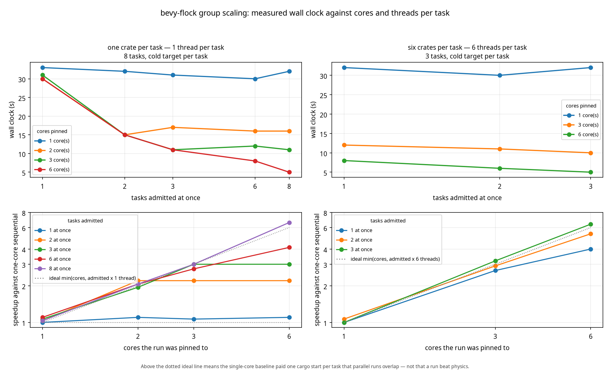
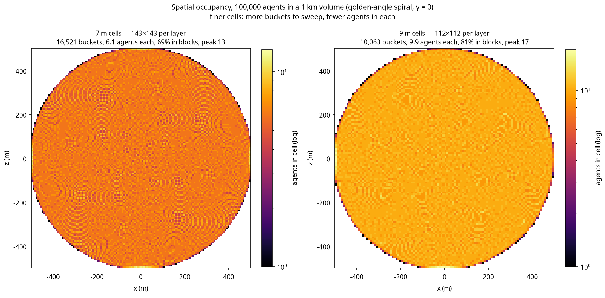

# Performance

Measured, not estimated. Every number here comes from a criterion bench under
`benches/`, on the machine and settings below, and the designs that lost are
documented alongside the one that won, because a table of "we are fast" is worth
less than a record of what was tried and rejected.

## Reproducing these numbers

Every number in this document was produced on the machine below, from the commit named
beside it, with the dependency graph the committed `Cargo.lock` pins. Three things are
deliberately fixed, because each of them moves a timing by more than the differences this
document argues about:

| What | Where it is pinned | Why it matters |
| --- | --- | --- |
| Toolchain | `rust-toolchain.toml` (`1.97.1`, the Bevy 0.20 MSRV) | These numbers were produced with it; a different compiler is a different measurement, not a reproduction |
| Dependencies | `Cargo.lock` and `compat/Cargo.lock`, both committed | Bevy, `wide` and `criterion` versions change the kernel and the harness |
| Build profile | `[profile.bench]` (`debug = true`, otherwise release defaults) | Benchmarks need symbols for the profiler; optimisation stays release |

Every CI job that builds or tests runs `--locked` (`clippy`, `test`, `features`, `msrv`,
`docs`, `determinism`, `bench-smoke`, `compat`), and a `lockfile` job fails if either file has
gone stale — so a dependency bump has to be a commit rather than a silent resolution.
Reproduce a row exactly with:

```sh
cargo bench --locked --bench crowd -- flock_frame/10000 --warm-up-time 0.5 --measurement-time 3
cargo bench --locked --bench band  --features simd -- band_frame/1000000_total_5000_manifested
cargo bench --locked --bench tiers -- tier_frame/reflex/10000
cargo bench --locked --bench packed --features simd -- packed_steer/steer_integrate_advance/50000
```

Raw criterion output lands in `target/criterion`, with an HTML report under
`target/criterion/report/index.html`. Drop the filter to run a whole suite and get the table
rather than one row.

### The machine

| | |
| --- | --- |
| CPU | ARM64, Neoverse-N1, 6 vCPU (shared cloud sandbox) |
| Memory | 9 GB |
| Kernel | Linux 6.8 (container) |
| Toolchain | Rust 1.97.1, `--release` with debug symbols (`[profile.bench]`) |
| Criterion | 10–20 samples, 0.5–1 s warm-up, 3 s measurement unless a bench overrides it |
| Renderer | none — headless `App::new()`, simulation only |

Two things to know about that host. It is **shared**, so a neighbour's load shows up as a few
percent of jitter; and its vCPU count has varied between sandboxes (6 here, 8 on the host the
earlier tables were taken on), which barely matters because every path measured here is
**single-threaded** — Bevy's schedule is one thread and the kernels are scalar loops or four
lane `wide` vectors, not rayon. What does change with the host is the absolute number, not the
shape of the curve or the ranking of designs.

### What still varies, and by how much

- **Run to run, same binary, same machine:** 1–4%. Criterion's confidence interval covers it;
  treat the middle value as the number and the interval as the noise floor.
- **A different machine:** not characterised here, and not worth characterising — an
  absolute time is a property of a host, not of this library. This document therefore argues
  in **ratios** (dense grid versus sorted array, scalar versus four-lane), and states the
  number that shipped so you can re-measure it on yours rather than adopt it.
- **First run after a rebuild:** slower and noisy while the page cache and CPU governor settle.
  Discard it; criterion's warm-up exists for exactly this.

### A cross-check, on the record

Re-measured during the reproducibility pass (2026-11-04, `flock_frame/10000`, locked
dependencies, 6 vCPU host): **18.75 ms**, against the 18.2 ms committed below — 3% inside the
quoted interval, which is the intended relationship between this section and the tables. The
1,000,000-inhabitant band frame re-measured at 3.80 ms against the 3.78 ms recorded for ADR
0021, for the same reason.

## Final numbers

| Benchmark | Time | Per agent |
| --- | --- | --- |
| `flock_frame/1` | 1.01 ms | — |
| `flock_frame/1000` | 1.74 ms | 1.7 µs |
| `flock_frame/10000` | **4.27 ms** | 0.43 µs |
| `flock_frame_large/100000` | **29.2 ms** | 0.29 µs |
| `spatial_query/radius_8m/1000` | 138 ns | — |
| `spatial_query/radius_8m/10000` | 185 ns | — |
| `spatial_query/radius_8m/100000` | 552 ns | — |
| `steering_step/32_neighbours` | 152 ns | — |

Four things to read from that table:

- **Per-agent cost is flat, and it halved twice.** 1.7 µs at a thousand agents, 0.43 µs at ten
  thousand and 0.29 µs at a hundred thousand: the index makes each agent's work local, the kernel
  walks neighbours once instead of three times (ADR 0026), and the frame now uses every core
  (ADR 0044).
- **10,000 agents fit a 60 Hz frame three times over.** 4.27 ms against the 16.6 ms budget is
  234 fps, and 3.9× of margin. The same crowd cost 18.2 ms before the kernel was rewritten (the
  frame was 92% steering, at 1.79 µs per agent); the 3D kernel in ADR 0028 added 19% back on top of
  the 7.71 ms planar figure, which is the honest price of the third dimension and is visible here
  rather than buried.
- **The fixed cost is the grid, not the crowd.** 1.01 ms of `flock_frame/1` is
  `rebuild_spatial_grid` at the default 1 km volume; the other 3.3 ms of the 10,000 row is
  everything that scales with agents. That fixed millisecond is now a quarter of the 10,000-agent
  frame and is the next thing worth attacking, not the steering kernel. A playable area of 200 m across drops the fixed part to
  ~20 µs.
- **Query cost tracks density, not population.** 138 ns at 1,000 agents and 552 ns at 100,000:
  the index walks the same 27 cells, and the cells are fuller. Those numbers are unchanged by
  ADR 0026 because the grid is unchanged — the crowd kernel bypasses `SpatialGrid::radius`
  rather than changing it.

The 1.00 ms at N=1 is the grid rebuild's fixed cost at the default 1 km volume
(405,000 cells after coarsening). It is the price of dense cells, which the query
numbers above justify. If your playable area is 200 m across, set the volume to
match and the fixed cost drops to ~20 µs.

## The design that lost: 15.6 million cells

The first index was a textbook dense grid sized from the configured volume: a
1 km cube with 4 m cells is 15.6 million cells. It allocated 60 MB and walked a
15.6 million entry prefix sum **every tick**, whatever the population.

| | |
| --- | --- |
| `flock_frame/1` | **37.6 ms** |
| `flock_frame/1000` | 39.3 ms |
| `flock_frame/10000` | 54.4 ms |
| `flock_frame_large/100000` | 224 ms |

A crowd of one cost 37 ms, i.e. 68% of a 10,000-agent frame was spent maintaining
cells nobody stood in. The library's own test suite took 100 s for the same
reason: 136 tests each rebuilt 15.6 million cells.

## The design that also lost: no cells at all

If per-cell storage is the problem, remove it: sort agents by cell id into one
flat array and binary-search the cell's window on demand. Memory becomes `O(n)`,
build `O(n log n)`, and a crowd of one costs 4.6 µs.

| | |
| --- | --- |
| `flock_frame/1` | **4.6 µs** |
| `flock_frame/1000` | 5.41 ms |
| `flock_frame/10000` | 78.3 ms |
| `flock_frame_large/100000` | 953 ms |
| `spatial_query/radius_8m/10000` | 4.24 µs |

It wins by 8000× at one agent and loses by 4× at a hundred thousand. The reason is
the query shape: an 8 m radius with 4 m cells touches 125 cells, and two binary
searches per cell (~26 steps each) is 3000 comparisons where a dense grid needs
125 array indices. Queries are the hot path, so the dense grid wins.

## The design that shipped

Dense cells, with a **budget of 2^20 cells** and automatic coarsening when a
volume would exceed it. The default 1 km volume coarsens from 4 m to 13.5 m cells
(405,000 cells, 1.6 MB) and rebuilds in about a millisecond.

The budget itself was tuned by measurement. These are the numbers the tuning was done on, with
the per-agent steering loop as it stood then: ADR 0026 has since cut the steering half of every
row by roughly two thirds, which changes the absolute times here and not the ordering that the
choice rests on.

| Cell budget | 1 NPC | 1,000 | 10,000 | 100,000 |
| --- | --- | --- | --- | --- |
| 2^20 | 1.00 ms | 2.47 ms | **18.2 ms** | **192 ms** |
| 2^18 | 0.30 ms | 2.11 ms | 23.1 ms | 276 ms |

2^18 is three times better for a crowd of one and 27% worse at the population this
crate targets, so the budget is 2^20 and the documentation tells you to size your
volume to your playable area.

## Cognition

`benches/brain.rs` measures what a think costs. The unit is a **virtual
nanosecond** (ADR 0009): an integer the logic declares, calibrated once in CI and
then treated as simulation state, because a budget measured against a real clock
dispatches different NPCs on a faster machine.

One tick of a built-in leaf, median of a criterion run on the reference machine:

| Leaf | Measured | Declared | Leaf | Measured | Declared |
| --- | --- | --- | --- | --- | --- |
| `idle` | 1.61 ns | 2 vns | `trade` | 8.56 ns | 9 vns |
| `watch` | 1.61 ns | 2 vns | `browse` | 7.15 ns | 7 vns |
| `is-alarmed` | 2.03 ns | 2 vns | `chatter` | 7.50 ns | 8 vns |
| `is-tired` | 2.02 ns | 2 vns | `flee` | 7.36 ns | 7 vns |
| `wander` | 7.27 ns | 7 vns | `rest` | 7.00 ns | 7 vns |
| `travel` | 7.52 ns | 8 vns | `eat` | 7.07 ns | 7 vns |
| `patrol` | 7.18 ns | 7 vns | `serve` | 7.87 ns | 8 vns |

A predicate costs about two nanoseconds and a countdown about seven, which is why
the declared table is small integers rather than round hundreds.

A whole think, including the walk over node indices:

| Tree | Measured | Declared |
| --- | --- | --- |
| `guard` | 45.4 ns | 27 vns |
| `merchant` | 47.3 ns | 46 vns |
| `urchin` | 31.3 ns | 36 vns |
| `noble` | 32.9 ns | 35 vns |
| `wanderer` | 44.6 ns | 35 vns |
| ten thousand guards, one think each | 449 µs | — |

The declared cost is the sum of the leaves a tree can reach; the measured cost
also contains the traversal, roughly two nanoseconds per visited node. Neither is
wrong — they answer different questions. The declaration is what the scheduler
charges; the measurement is what the CPU pays. The calibration gate therefore
compares **leaf against leaf**, where the two are directly comparable, and reports
tree-level numbers without failing on them, because otherwise every change to tree
shape would look like a calibration failure.

Ten thousand guards thinking costs 449 µs, 2.7% of a 16.6 ms frame. That is the
headroom the think scheduler exists to spend deliberately: at 60 Hz this crowd
could think every frame and still leave the frame 97% for everything else.

## Memory

`benches/memory.rs` measures what remembering costs, over 16,384 enrolled NPCs
with four subjects — a busy district rather than a city.

| Operation | 16,384 NPCs | Per NPC |
| --- | --- | --- |
| `remember` (one encounter each) | 125.6 µs | 7.7 ns |
| `recall` | 90.1 µs | 5.5 ns |
| `recall_decayed` | 139.9 µs | 8.5 ns |
| `sweep`, nothing faded | 113.7 µs | 6.9 ns |
| `sweep`, everything reclaimed | 288.4 µs | 17.6 ns |

Sixteen thousand NPCs remembering eight subjects each is 2 MB, allocated once.

Reading a memory inside a think costs 8.5 ns against a guard think of 45 ns, so
memory is about a fifth of a think at the only population where it is asked for.

**Sweeping is not a frame operation.** 288 µs is 1.7% of a 16.6 ms frame spent on
housekeeping, which is too much to pay every frame for work whose answer changes
slowly. Sweep on a cadence measured in seconds.

The benchmark found a real bug before the design was settled: the first version
guarded against double release with `free.contains(&index)`, which made sweeping a
full store quadratic — 24.7 ms for 16k rows. `Option::take` already prevents a
double push, so the guard was both wrong and expensive. 24.7 ms became 288 µs.

## Save format

`benches/saves.rs` measures both formats over 50,000 active NPCs with two
relationships each: about 2.15 MB, which is the size at which a save stops being
instant.

| | v1 | v2 | delta |
| --- | --- | --- | --- |
| bytes | 2,150,032 | 2,150,172 | +140 (+0.007%) |
| encode | 8.27 ms | 8.67 ms | +0.40 ms |
| decode | 11.50 ms | 11.93 ms | +0.43 ms |

The section container is close to free. What was not free was the first checksum
strategy: hashing the whole file in the trailer *in addition* to each section cost
6.7 ms of a 14.9 ms encode, because it hashed two megabytes twice. The trailer now
covers the header and table only, and encode landed within half a millisecond of
version 1.

At one NPC the container's fixed cost shows: 57 bytes becomes 197, because a table
and a registry are not free at small sizes either. A save with one relationship in
it is not the case this format optimises for.


## Profiling the 1,000,000-inhabitant frame (2026-11-04)

Captured with `cargo flamegraph` against `examples/profile_band.rs`, which builds the ADR 0021
layout — 5,000 near agents at 60 Hz, 15,000 mid agents at 20 Hz, 980,000 as density — and runs
frames without criterion's timing in the way. Artefact:
[`docs/images/band-1m-flamegraph.svg`](images/band-1m-flamegraph.svg).

```sh
cargo flamegraph --profile profiling --example profile_band --output docs/images/band-1m-flamegraph.svg -- 2000
```

### What the profile said

| Symbol | Self | Children | Reading |
| --- | --- | --- | --- |
| `application::packed::Pack::steer` | 82.2% | 90.2% | the kernel is the frame |
| `libm.so.6` | 10.6% | — | `hypotf`, `fmod` from clamp and wrap |
| `band_steer` | 1.2% | 68.5% | copy in/out is noise next to the steery |
| `band_steer_mid` | 1.0% | 28.2% | consistent with a 3-frame cadence |

Two things were worth fixing, and both were in the *cheap* half of the arithmetic rather
than the neighbour scan:

1. **`clamp()` took a square root every time it was called** — four times per agent per tick,
   for cohesion, alignment, separation and the final limit — and in the common case the
   vector is already under the limit, so the root was pure waste. It now compares squared
   lengths and only divides when something actually exceeds its cap. `hypotf` leaves the
   profile.
2. **`advance()` used `f32::rem_euclid`**, which lowers to `fmod`, per axis per agent per
   tick. A steady-state position is either in range or one extent out of it, so a branch plus
   a subtraction replaces the libm call; the general path remains for a caller passing a
   wild `dt`.

### What it bought

| Measurement | Before | After |
| --- | --- | --- |
| 1,000,000 band frame | 5.02 ms | **4.75 ms** |
| packed steer, 5,000 agents | 1.50 ms | **1.31 ms** |
| packed steer, 1,000 agents | 0.249 ms | **0.238 ms** |

A 5.4% frame and a 12.5% kernel improvement, from removing transcendentals rather than from
touching the loop structure.

### What it did not buy

A restructured inner loop — destructuring the pack into separate slices so the compiler can
see that reading positions and writing desired touch different fields — was written, measured
at **5.70 ms**, and reverted. The closure form in `Pack::steer` keeps the neighbour walk in a
single function and the optimiser hoists the base pointers itself; the "obvious" borrow-split
version was 20% slower. That experiment is worth recording precisely because it is the change
that looks right on paper.

### What remains

`Pack::steer` is now 93% of the frame in self time, so the remaining work is the neighbour
scan itself: nine buckets, a linked-list walk per bucket, and roughly fifteen to twenty
neighbours per agent at the band's density. The options, in order of expected value:

1. **Process four agents at a time** with explicit `f32x4` arithmetic — the accumulation is
   independent per agent, so it vectorises without changing the algorithm.
2. **Store neighbours as a CSR range** instead of a linked list, trading a counting pass for
   sequential memory.
3. **Lower the band's density target** — the frame is neighbour-bound, and `density` is the
   parameter that decides how many neighbours an agent has. ADR 0020 made that a first-class
   knob for exactly this reason.


## Threads, not just lanes (2026-11-05)

Every optimisation before this one traded lanes: four agents at a time through `wide::f32x4`. That
road is finished and measured. What none of it used was the other five cores, and a profile of the
100,000-agent frame put 84% of samples inside `Crowd::steer` — a pure map over agents — running on
one thread.

ADR 0044 cuts a frame into contiguous slices of agents and hands them to the ECS compute pool. All
four roads produce bit-identical output; only where the loop runs changes. Same host, same
`--locked` build, 20 samples:

| Road | 10,000 agents | 100,000 agents |
| --- | --- | --- |
| `wide` (the previous default) | 8.48 ms | 84.0 ms |
| `scalar` (one thread, reference) | 9.73 ms | 93.0 ms |
| `threads` (six threads, reference) | 4.31 ms | 30.0 ms |
| `auto` (what ships) | **4.23 ms** | **29.6 ms** |

The frame-level result, measured on the standard benchmarks either side of the change: 9.18 ms to
4.27 ms at 10,000 agents (−48%) and 90.0 ms to 29.2 ms at 100,000 (−62%).

Two things the numbers say that are easy to get wrong. The gain is 2.0× on six threads, not 6×: the
scan is memory-bound, and the neighbour arrays are read by every slice. And a crowd below 1,024
agents stays on the wide road, which is why `flock_frame/1000` did not move at all.

The wide road is still single-threaded, and the two wins are additive in principle — four lanes
across six threads. They are not combined yet, because a block writes four non-contiguous agent
slots and splitting those writes needs either a slot-indexed output buffer or cached per-thread
scratch. ADR 0044 records the plan and the honest expectation: 2–3× on top, not 6×, for the same
bandwidth reason.

## Reciprocal avoidance, on and off (2026-11-05)

`cargo bench --bench crowd -- crowd_avoidance`, `--release`, default features (`simd` and
`threads`), ten samples, Criterion's own warm-up. The crowd is the spawn spiral in three
dimensions at 1.6 m spacing, which is denser than a real square and therefore a pessimistic
measurement of the neighbour count.

| Population | `steer_only` | `steer_and_avoid` | Avoidance alone |
| ---------: | -----------: | ----------------: | --------------: |
|     10,000 |     2.25 ms  |          3.27 ms  |       +1.01 ms  |
|    100,000 |    25.74 ms  |         38.08 ms  |      +12.34 ms  |

The first implementation was scalar and cost 3.96 ms at 10,000; moving it onto the same
`SteeringRoad` the kernel uses (read the pre-pass snapshot, write disjoint slots) took it to
1.01 ms, a 3.9x improvement, and the parallel and scalar passes are held to bit equality by
`a_parallel_avoidance_pass_matches_the_scalar_one`.

What this means in practice: avoidance costs about 45% of a steering frame at both sizes, because
both are neighbour-pair bound and the density is the same. A game that tiers its crowd pays it on
the steered agents only; ambient agents are avoided but do not avoid (ADR 0045).

## Four-agent SIMD steering (2026-11-04)

ADR 0023. After the profiling pass the kernel was 93% of the frame in self time, so the next
move was the neighbour scan itself: four agents behind one bucket walk, with `wide::f32x4` as
the vector type.

The enabling detail is not the vector width, it is the **order**. Blocks are taken from a
cell-major index built as a by-product of the grid, so the four agents in a block are
neighbours on the map and not merely neighbours in memory.

| Workload | Scalar | `--features simd` | Change |
| --- | --- | --- | --- |
| 1,000,000 band frame | 4.75 ms | **3.78 ms** | −20.4% |
| packed steer, 50,000 | 138 ms | **56.5 ms** | −59% |
| packed steer, 5,000 | 1.31 ms | **1.20 ms** | −8.4% |
| packed steer, 1,000 | 0.238 ms | **0.223 ms** | −6.3% |

Enable it with `bevy-flock = { version = "0.1", features = ["simd"] }`. The default build
stays dependency-free, and the scalar kernel remains in the crate as the reference the wide
path is tested against bit for bit.

Three earlier attempts at the same idea were slower and are recorded in the ADR: blocking in
index order (1.40 ms at 5,000), blocking in cell order without the same-cell fast path
(1.36 ms), and computing the pair count per candidate instead of from the lane totals.

## Memory, not just time

Wall-clock numbers say nothing about *why*, and for this kernel the why turned out to be the
cache. `docs/memory.md` has the profile: the wide path executes 10% fewer instructions and
issues 11% **more** memory operations, while D1 misses fall 76% and last-level misses 86%. The
ordering is the optimisation; the vector width is a multiplier.

The milestone sign-off, including the open churn finding, is in
[`release-checklist.md`](release-checklist.md).

## Group scaling: cores against threads per task (2026-11-05)

ADR 0033 caps a group at `nproc / threads_per_task`. That rule was measured on one machine at one
core count, so the sweep is repeated with the process pinned to 1, 2, 3, 4, 6 cores and every task
given a cold target directory. Two shapes, because the difference is the point: a task that is one
crate's codegen (one thread) and a task that is 6 crates built in parallel (6 threads, the shape a
workspace `cargo build` has). Each cell is the median of 2 runs; the largest spread between repeats
was 8.8%.



Shape A on 6 cores (8 one-crate tasks):

| admitted at once | wall | speedup |
| --- | --- | --- |
| 1 | 15.8 s | 1.0x |
| 2 | 8.5 s | 1.9x |
| 3 | 6.2 s | 2.6x |
| 4 | 4.1 s | 3.8x |
| 6 | 4.1 s | 3.8x |
| 8 | 3.0 s | 5.2x |

Shape B on 6 cores (3 bundles of 6 crates):

| admitted at once | wall | speedup |
| --- | --- | --- |
| 1 | 6.5 s | 1.0x |
| 2 | 6.4 s | 1.0x |
| 3 | 6.3 s | 1.0x |

What the curves show, and what they cost ADR 0033:

- **The formula is a floor with headroom, not an optimum.** It says 6 for one-thread tasks on
  6 cores; measured, that gives 4.1 s and admitting 8 gives
  3.0 s (5.2x), because cargo's resolve/read/spawn phase
  overlaps across tasks. On two cores the ordering is
  reversed
  (1.88x at two at once, 1.79x at three), so this is bursty work rather
  than a licence to oversubscribe.
- **Threads per task dominates the curve.** On 6 cores a six-thread bundle alone reaches
  1.0x; 3 together reach 1.0x. Capping that shape at one task
  would leave much of the machine idle, which is why the policy measures threads instead of counting
  tasks.
- **Concurrency past a task's own thread count buys nothing.** A six-thread bundle on three cores
  takes 12.7 s admitted alone and 12.6 s with
  3; it is already queueing for cores internally.

The suite that guards these numbers is ADR 0034: `scripts/scaling_regression.py` compares a fresh
sweep against `docs/data/scaling-sweep.json` on speedup ratios, so a slower CI runner is not a
regression, and fails when a cell loses more than 25% of its speedup (widened to twice the measured
spread; 12% to warn). The generated review —
matrices, efficiency, the measured optimum against the formula — is
[`docs/reports/scaling-report.md`](reports/scaling-report.md).

Reproduce with `scripts/scaling_sweep.sh docs/data/scaling-sweep.json` (eighteen minutes on six
cores, measured; every run pinned with `taskset`, two repeats per cell) then `python3
scripts/scaling_curves.py docs/data/scaling-sweep.json docs/images/scaling-curves.png`. CI runs the
reduced matrix on every push; the full one is a local or nightly job.

### Verification run, 2026-11-05

The regression gate was run end to end on this six-core machine: 45 cells, **18 m 21 s** of wall clock, two
repeats per cell and four on each sequential denominator. Thirty-five cells are comparable (shape B has
only three bundles, so concurrency above three is not swept), and all thirty-five held — median **−0.4%**
on shape A and **−0.9%** on shape B, worst cell **−3.7%** (B, two cores, three bundles at once) against a
13.2% warning line and a 25% failure line.

Two cells were re-measured in isolation because their first readings were ragged:

| cell | first reading | re-measured (4 repeats) | baseline |
|---|---|---|---|
| A, 1 core, sequential | 17.73 s, 18.1% spread | **15.78 s, 2.0%** | 15.88 s, 0.0% |
| A, 4 cores, concurrency 4 | 5.22 s, 41.1% spread | **4.09 s, 1.1%** | 4.20 s, 1.5% |

The one-core outlier mattered more than its own row: it is the denominator of every one-core speedup, so
two ragged repeats turned five rows into apparent gains of 9–12%. That is the flattering direction — a
genuine regression could hide behind an inflated denominator — which is why the gate now marks blinded
cells `unverified` and folds the sequential cell's spread into the rows that divide by it (ADR 0034).

## What the numbers do not cover

- **Rendering.** There is no renderer; the frame time above is simulation only.
  Instanced rendering of 10,000 NPCs will cost more than the simulation does.
- **The think scheduler.** Cognition is measured, not yet scheduled: every guard in
  the benchmark thinks on every iteration. The virtual-cost scheduler that decides
  *who* thinks is a later task, and its overhead is not in these numbers.
- **Game-registered leaves.** Only the built-in catalogue is measured. A leaf that
  reads a component or queries the world will cost more than these counters, which
  is exactly why the calibration gate fails on drift instead of trusting the
  table.
- **wasm.** No wasm numbers yet; the determinism guarantees cover it, the
  performance does not.
- **Threads.** Everything measured is single-threaded. The determinism policy
  (ADR 0002) constrains what can be parallelised and how.

## Think scheduling

`benches/think.rs`, and the table `application::schedule` asserts in its own tests. A
16.6 ms **virtual** budget — simulated cost, never a clock — with the cost mix measured
in `benches/brain.rs`:

| Participants | Thinks per tick | Served per tick | Worst wait | Planner wall time |
| --- | --- | --- | --- | --- |
| 1 | 1 | 100% | 1 tick | — |
| 1,000 | 1,000 | 100% | 1 tick | 0.12 ms |
| 10,000 | 8,872 | 88.7% | 3 ticks | 1.34 ms |
| 100,000 | 12,124 | 12.1% | 45 ticks | 1.83 ms |

Two readings matter more than the headline.

**Ten thousand NPCs do not all think every tick at this cost mix.** The budget serves
88.7% and the rest wait at most three ticks — a twentieth of a second for a crowd the
player cannot pick out of a line. A per-archetype fudge factor would have hidden that
trade instead of pricing it.

**Deciding is not free.** The planner costs ~150 ns per selected participant, 1.83 ms
at 100,000. A game at that scale should budget 12–14 ms of virtual cost and spend the
rest of the frame on the thinks themselves, since the planner's wall time is paid
whatever the thinks then cost.

## Cognition through the ECS

The tables above price the planner. This one prices a frame: a real `App`, the real
`FlockPlugin`, real brains, real systems (`benches/think.rs`, `ecs_think`). The baseline
is the same world with no brains at all, so the difference is what thinking costs.

| Brains | Frame, no brains | Frame, with brains | Delta | Per brain |
| --- | --- | --- | --- | --- |
| 1,000 | 4.27 ms | 4.42 ms | 0.15 ms | 150 ns |
| 10,000 | 4.28 ms | 5.01 ms | 0.73 ms | 73 ns |

Two things to read carefully, because both are easy to get wrong.

**The delta is not the think.** These brains run a one-node tree at a declared 2 µs cost.
The 73 ns per brain is the *system overhead* — enrolling, reading the cost, planning,
finding the chosen ones — and the tree tick itself is inside the 2 µs budget rather than
inside this measurement. A real archetype tree costs 4–12 µs of virtual budget, which is
what the budget spends and what the frame pays.

**The baseline is the crowd, not the scheduler.** Four milliseconds of the frame is the
plugin spawning and steering its configured population. A game that measures its own
frame will see the same shape: the scheduler is a small line item, and the crowd it
schedules is the large one. That is the correct order of magnitude, and it is why the
budget has to be a budget.

### The comfortable maximum

With a 14 ms virtual budget (`ThinkSchedule::DEFAULT_BUDGET`) and a 2 µs deliberation:

- **7,000 deliberative thinkers per tick** is the ceiling: 14 ms ÷ 2 µs. At or below it,
  every NPC thinks every tick and the wait is one tick.
- **6,000 is comfortable** — the same crowd with 14% headroom for the expensive archetype
  that turns up in a scene and costs 12 µs rather than 2.
- **10,000 fits the frame** (5.01 ms measured) but only ~70% think per tick, and the worst
  NPC waits two ticks. Fine for background, visible on a conversation.
- **100,000 fits the frame** (12% per tick, 45-tick worst wait) and is only acceptable
  when the tiering in ADR 0017 lands, because then 95% of them are reflex agents at a
  hundredth of the cost.

## Tiered cognition

`benches/tiers.rs`, 10,000 NPCs, 14 ms budget, against a 4.23 ms baseline frame with the
same crowd and no brains:

| Composition | Frame | Delta | Who thought |
| --- | --- | --- | --- |
| All reflex (200 ns) | 6.40 ms | 2.17 ms | all 10,000, every tick |
| All reactive (2 µs) | 4.85 ms | 0.62 ms | ~1,750 per tick |
| All deliberative (8 µs) | 4.77 ms | 0.54 ms | ~262 per tick |
| All social (30 µs) | 4.68 ms | 0.45 ms | ~23 per tick |
| 95/4/1 mix | 6.42 ms | 2.19 ms | ~9,700 / 175 / 13 |

The expensive tiers are the cheap frames, because their reserved shares buy so few of them.
Frame cost is bounded by the budget; the tier decides who is served and how long they wait.
Reflex is the only composition where everybody thinks every tick, and it is the only one
that costs 2 ms.

**So the reflex ceiling is ~64,000 per tick at 14 ms**, measured at ~217 ns per reflex think
end to end in the ECS — not the ~93,000 that dividing the budget by the declared 150 ns
would suggest. The difference is query traversal, blackboard access and change detection,
which no declared cost includes.

## The comfortable maximum, restated

| Tier | Measured per-think | Comfortable per tick (14 ms) |
| --- | --- | --- |
| Reflex | 217 ns | 64,000 |
| Reactive | ~350 ns (delta/1,750) | 40,000 |
| Deliberative | ~2 µs | 7,000 |
| Social | ~20 µs | 700 |

Read the last column with the reservation in mind: a tier's share is not its capacity. The
deliberative tier could *fit* 7,000, and its 15% share only pays for 262.

## At 64,000 and 100,000 (full suite, 2026-11-04)

Frame times in ms; baseline is the same world with no brains.

| Population | Baseline | Reflex | Reactive | Deliberative | Social | 95/4/1 mix |
| --- | --- | --- | --- | --- | --- | --- |
| 1,000 | 4.26 | 4.38 | 4.38 | 4.27 | 4.24 | 4.42 |
| 10,000 | 4.18 | 6.37 | 4.87 | 4.75 | — | 6.42 |
| 64,000 | 4.19 | 11.44 | 7.93 | 7.68 | 7.55 | 11.99 |
| 100,000 | 4.22 | 14.01 | 9.74 | 9.52 | 9.03 | 14.67 |

Two facts worth carrying away:

- **Per-think cost is not a constant.** The rows imply 219 ns at 10,000 and 113 ns at
  64,000. Quote frame times, not nanoseconds.
- **Cognition is not the wall at 100,000.** The crowd benchmark with 100,000 NPCs and no
  brains runs at **198 ms per frame**: steering and spatial partitioning cost fourteen
  times what thinking does. ADR 0018's ambient continuum exists for that number, not for
  the scheduler's.

### The transposed SIMD kernel (ADR 0030)

Behind `--features simd`, the crowd kernel blocks four agents of a cell and broadcasts each
neighbour into all four lanes. 10,000 agents, kernel only, medians:

| Crowd | Scalar | Transposed | Delta |
| --- | --- | --- | --- |
| planar | 7.36 ms | 5.78 ms | −22% |
| volumetric | 6.12 ms | 4.85 ms | −29%…−21% |
| dense (30 m disc) | 114.9 ms | 81.8 ms | −29% |

Off by default: it adds a per-frame SoA copy that a sparse crowd does not need, and the gain is
largest where the kernel is most expensive. Reproduce with
`cargo bench --bench crowd --features simd -- crowd_kernel`.

### Cell sizing and lane occupancy (ADR 0031)

The transposed kernel wants **6-10 agents per occupied cell**, which in a one-kilometre volume is a
7-9 m cell. Four per bucket is the minimum for a block, not the optimum: at 3 agents a bucket, half
the agents take the scalar tail and the road still wins 27%, but at 48 a bucket both roads lose to
the work per agent.

100,000 agents, kernel only, one pass:

| cell (m) | agents/bucket | in blocks | scalar | transposed |
| --- | --- | --- | --- | --- |
| 5.0 | 3.2 | 50% | 84.35 ms | 60.49 ms |
| 7.0 | 6.1 | 70% | 75.88 ms | 52.59 ms |
| 9.0 | 10.0 | 82% | 74.97 ms | 52.63 ms |
| 13.5 (default) | 22.2 | 93% | 79.38 ms | 64.21 ms |
| 20.0 | 48.2 | 97% | 96.59 ms | 95.53 ms |

The default grid sizes cells for queries (ADR 0003), which lands on 13.5 m: 19% better than scalar,
8-20% short of the 9 m optimum. Sweep your own density with `cargo run --release --example grid_sweep`.
End to end at 100,000 agents with the default grid the frame is 79.07 ms with the transposed road,
against 90.0 ms measured for the scalar road.

### The ECS path against cell size (ADR 0031, closed)

Whole-frame time at steady state, budget raised per case so the cell size survives:

| population | 13.5 m / 405k cells | 9 m / 1.4M cells | 7 m / 2.9M cells |
| --- | --- | --- | --- |
| 10,000 | 7.29 ms | 7.29 ms | 7.26 ms |
| 100,000 | 77.0 ms | 77.8 ms | 80.4 ms |

1.4M cells is free; 2.9M costs about 1% at 100,000. The kernel's 8-20% preference for 9 m does not
reach the frame because tiering caps how many agents steer (about 5,000 of 100,000, ADR 0017) and
the grid rebuild is a small share. `MAX_CELLS` therefore stays; `SpatialGridConfig::with_cell_budget`
is the knob for a game that steers more of its crowd.



The re-open trigger is enforced: `cargo bench --bench crowd -- flock_frame_cell` then
`python3 scripts/cell_size_gate.py` (3% warn, 10% fail), which is what CI's `cell-size-gate` job runs.
