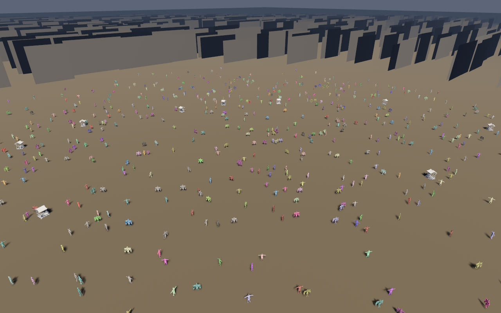

# The Bevy playground: building and running it on Metal

`playground/` draws the Ashfall city and its crowd through Bevy's own PBR pipeline in a window. This
page is the operational half — how to build it, how to run it on a Mac, how to read what it prints,
and what to do when a window opens onto nothing. The crate's own page,
[`playground/README.md`](../../playground/README.md), covers what is simulated there and which parts
have tests.



*The district view, 2,000 bodies, drawn by this crate on `llvmpipe` (Mesa's CPU Vulkan driver) at
1280x800 under Xvfb. It is a correctness capture, not a beauty shot: a real GPU adds anti-aliasing,
shadow filtering and a frame rate worth measuring.*

## Build

The crate is its own package, not a member of the library's workspace, so the path is explicit:

```sh
cargo run --release --manifest-path playground/Cargo.toml -- --view district
```

`--release` is not optional in practice. A debug build of a Bevy renderer is five to twenty times
slower, and the difference is time spent in `wgpu` validation and unoptimised vertex work, which is
exactly what a frame-time measurement would be measuring.

The first build compiles Bevy's crates and takes a while; the second is a rebuild of one crate.

### macOS, Metal specifically

Nothing in the build is platform-specific — `wgpu` picks Metal on macOS — but three things are worth
knowing before the first run:

```sh
# The native backend, and the only one an Apple GPU exposes. A machine with no Metal support
# reports "no adapter" instead of falling back to a software rasteriser.
cargo run --release --manifest-path playground/Cargo.toml -- --backend metal --view district

# Nothing but the command line: no window, no driver, no GPU. Prints the flags and exits.
cargo run --manifest-path playground/Cargo.toml -- --help
```

- **Metal, not `auto`, when you are diagnosing.** `auto` asks for `PRIMARY | SECONDARY`, which on a
  Mac resolves to Metal anyway; saying `--backend metal` turns "the driver picked something I did
  not expect" into a one-line answer. `--backend vulkan` on a Mac fails on purpose; MoltenVK is not
  part of this dependency graph, and a demo that silently renders on a translation layer while
  claiming Metal is worse than one that refuses.
- **A window, so no CI.** `WinitPlugin` needs an event loop and a display server. `--frames N` is
  what makes a run bounded and scriptable: it draws N frames, prints the summary, exits 0.
- **Apple silicon runs this on the GPU the whole time**, so the numbers in the summary line are real
  frame times. Read the median; see below.

## Flags

| Flag | |
|---|---|
| `--view NAME` | `district`, `street`, `hero`, `skyline`, `procession` |
| `--frames N` | draw N frames, print the summary, exit |
| `--capture PATH` | write the last frame to `PATH` as a BMP, then exit |
| `--width N` `--height N` | window size, 1..=16384 a side, default 1280x800 |
| `--backend NAME` | `auto` (default), `metal`, `vulkan`, `gl` |
| `--population N` | NPCs to simulate, default 2000 |
| `--ticks N` | ticks before the first frame, default 600 |
| `--seed N` | layout seed, default 7 |
| `--extent M` | layout half-extent in metres, default 900 |
| `--help` | usage |

## Reading the run

Two lines matter. The first is Bevy's, and names the device:

```text
INFO bevy_render::renderer: AdapterInfo { name: "Apple M3 Pro", device_type: IntegratedGpu, backend: Metal, ... }
```

The second is the crate's, printed when the frame count runs out:

```text
ashfall-playground: 300 frames at 1280x800 — median 4.1 ms (243.9 fps), mean 5.9 ms, p95 7.2 ms
```

The **median** is the number to quote. The mean carries the first frames, which include shader
compilation and pipeline creation — on a cold start that is tens of milliseconds per frame for the
first handful, and it will dominate a short run. The **p95** is the stutter ceiling: a walk through a
crowd is judged by its worst frames, not its best.

`--frames 300` at the size you care about is the smallest run worth reading. Fewer frames and the
distribution is mostly start-up.

## Capturing a frame

```sh
cargo run --release --manifest-path playground/Cargo.toml -- \
    --view district --frames 60 --capture out/district.bmp
```

The capture is taken on the last drawn frame and written a frame or two later, which is why the
runner keeps drawing for twelve frames after asking for it rather than closing the window underneath
the readback. BMP is the format because Bevy's PNG encoder is an optional feature that pulls a
compression crate; this crate enables `bmp`, which needs nothing. Adding PNG is a one-line feature
change in `playground/Cargo.toml`:

```toml
bevy_image = { version = "0.20.1", features = ["bmp", "png"] }
```

Until then `--capture something.png` is refused at the flag, with the reason, rather than writing a
file that is not the format its name claims.

## When the window is empty

This is the failure this crate hit while being built, and the plugin list in `build_app` is the
answer to it. Bevy's umbrella crate adds these for you; naming subcrates directly does not, and the
failure mode is a black or flat-coloured window with no error.

| Symptom | Missing |
|---|---|
| Everything draws, all of it black | `bevy_light::LightPlugin` — no `GlobalAmbientLight`, and `PbrPlugin` panics trying to read it |
| A panic in `VolumetricFogPlugin::build` | `bevy_mesh::MeshPlugin` — no `Assets<Mesh>` before the pipeline exists |
| A perfect scene that draws nothing at all | `bevy_camera::CameraPlugin` — no visibility propagation, so every `ViewVisibility` stays false |
| `Res<ClearColor>` failed validation | nothing inserts it for you; the crate sets it to the fog's colour |
| `TonyMcMapFace tonemapping requires the tonemapping_luts feature` | the camera asks for the default tonemapper; this crate selects `Tonemapping::AcesFitted`, which is a curve in code |
| `Plugins<_>` is not satisfied | more than sixteen plugins in one `add_plugins` tuple; split it |

The order is Bevy's own: task pool and log, then time/transform/input, then window, assets, image,
camera, mesh, light, render, core pipeline, PBR, and `WinitPlugin` last, alone, because it installs
the event loop and a plugin added after it never sees a frame.

## What was verified, and where

The crate's 29 tests cover the parts that do not need a device: geometry for every shipped model,
the cube and ground meshes and their winding, transform mapping, tint quantisation at its bounds, the
camera's angle/forward round trip and basis, the pitch clamp, view cycling, every flag including the
window-size pair, the frame statistics (median, mean, p95, and the empty run), and the refusal of a
capture format this build cannot encode.

The window itself is not covered, and cannot be: it needs a display and a driver. The capture above
is the closest thing to a test — it was produced by running the real binary on a real Vulkan driver
(`llvmpipe`, Mesa 25.2) under Xvfb, at 1280x800, with 2,000 simulated bodies, and it is committed so
a regression that empties the frame is visible as an image rather than as a discussion. What it does
**not** show: anti-aliasing quality, shadow filtering, or a frame time that means anything. Those are
a Mac's job, and the summary line above is where to read them.

## The skinned district: the same crowd, with skeletons

`playground`'s main binary draws boxes for bodies. The `skinned` binary draws the same crowd as
five-joint rigs with skinned meshes and a seven-clip blend tree, so the animation is Bevy's skinning
path rather than geometry moved by hand.

```sh
cargo run --release --manifest-path playground/Cargo.toml --bin skinned -- --npc 2000
```

| Flag | |
|---|---|
| `--npc N` | bodies, default 2000 |
| `--radius M` | plaza radius, metres, default 34 |
| `--frames N` | draw N frames and exit |
| `--capture PATH` | write the last frame as a BMP |
| `--width N` `--height N` | default 1280x800 |
| `--backend NAME` | `auto`, `metal`, `vulkan`, `gl` |
| `--assert-motion` | non-zero exit unless the crowd provably animated |

Verify it without a display, and without trusting your eyes:

```sh
cd playground
cargo build --bin skinned
xvfb-run -a ./target/debug/skinned --frames 200 --npc 2000 --assert-motion
# skinned: 213 frames — 2000 moved, 1958 blended, 21 gesturing, 667 looking, biggest step 2.612 m
```

The four numbers are the gate: something moved, something blended walk or run above half weight,
a gesture cue reached a clip, and someone aimed their gaze. Drop `--assert-motion` and those numbers
are printed but do not fail the run.

### Four Bevy 0.20 traps this example exists to document

- **Magenta frames.** `Tonemapping::TonyMcMapface` needs the `tonemapping_luts` feature. Without it
  Bevy logs one line and renders the entire frame magenta, which reads as a broken material for as
  long as it takes to notice the log. This example uses `Tonemapping::None`.
- **Skinned scenery.** A mesh carrying `JOINTS_0` and `JOINT_WEIGHT` is drawn with the skinned
  pipeline. Give such a mesh to an entity without `SkinnedMesh` and wgpu fails validation on the
  first frame and quits the app. Scenery meshes therefore carry no skin attributes at all.
- **Ambient light.** `GlobalAmbientLight` is read while `PbrPlugin` builds, so inserting it after
  `add_plugins` sets a resource the shader never sees. Insert it first.
- **Windings.** A box face listed clockwise against an outward normal renders black, not wrong. The
  `every_triangle_faces_its_normal` test compares each triangle's geometric normal with the stored
  one, which is the cheapest way to keep a corner table and a normal table honest.
