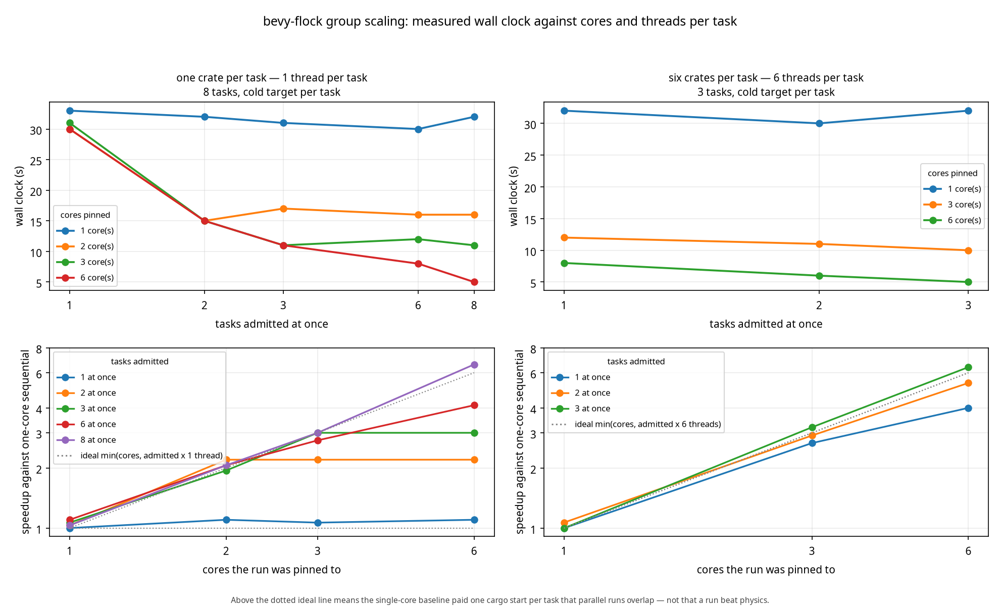

# Scaling report: cores, threads per task, and what the crawl fills

Generated 2026-11-05T13:00:12+00:00 from `docs/data/scaling-sweep.json`, recorded 2026-11-05T09:52:25+00:00 on 6 cores (aarch64, `Linux-6.18.38+-aarch64-with-glibc2.39`).

Every number here is measured: each run is pinned with `taskset`, each task gets a cold target directory, and each cell is the median of 2 runs. Nothing is modelled. The fixture is 8 crates of 1500 functions for shape A, and 3 bundles of 6 crates for shape B.



Two quantities are used throughout. **Speedup** is the same core count's sequential wall clock divided by the wall clock at that concurrency: dimensionless, so it compares across machines. **Efficiency** is that speedup divided by `min(cores, concurrency x threads per task)`: the fraction of the ideal the run actually delivered. Above 100% is possible and is explained where it happens.

## Tolerances this report is judged by

ADR 0034 commits to a **warning at 12%** and a **failure at 25%** of lost speedup, each widened by the measured spread (1.5x for a warning, 2.0x for a failure). The widest spread on this baseline is 8.8%, so the gate applies **13.2%** and **25.0%**.

In wall clock, which is what a developer feels: the CI's 4-at-once cell on 6 cores runs in 4.1 s today, warns above 4.8 s and fails above 5.5 s. The second tolerance this suite owes is the CI budget itself: the job carries a 15-minute timeout against a measured three minutes on a six-core machine.

Runtime frame budgets (16.6 ms at 10,000 agents, 8 ms at 100,000 with 5,000 manifested, 6 ms at 1,000,000) are enforced by the criterion benches and `docs/release-checklist.md`, not here: this suite grades parallelism, not absolute speed.

## Shape A: one crate per task (1 thread per task), 8 tasks

Wall clock:

| cores | 1 at once | 2 at once | 3 at once | 4 at once | 6 at once | 8 at once |
| ----- | --------- | --------- | --------- | --------- | --------- | --------- |
| 1     | 15.9 s    | 16.0 s    | 16.1 s    | 16.1 s    | 16.1 s    | 16.0 s    |
| 2     | 15.6 s    | 8.3 s     | 8.7 s     | 8.3 s     | 8.9 s     | 8.4 s     |
| 3     | 15.5 s    | 8.1 s     | 6.3 s     | 5.9 s     | 6.6 s     | 5.8 s     |
| 4     | 15.7 s    | 8.4 s     | 6.2 s     | 4.2 s     | 5.2 s     | 4.3 s     |
| 6     | 15.8 s    | 8.5 s     | 6.2 s     | 4.1 s     | 4.1 s     | 3.0 s     |

Speedup against that core count's sequential run:

| cores | 1 at once | 2 at once | 3 at once | 4 at once | 6 at once | 8 at once |
| ----- | --------- | --------- | --------- | --------- | --------- | --------- |
| 1     | 1.00x     | 0.99x     | 0.98x     | 0.98x     | 0.99x     | 0.99x     |
| 2     | 1.00x     | 1.88x     | 1.79x     | 1.89x     | 1.76x     | 1.86x     |
| 3     | 1.00x     | 1.90x     | 2.46x     | 2.64x     | 2.36x     | 2.69x     |
| 4     | 1.00x     | 1.86x     | 2.53x     | 3.73x     | 3.01x     | 3.63x     |
| 6     | 1.00x     | 1.86x     | 2.56x     | 3.83x     | 3.81x     | 5.18x     |

Efficiency, as a percentage of `min(cores, concurrency x threads)`:

| cores | 1 at once | 2 at once | 3 at once | 4 at once | 6 at once | 8 at once |
| ----- | --------- | --------- | --------- | --------- | --------- | --------- |
| 1     | 100%      | 99%       | 98%       | 98%       | 99%       | 99%       |
| 2     | 100%      | 94%       | 89%       | 95%       | 88%       | 93%       |
| 3     | 100%      | 95%       | 82%       | 88%       | 79%       | 90%       |
| 4     | 100%      | 93%       | 84%       | 93%       | 75%       | 91%       |
| 6     | 100%      | 93%       | 85%       | 96%       | 63%       | 86%       |

## Shape B: six crates per task (6 threads per task), 3 tasks

Wall clock:

| cores | 1 at once | 2 at once | 3 at once |
| ----- | --------- | --------- | --------- |
| 1     | 36.5 s    | 36.6 s    | 36.5 s    |
| 2     | 19.1 s    | 18.7 s    | 19.0 s    |
| 3     | 12.7 s    | 12.5 s    | 12.6 s    |
| 4     | 9.8 s     | 9.5 s     | 9.6 s     |
| 6     | 6.5 s     | 6.4 s     | 6.3 s     |

Speedup against that core count's sequential run:

| cores | 1 at once | 2 at once | 3 at once |
| ----- | --------- | --------- | --------- |
| 1     | 1.00x     | 1.00x     | 1.00x     |
| 2     | 1.00x     | 1.02x     | 1.01x     |
| 3     | 1.00x     | 1.02x     | 1.01x     |
| 4     | 1.00x     | 1.03x     | 1.02x     |
| 6     | 1.00x     | 1.01x     | 1.03x     |

Efficiency, as a percentage of `min(cores, concurrency x threads)`:

| cores | 1 at once | 2 at once | 3 at once |
| ----- | --------- | --------- | --------- |
| 1     | 100%      | 100%      | 100%      |
| 2     | 50%       | 51%       | 50%       |
| 3     | 33%       | 34%       | 34%       |
| 4     | 25%       | 26%       | 26%       |
| 6     | 17%       | 17%       | 17%       |

## Where the crawl fills, against what the cap formula would choose

| shape | cores | cap formula says | best measured | speedup at best | best ÷ cap |
| ----- | ----- | ---------------- | ------------- | --------------- | ---------- |
| A     | 1     | 1                | 1             | 1.00x           | 1.00x      |
| A     | 2     | 2                | 4             | 1.89x           | 2.00x      |
| A     | 3     | 3                | 8             | 2.69x           | 2.67x      |
| A     | 4     | 4                | 4             | 3.73x           | 1.00x      |
| A     | 6     | 6                | 8             | 5.18x           | 1.33x      |
| B     | 1     | 1                | 3             | 1.00x           | 3.00x      |
| B     | 2     | 1                | 2             | 1.02x           | 2.00x      |
| B     | 3     | 1                | 2             | 1.02x           | 2.00x      |
| B     | 4     | 1                | 2             | 1.03x           | 2.00x      |
| B     | 6     | 1                | 3             | 1.03x           | 3.00x      |

The last column is the honest score for ADR 0033's rule: above 1.0 the formula admits fewer tasks than the machine rewards, below 1.0 it admits more than help.

## Best measured speedup per core count

```
A 1c                        ######                            1.00x
A 2c                        ############                      1.89x
A 3c                        #################                 2.69x
A 4c                        #######################           3.73x
A 6c                        ################################  5.18x
B 1c                        ######                            1.00x
B 2c                        ######                            1.02x
B 3c                        ######                            1.02x
B 4c                        ######                            1.03x
B 6c                        ######                            1.03x
```

## Findings

- Repeats differed by at most 8.8% on any cell; the gate's tolerance is 25.0% to fail and 13.2% to warn, both computed above.
- This suite gates the *shape* of the curve, not absolute speed: speedups are ratios against the same run's sequential baseline, so a change that slows every task equally cancels out. Per-task cost regressions belong to the criterion benches (`crowd`, `packed`, `brain`, `tiers`, `band`), which compare absolute times on one machine (ADR 0034).
- Shape A on 6 cores: the formula admits 6 and the measured best is 8 (5.18x against 3.81x at the formula's choice, +36%). The formula under-admits this shape.
- Shape B on 6 cores: the formula admits 1 (1.00x) and the measured best is 3 (1.03x, +3%), so the rule is close but not optimal for this shape.
- On 3 cores, one six-thread bundle alone reaches 1.00x and three together reach 1.01x (+1%): the threads inside the task already fill the machine, which is why the policy counts threads rather than tasks.

## Reproducing

```bash
scripts/scaling_sweep.sh /tmp/sweep.json            # ~20 minutes, pinned, two repeats per cell
python3 scripts/scaling_curves.py /tmp/sweep.json docs/images/scaling-curves.png
python3 scripts/scaling_regression.py docs/data/scaling-sweep.json /tmp/sweep.json
python3 scripts/scaling_report.py docs/data/scaling-sweep.json --out docs/reports/scaling-report.md
python3 scripts/scaling_report.py --check                       # fails if this report or ADR 0034 drifted
```

CI runs a reduced matrix (`SHAPES="A" CORES="1 $(nproc)" CONC="1 2 4"`, two repeats) on every push and compares it with the same baseline; the full matrix above stays a local or nightly job because it costs twenty minutes.
