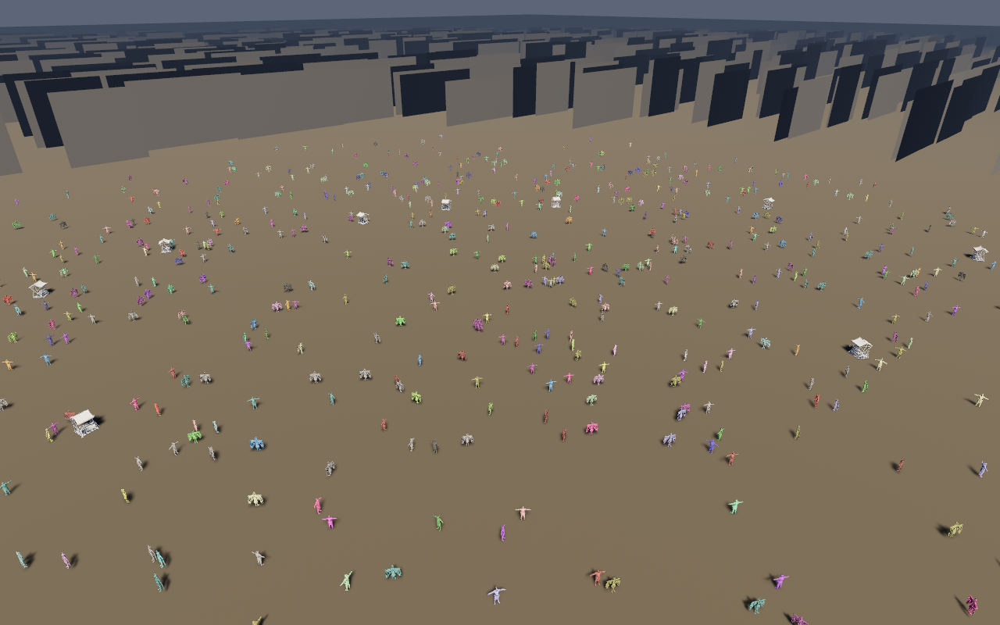
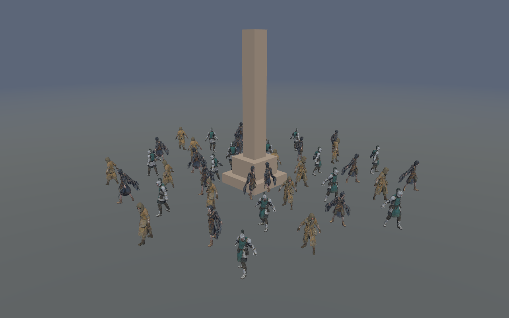
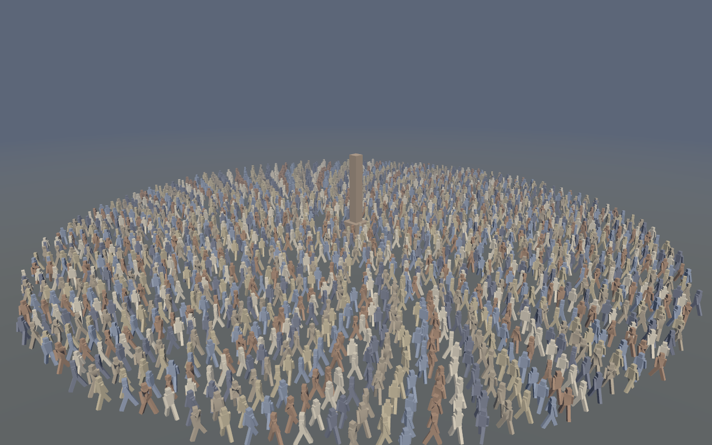

# ashfall-playground

The Ashfall crowd and the city, drawn by Bevy's PBR pipeline in a window you can walk through.
On macOS that is Metal; elsewhere it is Vulkan or GL. Same scene as the software and offscreen
demos, one GPU pipeline that is not hand-written.

```sh
cargo run --release --manifest-path playground/Cargo.toml -- --view district
```

Run from the repository root. `-p bevy-flock-playground` does not work and never has: this crate is
its own package with its own lock file, not a member of the library's workspace, so `cargo` has to
be given its manifest rather than its name.

| Control | |
| --- | --- |
| `W` `A` `S` `D` | move |
| `Q` / `E` | down / up |
| shift | sprint |
| right mouse (hold) | look |
| `Tab` | next shipped view |
| `Escape` | quit |



*The district view, 2,000 bodies, 1280x800 — captured from this crate on `llvmpipe` (Mesa's CPU
Vulkan driver) under Xvfb. It is a correctness capture: a real GPU adds anti-aliasing and filtered
shadows, and a frame time worth quoting. The images in `docs/demo` that are not this one come from
the software rasteriser, and a Bevy frame at the same camera will not match them pixel for pixel —
different rasteriser, different shading model, different anti-aliasing.*

## Flags

| Flag | |
| --- | --- |
| `--view NAME` | open at `district`, `street`, `hero`, `skyline` or `procession` |
| `--frames N` | draw N frames, print the timing summary, exit |
| `--capture PATH` | write the last frame to `PATH` as a BMP, then exit |
| `--width N` `--height N` | window size, at least 1 and at most 16384 a side (default 1280x800) |
| `--backend NAME` | `auto` (default), `metal`, `vulkan`, `gl` |
| `--population N` | NPCs to simulate, default 2000 |
| `--ticks N` | ticks before the first frame, default 600 |
| `--seed N` | layout seed, default 7 |
| `--extent M` | layout half-extent, metres, default 900 |
| `--help` | usage |

`--backend metal` on a machine without Metal is not a fallback: wgpu finds no adapter and Bevy
reports it. That is deliberate, because a demo that silently draws nothing looks like a scene bug.

## The crowd moves

This is not a diorama. Every frame ticks the simulation once and writes each body's pose onto the
entity that was spawned for its slot: position, facing, and a 4 cm walk bob whose phase advances with
the distance that body actually covers, so a standing NPC's feet stay still and a walking one's do
not. `--ticks` is the pre-warm before the window opens — the crowd arrives already dispersed — and
from the first frame on it is live.

One tick per *rendered* frame, and the tick itself advances the library's fixed timestep by the wall
time since the last one. That is what keeps the crowd's speed honest: sixty frames a second and four
frames a second move the crowd across the city at the same rate, and only the smoothness differs. On
a software rasteriser that means a quarter-second stride per frame — correct, and visibly coarse.
That coarseness is the reason the timing line below is worth reading before judging the motion.

Each frame reads the crowd back with `Playground::bodies_into`, which fills a buffer this crate keeps
and allocates nothing once that buffer is warm. It was not always so: the first version called
`Playground::bodies`, a snapshot API built for diffable captures — one `Vec`, one stable sort, one
copy, per frame. Measured with `demo/benches/crowd_readback.rs`, that cost 30 µs at 2,000 bodies and
150 µs at 10,000, half of it the sort and the copies. Caching the query, reusing the buffer and
sorting in place took it to 18 µs and 90 µs; the remaining cost is the ECS iteration itself, at
roughly 7 ns a body. `docs/dev/tuning/performance.md` has the table and the numbers behind it.

When the frame count runs out, the run prints one line and exits:

```text
ashfall-playground: 300 frames at 1280x800 — median 4.1 ms (243.9 fps), mean 5.9 ms, p95 7.2 ms
```

Read the median. The mean carries the first frames, which include shader compilation and pipeline
creation; the p95 is the stutter ceiling. `docs/dev/tuning/playbooks/bevy-playground.md` covers the rest:
building for Metal, capturing frames, and the plugin list this crate had to name because the `bevy`
umbrella was not there to add it — each omission of which shows up as a black or flat-coloured
window with no error.

## What is simulated, and where

The crowd is the library's: `Playground` builds a city and populates it, `tick` runs the
simulation, and `bodies()` hands a renderer the people it should draw. The same seed and tick count
produce the same city here, in `demo`'s software renderer, and in `demo-gpu`'s offscreen one — this
crate steps the clock, but the simulation it steps is the library's, not a second one written here.

Four things are this crate's own, three of them pure functions in `src/scene.rs`:

- **Geometry.** `bevy_mesh` splits a loaded glTF mesh into Bevy's vertex attributes; `cube_mesh`
  builds the unit box the ruined blocks are drawn from.
- **Placement.** `transform_for` and `block_transform` map an instance's position, yaw and scale
  onto a `Transform`.
- **Materials.** Tints are quantised to four levels a channel before a material is created, so a
  crowd of two thousand shares at most 64 materials instead of one each. One material a body is one
  bind group a body, and the draw calls then outnumber the triangles.
- **The bridge from bodies to entities.** `BodyLink` carries a body's slot on the entity spawned for
  it, `simulate` ticks and writes each pose, and `stride_phase` and `bob` in `src/lib.rs` turn metres
  walked into a leg cycle. `bodies()` sorts by identity and then drops the key, so the slot is the
  only thing there is to match on — which is why the readback is length-checked before any pose is
  written.

## Verification

`cargo test` -- 31 tests -- covers the parts that do not need a GPU: geometry conversion for every
shipped model, the cube's closed topology and the ground quad's winding, transform mapping, tint
quantisation and its bounds, the camera's angle/forward round trip and orthonormal basis, the pitch
clamp, view cycling, every flag including the window-size pair, the frame statistics, the walk cycle
(half a stride is half a turn, a whole stride wraps, the bob never exceeds its amplitude), and the
refusal of a capture format this build cannot encode.

The window itself is not covered by a test and cannot be: it needs a display and a driver. A
machine with neither can still check that the scene and the app build, and `--frames` exists to
make a real GPU run a bounded, scriptable check:

```sh
cargo run --release --manifest-path playground/Cargo.toml -- \
    --backend metal --frames 120 --view district
```

## The skinned district: rigged avatars, or 2,000 mannequins

`ashfall-playground` draws boxes. `skinned` draws people, two ways.

`--rig avatar` (the default) loads the three Ashfall characters out of `demo/assets/npcs/rigged` —
`aerie`, `gatewarden`, `scavenger` — each a textured mesh rigged by Meshy into 24 bones, with idle,
walk and run recorded onto it as separate GLBs. Bevy's glTF loader builds the scene, the skeleton,
the skin and the clip assets; the example's only glue is rewriting each bone's `AnimatedBy` to the
body that owns it, so the blend, the gesture channel and the motion gate all see one entity per NPC
rather than one per character plus one per bone.

```sh
cargo run --release -p bevy-flock-playground --bin skinned -- --rig avatar --npc 300
```


*40 rigged avatars, 140 frames, 1280x800, captured on `llvmpipe` under Xvfb. Twelve thousand
triangles and 24 bones each, with the shipped idle/walk/run blend driving the legs.*

`--rig mannequin` is the other half: a nine-joint rig — hips, chest, head, two shoulders, two hips,
and the two pivots gaze turns — with a mesh, an `AnimationPlayer` and seven clips authored in code at
startup. Nothing is loaded from disk, so a checkout with no generated assets still has a crowd, and
the count goes to 2,000 and beyond.

```sh
cargo run --release -p bevy-flock-playground --bin skinned -- --rig mannequin --npc 2000
```


*2,000 mannequins, 200 frames, 1280x800, captured on `llvmpipe` under Xvfb. Each body is ten
thousand vertices of skinned geometry and one blend tree of seven clips.*

| Flag | |
| --- | --- |
| `--rig NAME` | `avatar` (default) or `mannequin`; falls back to `mannequin` when the GLBs are missing |
| `--npc N` | bodies to spawn: default 300 avatars, 2000 mannequins |
| `--radius M` | plaza radius in metres, default 22 |
| `--frames N` | draw N frames and exit; omit to keep the window open |
| `--capture PATH` | write the last frame to `PATH` as a BMP |
| `--width N` `--height N` | window size, default 1280x800 |
| `--backend NAME` | `auto` (default), `metal`, `vulkan`, `gl` |
| `--assert-motion` | exit non-zero unless the crowd provably animated |

What the crowd does is the library's: `bevy-flock-anim` binds walk/run/idle/nod/wave clips to the
rig through a per-entity blend, `bevy_flock`'s locomotion decides the blend weights from velocity,
its gesture channel decides when a body waves, and `resolve_gaze` turns every body's head towards
the monolith. The crate contributes the rigs, the clips, the spiral placement and the milling motion —
each a pure function with tests.

`--assert-motion` is the interesting flag. It is the difference between "the window opened" and "the
crowd animated": it fails unless at least one body moved since spawn and blended walk or run above
half weight, and — for the mannequin, whose clips include the gesture and gaze channels — it also
fails unless a gesture cue reached a clip and a body aimed its gaze. An avatar rig has Meshy's idle,
walk and run and nothing that maps a gesture cue onto them, so the gate asks each rig only for what
that rig can prove. Every failure is named on its own line, because "nothing moved" sends the reader
to the wrong file when the real problem was that no gesture was ever requested:

```sh
xvfb-run -a ./target/debug/skinned --rig mannequin --frames 200 --npc 2000 --assert-motion
# skinned: 200 frames — 2000 moved, 1958 blended, 21 gesturing, 667 looking, biggest step 2.494 m
```
